# 云岭青心 · 青少年发展协同服务平台
## 《产品说明》

| 项目 | 内容 |
|---|---|
| 文档版本 | V1.2（立项评审稿，含内容/社群/AI/竞赛演示决策） |
| 编制日期 | 2026-11-09 |
| 编制角色 | 产品架构组（代拟） |
| 适用阶段 | 立项评审、需求基线、研发交底、试点验收 |
| 文档状态 | 待业务方评审；评审通过后作为需求基线冻结 |
| 关联文档 | 《技术路径》V1.0、《“引导真空”与协同突围》调研报告、旧版《功能》《技术路径》、演示版小程序源码 |

> **阅读指引**：第 0 章是给评审会的一页纸结论；第 1—2 章回答“为什么做、做成什么”；第 3—5 章回答“谁在用、用什么、做到什么程度”；第 6—8 章回答“怎么用、数据长什么样”；第 9—14 章回答“怎么接、怎么保安全、怎么衡量、怎么迭代”。需要快速决策的读者可只读第 0、5、12、14 章。

---

## 0. 评审速览：一页纸结论

### 0.1 一句话定位

**云岭青心不是一款“心理测评 APP”，而是一套以“心理安全为底线、成长支持为主线、家校社医团协同为机制”的县域青少年发展协同操作系统。** 它把“发现—激发—协同—成长”四阶闭环变成可记录、可派单、可追踪、可审计的协同工单，让学校、家庭、社区、医疗机构、共青团在同一个案件上协作，而不是各自建群、各自填表。

**对内一句话：青少版的“学习强国” + 青少年发展协同操作系统。** 上层用内容、视频、生涯、社群、AI 答疑做日活；下层用测评、预警、个案、转介、成长护照做专业纵深。没有上层，产品没有日活；没有下层，产品进不了政府购买。

> **质量目标**：按“政府购买服务优质档”设计，分两阶段达标——一期以 1.5 万元完成“可运行、可审计、可复制”的试点验证；二期以政府购买预算完成等保三级、密评、SLA、驻场与培训的交付质量。产品架构从第一天按二期标准设计，避免二次重构。

### 0.2 八个关键判断

| 编号 | 判断 | 依据 | 对产品的直接约束 |
|---|---|---|---|
| J1 | 底线是“危机不漏、响应及时”，不是“测得多” | 调研显示基层主要矛盾是行为困扰与引导缺失，极端病例少但发现晚；国家政策要求“监测预警、干预处置”闭环 | P0 必须做成“识别—响应—转介—跟踪”闭环；测评只是入口之一，不能把测评当产品 |
| J2 | 增长点是“成长需求识别”，不是“问题筛查” | 玉溪特征是“不是学不动，是没人带”；教体局明确希望走“打破信息差、生涯规划”的方向 | 产品主界面必须是成长资源、优势发现、五育活动；风险模块面向教师，不面向学生炫耀 |
| J3 | 协同的堵点是“没有共同案件”，不是“没有群” | 家校社医团各自有台账，但无统一案件号、无 SLA、无闭环证据 | 以“一案一码”为核心数据对象；所有通知、谈话、转介、反馈都挂在案件上 |
| J4 | 数据敏感度决定架构，不是功能决定架构 | 未成年人心理数据属于敏感个人信息，部分属于高度敏感；政府购买要求等保、密评、审计 | 默认最小采集、双同意、用途绑定、字段级加密、全链路审计；禁止“偷偷检测” |
| J5 | 1.5 万元买不到“政府级交付”，只能买到“可验证的试点与软著” | 等保测评、密评、渗透、驻场、心理督导均不在 1.5 万元内 | 一期按“可运行、可审计、可复制”做最小闭环；政府购买阶段单列合规与运维预算 |
| J6 | 没有内容与社群，产品就没有日活；没有安全与协同，产品就进不了政府 | “学习强国”式内容/社群是日常入口；家长/学校/团委只为“有用 + 安全”买单 | 双引擎：内容/社群/资源/AI 拉新留存，安全/协同/档案做深 |
| J7 | AI 是入口，不是医生 | 未成年人 AI 风险高；但 AI 答疑是“信息差”最快入口 | 做受控 RAG Agent + 技能 + 转人工；不做诊断/开放式情感陪伴 |
| J8 | 千万注册是组织与资本问题，不是代码问题 | 10 人/1.5 万元只能做软著与试点；10M 需要内容、运营、审核、资金 | 目标分四级：软著版、试点版、规模版、主流版；每级写清“必须为真” |

### 0.3 六个必须记住的数字

| 数字 | 含义 | 出处/口径 |
|---|---|---|
| 21.7 万 | 玉溪市中小学生心理健康普查覆盖规模 | 项目计划书（基于公开报道整理），用于区域容量设计，不作为个体数据 |
| 3,000—5,000 | 一期试点学生规模 | 3—5 所乡镇初中，按每校 800—1,200 人估算 |
| 15 分钟 | 紧急个案（L3）触达责任人的时限 | 本文件业务规则 BR-17，评审可调整 |
| 99.9% | 生产环境可用性目标 | 本文件 NFR-01；MVP 单可用区阶段为 99.5%，政府购买阶段提升至 99.95% |
| 1 个月 | 软著版开发 + 提交窗口 | 2026-11-10—2026-12-09；拿证另需 30—60 个工作日 |
| 1 万人次 / 50 万人次 / 1000 万注册 | 试点使用 / 规模使用 / 主流注册 | 见 18.8；G3 为愿景，不作为当前承诺 |

### 0.4 六个已定的产品决策

1. **学生与家长走微信小程序，教师与管理者走 Web/企业微信 H5，不强行做一个“全能 APP”。** 理由：学生触达成本最低、教师需要大屏表格、政府需要浏览器访问；原生 APP 放到二期。
2. **MVP 做受控 AI 成长助手（RAG + 技能 + 转人工），不做开放式情感陪伴聊天。** 理由：AI 是“信息差”入口，但未成年人场景必须可标识、可解释、可转人工；开放式陪伴放 P2，并需备案与安全评估。
3. **风险分级采用“系统提示 + 人工确认”，不允许算法直接给学生贴“抑郁症/高风险”标签。** 理由：量表是筛查工具不是诊断；误标会对未成年人造成二次伤害。
4. **家长看到的是“摘要 + 建议 + 是否已响应”，不是原始分数、逐题作答和咨询全文。** 理由：既保障监护人知情，又避免家庭冲突升级与隐私泄露。
5. **所有跨主体协作必须落到“案件—任务—时限—证据”四件套。** 理由：政府购买验收看的是闭环率与响应时效，不是功能清单。
6. **内容与社群是日活引擎，但必须“先审后发、圈内公开、未成年人禁私信”。** 理由：没有内容/社群就没有日活；没有审核/边界就是下一个舆情事故。

### 0.5 需要评审会当场拍板的五件事

| 编号 | 待拍板事项 | 选项 | 建议 |
|---|---|---|---|
| PD-1 | “政府购买一级 APP 质量”的口径 | A. 政府购买服务优质档；B. 网络安全等级保护第一级；C. 其他 | 选 A，并按等保三级设计；若确指等保一级，目标偏低，建议在会上纠正 |
| PD-2 | 一期试点是否包含团委/社区/医疗机构全流程 | A. 只做学校闭环；B. 学校+团委；C. 全主体 | 选 B，医疗机构以“转介通道”最小闭环接入，避免一期摊子过大 |
| PD-3 | 是否允许家长查看学生历史测评趋势 | A. 全部可见；B. 仅摘要与最近一次；C. 仅危机时可见 | 选 B，且非危机趋势由学生选择是否向家长开放；危机处置与法定监护事项除外 |
| PD-4 | 一期是否把“内容/社群/AI”作为核心，而不是只做心理工具 | A. 是；B. 只做心理工具；C. 先内容后工具 | 选 A，但一期只做“内容 + 轻社群 + 受控 AI”，不做泛社交 |
| PD-5 | B 站视频演示素材是否只用于内部演示、不进入软著/安装包 | A. 是；B. 进入软著；C. 公开上线 | 选 A；正式上线走官方嵌入/授权，不下载、不转码 |

### 0.6 目标阶梯与一个月软著冲刺

| 层级 | 时间 | 用户/场景 | 产品形态 | 资金/团队 | 真实性 |
|---|---|---|---|---|---|
| G0 软著版 | 2026-12-09 | 0 公开用户；内部演示 | 学生端 + 教师端 + 管理端 + 内容/AI/社群演示 | 1.5 万元 + 10 余人 | **可承诺** |
| G1 试点版 | 2027-03 | 3—5 校、3,000—5,000 注册、1 万人次使用 | 学校闭环 + 内容 + AI + 轻社群 | 追加 20—30 万元 | 有条件可承诺 |
| G2 规模版 | 2027-12 | 30 校、5 万注册、50 万人次使用 | 多租户 + 社群 + 机构 + 资源版 | 追加 100—200 万元 | 需融资/采购 |
| G3 主流版 | 2029+ | 100 万—1,000 万注册 | 多省、APP 矩阵、开放平台 | 1 亿元级（融资/政府购买） | **愿景，不承诺** |

> **一个月软著版只做 G0，不承诺 G1—G3。** 软著版以“代码完整、可运行、可演示、文档齐全”为准，不以“生产级并发/等保/7×24”为准；后者放到 G1/G2。详细范围见 18.9。

> **资金前置条件**：G1 的 20—30 万元需在 2027-01 前落实（大创追加/学校/教体局/公益资助），否则试点延期；G2 需政府购买或融资，G3 需公司化资金。不要把“愿景”写成“已落实预算”。

### 0.7 V1.1—V1.2 增补索引

| 主题 | 章节 | 一句话 |
|---|---|---|
| 内容生态/“强国 B 站” | 18.3 | 频道、来源、版权、审核、B 站三阶段 |
| 成长社群 | 18.4 | 圈内公开、禁私信、先审后发、版主 |
| AI Agent/Skill | 18.5 | 受控 RAG、技能、护栏、评测、转人工 |
| 机构入驻 | 18.6 | 资质、服务、数据边界、考核 |
| 数据共享/“支付宝级” | 18.7 | DPA 12 条、10 项控制、3 年目标 |
| 目标阶梯/规模化 | 18.8 | 1 万人次/50 万人次/1000 万注册；G3 是愿景 |
| 一个月软著 | 18.9 | 4 周、范围取舍、材料清单 |
| 同意文本/量表 | 18.10/18.11 | 演示草案；娱乐量表免责 |
| 竞赛演示/授权/表述 | 18.13 | B 站三场景、授权书、学习强国表述规范 |

### 0.8 本轮已定事项（V1.2）

| 编号 | 事项 | 落定 | 影响 |
|---|---|---|---|
| VD-1 | B 站素材 | **仅内部演示**；竞赛路演需书面授权或替换；正式上线只做官方嵌入/外链 | 软著/路演/上线三套素材策略 |
| VD-2 | 内容审核 | AI 一审 → 团队二审（演示版）→ 团/教体局/心理机构三审（上线） | 审核台要有“AI 预审 + 人工复核 + 机构会签” |
| VD-3 | AI 模型 | **DeepSeek（国产）**；优先私有化/专属实例；不接境外模型 | 模型网关、数据脱敏、合同禁训练 |
| VD-4 | 数据共享 | 团 + 教体局 + 平台；云南大学可选，仅去标识化科研 | 三方/四方 DPA；云大不进生产明文 |
| VD-5 | 量表/同意文本 | 团牵头审定；心理机构出专业意见；教体局会签；法务审核 | 18.10/18.11 责任链更新 |
| VD-6 | “青少版学习强国”表述 | 内部可作类比；路演避免商标化，需免责声明 | 18.13 表述规范 |

---

## 1. 摘要：我们要解决什么问题

### 1.1 问题定义：不是“心理有病”，而是“成长没人带”

2026 年 7 月，团队在玉溪市教育体育局、共青团玉溪市委、红塔区妇幼保健院临床心理科、江川区星云社区、通海县大梨社区等单位的访谈中得到一个高度一致的判断：**欠发达地区青少年的主要矛盾不是极端心理疾病，而是关键成长期的有效引导缺失。** 一线教师的原话是“这里的孩子不是‘学不动’，是‘没人带’”。

我们把这一状态定义为 **“引导真空”**：家庭引导缺位、学校引导不足、社区引导薄弱三重缺失叠加，导致青少年在小学高年级至初中阶段出现厌学、沉迷虚拟世界、课堂纪律涣散、人际冲突等行为困扰，而这些问题又尚未达到临床诊断标准，因此同时被教育系统和医疗系统“漏接”。

调研同时识别出四重断裂：

| 断裂 | 表现 | 现有工具的失效点 |
|---|---|---|
| 发现断裂 | 一年一次纸质普查，统计耗时 1—2 个月；日常观察无记录 | 只有“测评”，没有“日常信号”；只有“结果”，没有“过程” |
| 激发断裂 | 班主任身兼数职，缺乏引导素材与方法；社区有场地缺课程 | 资源散落在公众号、网盘、纸质手册，无法按学段/场景精准到达 |
| 协同断裂 | 学校、家庭、社区、医院各自为政；转介平均超过 72 小时 | 没有共同案件号、没有责任分工、没有时限、没有闭环证据 |
| 成长断裂 | 活动一次性，康复返校无支持，成长轨迹不留存 | 档案是“死档案”，不更新、不回访、不用于下一步支持 |

### 1.2 为什么现有方案不够

| 方案类型 | 能解决 | 不能解决 | 对本项目的启示 |
|---|---|---|---|
| 商业心理 APP（壹心理、简单心理等） | C 端内容、付费咨询 | 学校管理、区域治理、危机转介、欠发达地区支付能力 | 不能照搬 C 端逻辑；B 端才是主战场 |
| 校园心理测评 SaaS | 批量测评、电子档案 | 日常发现、家校社协同、团委/社区角色、低成本 | 测评只是 P0 的一个模块，不是全部 |
| 政务心理健康监测平台 | 区域上报、数据汇总 | 一线教师可用性、学生自主性、家庭参与 | 不能做成“填报系统”；要减轻基层负担 |
| 微信群 + Excel | 低成本、熟人协同 | 数据安全、责任追溯、时限、统计 | 用“结构化协同工单”替代“群里喊话” |

### 1.3 产品机会

**把“协同”做成产品，而不是把“功能”堆成产品。** 具体表现为三个“一”：

- **一个案件号**：从一个学生的关注信号开始，所有谈话、评估、转介、反馈、回访都挂在同一个案件上，谁在什么时候做了什么一目了然。
- **一张成长护照**：学生自己拥有的成长记录，包含优势、兴趣、五育活动、重要他人寄语；可授权给教师/家长查看，毕业后可带走。
- **一套协同规则**：明确“谁在什么时限内做什么”，把“家校社协同”从理念变成可考核的 SLA。

---

## 2. 产品定位与价值

### 2.1 定位陈述

> 面向县域教育系统与共青团组织，以中小学生为中心，连接教师、家长、社区、医疗机构与志愿者，提供“心理安全底线 + 成长需求识别 + 多方协同支持”的轻量化平台。它不替代医院诊断，不替代学校心理教师，不替代家庭教养，而是让这些角色在同一个案件上“找得到人、说得清事、留得下痕、闭得了环”。

**三个关键词：**

| 关键词 | 含义 | 反面 |
|---|---|---|
| 底线 | 危机识别、响应、转介、跟踪不漏人 | 只做科普、只做打卡、只做测评报告 |
| 发展 | 优势发现、五育活动、生涯探索、成长护照 | 把学生当“风险分数” |
| 协同 | 一案一码、任务派单、时限、证据、复盘 | 建群、发通知、填表格 |

### 2.2 分角色价值主张

| 角色 | 核心痛点 | 产品提供的价值 | 可量化收益 |
|---|---|---|---|
| 学生 | 不知道该找谁、怕被贴标签、成长没人回应 | 低压力心情记录、成长资源、成长护照、一键求助；自己决定向谁开放 | 求助心理成本下降；资源匹配时间从“找不到”到“3 分钟内可达” |
| 家长 | 只看到成绩，看不到情绪；不知道怎么管 | 脱敏摘要、家庭教育课程、亲子活动、危机时的明确指引 | 家长课程完成率；亲子沟通频次 |
| 班主任 | 事情多、不会判断、怕担责 | 班级看板、3 步记录、标准话术、自动升级、留痕免责 | 每周处理预警时间 ≤30 分钟；谈话记录 ≤3 分钟 |
| 心理教师 | 个案散、转介难、跟踪断 | 个案池、评估工具、转介包、回访提醒、督导记录 | 转介平均时长从 72h 降至 24h 内 |
| 校领导 | 底数不清、责任不清、迎检材料多 | 全校态势、责任矩阵、一键导出报告、审计追溯 | 迎检材料准备时间下降 50% |
| 教体局 | 区域数据滞后、学校差异大、缺抓手 | 区域看板、学校对比（脱敏）、资源调度、年度报告 | 数据时效从“月”到“日”；报告自动生成 |
| 团委 | 有阵地、有热线，但发现通道窄 | 社区活动、志愿者匹配、12355 转介、青年发展数据 | 社区青少年触达人数；转介闭环率 |
| 医疗机构 | 学校转介信息不全、随访难 | 标准化转介包、预约、反馈、返校支持 | 转介信息完整率；复诊/随访率 |
| 社区/社工 | 有场地缺课程、缺专业支持 | 活动模板、课程包、风险转介通道 | 活动场次；参与人数 |
| 平台运营 | 多租户、多角色、难运维 | 租户管理、内容审核、权限审计、健康监控 | 开通一所学校 ≤1 天 |

### 2.3 理论映射：PYD 5C 与“五育并举”如何落到功能

| 理论维度 | 产品功能 | 学生可见的表达 | 禁止做法 |
|---|---|---|---|
| Competence 能力 | 优势识别、学习策略、生涯探索 | “我擅长什么”“我可以怎么练” | 不排名、不贴“差生”标签 |
| Confidence 自信 | 成长勋章、小目标、正向反馈 | “我完成了什么” | 不用虚假夸奖、不用成瘾式签到奖励 |
| Connection 连接 | 成长护照授权、家校沟通单、社区活动 | “谁在支持我” | 不强制公开、不鼓励过度依赖平台 |
| Character 品格 | 五育活动、志愿服务、朋辈引导 | “我为什么做这件事” | 不用积分兑换功利化 |
| Caring 关爱 | 一键求助、危机响应、同伴支持 | “我需要帮助时找谁” | 不把求助记录公开、不作为评价依据 |

**五育并举的落地方式**：不是给学生打“德智体美劳”五个分数，而是建立“活动—参与—反思—成长证据”的记录链。每一条记录包含：活动类型（德育/智育/体育/美育/劳育）、参与角色、时长、学生自评、教师/志愿者见证、成长反思。系统只做“证据留存”和“资源推荐”，不做“五育排名”。

| 五育 | 心理机制 | 产品功能 | 一期指标 |
|---|---|---|---|
| 德育 | 价值感、归属感、规则内化 | 志愿服务、朋辈引导、红色教育、班级公约 | 活动参与率 ≥30% |
| 智育 | 胜任感、掌控感、好奇心 | 学习策略、优势识别、生涯探索、项目式学习 | 资源完成率 ≥50% |
| 体育 | 情绪调节、抗压、睡眠 | 运动打卡、团队运动、户外活动 | 周均运动 ≥3 次 |
| 美育 | 表达、审美体验、情绪疏导 | 绘画/音乐/摄影作品、民族文化活动 | 作品提交率 ≥20% |
| 劳育 | 自我效能、责任、合作 | 劳动任务、社区服务、校园岗位 | 任务完成率 ≥40% |

> 五育不是五个分数，而是五条证据链；心理效益通过学生反思与重要他人反馈体现，不通过排名或积分兑换体现。

### 2.4 与旧版、竞品的差异

| 维度 | 旧版演示小程序 | 本项目 V1.0 | 差异理由 |
|---|---|---|---|
| 角色 | 只有学生 + 咨询师 + 管理员 | 学生、家长、班主任、心理教师、校领导、教体局、团委、社区、医疗机构、运营、审计 | 协同是核心，单角色无法闭环 |
| 数据模型 | 测评记录、咨询、科普、危机提醒 | 租户、组织、案件、任务、转介、同意、审计 | 从“内容工具”升级为“协同系统” |
| 风险机制 | 一键求助 + 通知 | 分级规则 + 人工确认 + SLA + 升级 + 转介 + 回访 | 危机不能只靠一个按钮 |
| 安全 | Supabase RLS 设想 | 国内云、等保三级目标、字段级加密、用途绑定、全链路审计 | 境外 BaaS 与政府数据合规不兼容 |
| 终端 | 微信小程序 | 小程序 + Web + H5 + 平板适配；原生/鸿蒙二期 | 教师和管理者需要桌面端 |
| 商业模式 | 未明确 | 政府购买服务 + 学校服务包 + 公益资助 | 可持续运营 |

### 2.5 产品边界与伦理红线（必须写进研发验收）

**我们做：** 主动记录、授权测评、教师观察、资源匹配、危机响应、转介跟踪、区域统计、协同工单。

**我们不做（硬性禁止，代码评审一票否决）：**

| 编号 | 禁止项 | 为什么禁止 | 替代方案 |
|---|---|---|---|
| E-01 | 后台读取学生聊天记录、相册、通讯录、剪贴板 | 侵犯通信秘密与隐私，违反最小必要 | 只处理学生主动提交的内容 |
| E-02 | 摄像头/麦克风常开、微表情/声纹情绪识别 | 无感监测，未成年人高度敏感 | 不做生物特征采集 |
| E-03 | 抓取社交平台发言、网络浏览记录做画像 | 超出教育服务目的，易误判 | 只用校内授权数据 |
| E-04 | 持续定位、轨迹回放、围栏监控 | 过度监控，违背信任 | 一键求助时经确认的模糊位置 |
| E-05 | 强制测评、限时施压、不完成就通报 | 违背自愿原则，制造焦虑 | 自愿参与，可跳过，结果不公开 |
| E-06 | 给学生贴“抑郁/高危/问题学生”标签并公示 | 污名化，二次伤害 | 内部支持等级 + 人工确认 + 不公开 |
| E-07 | AI 冒充真人、诱导情感依赖、阻止学生求助真人 | 违反拟人化互动服务管理规定 | AI 明确标识，主动引导转人工 |
| E-08 | 根据心理数据推送广告、保险、课程销售 | 数据二次利用，违反目的限定 | 只推送公益成长资源 |
| E-09 | 把心理数据用于招生、评优、教师考核 | 改变数据用途，造成寒蝉效应 | 用途码白名单，考核只用聚合数据 |
| E-10 | 未经单独同意的科研使用、模型训练、跨境传输 | 违反个保法 | 去标识化 + 伦理审查 + 单独同意 |

### 2.6 成功图景（两年后）

- 玉溪市 1 个市域平台、3 个县区、30 所学校、3 万名学生稳定使用；
- 每一所试点学校都能在 15 分钟内触达 L3 个案责任人，24 小时内完成首次专业介入；
- 90% 以上的“被识别需支持”学生完成“响应—干预/转介—跟踪”闭环；
- 教师每周花在平台上的时间不超过 30 分钟，但能说清“我班上谁需要什么支持”；
- 家长不再只问“考了多少分”，而能收到“孩子最近状态 + 我可以怎么做”；
- 团委和教体局在联席会议上能用“数据显示”而不是“我们认为”说话。

---

## 3. 用户角色与权限模型

### 3.1 角色清单

| 编号 | 角色 | 典型用户 | 核心任务 | 使用端 | 数据范围 |
|---|---|---|---|---|---|
| R01 | 学生 | 小学高年级—高中 | 打卡、测评、看资源、求助、成长护照 | 微信小程序 | 本人 |
| R02 | 家长/监护人 | 父母、祖辈、其他监护人 | 绑定、同意、看摘要、学课程、家校沟通 | 微信小程序 | 本人子女 |
| R03 | 班主任 | 班级教师 | 看班级、处理预警、谈话记录、转介发起 | Web/企业微信 H5 | 本班 |
| R04 | 心理教师 | 专兼职心理教师 | 评估、个案、咨询、转介、回访 | Web | 本校个案 |
| R05 | 校领导/德育主任 | 校长、副校长、德育主任 | 全校态势、责任督办、迎检 | Web | 本校聚合 + 个案摘要 |
| R06 | 学校管理员 | 信息员/教务 | 名册、账号、班级、权限申请 | Web | 本校 |
| R07 | 教体局管理员 | 市/县德育科、基教科 | 区域看板、学校对比、报告、配置 | Web | 辖区聚合 |
| R08 | 团委工作者 | 市/县团委学少部 | 社区活动、志愿者、12355 转介 | Web | 本级活动 + 授权个案 |
| R09 | 社区/社工/志愿者协调员 | 社区青少年阵地 | 活动发布、签到、观察记录 | Web/H5 | 本阵地 |
| R10 | 医疗机构/咨询师 | 医院心理科、签约咨询师 | 接收转介、预约、反馈 | Web | 授权个案 |
| R11 | 平台运营 | 平台公司 | 租户开通、内容审核、系统配置 | Web | 平台级，但不含 L4 明文 |
| R12 | 安全审计员/DPO | 合规/安全 | 审计、导出审批、权限复核 | Web | 审计日志 + 配置 |

**V1.1 扩展角色（内容/社群/机构）：**

| 编号 | 角色 | 典型用户 | 核心任务 | 使用端 | 数据范围 |
|---|---|---|---|---|---|
| R13 | 机构管理员 | 医院/机构负责人 | 机构信息、服务目录、人员管理 | Web | 本机构 |
| R14 | 咨询师/讲师 | 医院心理科、签约咨询师 | 接诊、咨询、课程、反馈 | Web | 授权个案 |
| R15 | 创作者 | 教师、大学生、职业导师 | 内容上传、数据看板 | Web | 自己的内容 |
| R16 | 社群版主 | 教师、社工、志愿者 | 帖子审核、举报、禁言 | Web/小程序 | 本圈 |
| R17 | 内容审核员 | 平台运营 | 内容审核、下架、版权 | Web | 全平台内容 |

> **角色设计原则**：角色不是“职位”，而是“职责集合”。一个人可以有多角色（如心理教师兼班主任），但同一请求只能选择一个“主角色 + 目的码”，避免“用管理员身份顺手看个案”。

### 3.2 权限模型：RBAC 定角色，ABAC 定边界，数据域定范围，目的码定用途，审批定特例

| 层 | 解决什么问题 | 实现方式 | 例子 |
|---|---|---|---|
| 第 1 层 RBAC | 谁能做哪类动作 | 角色—权限点（如 alert:ack、case:refer） | 班主任有 alert:read，没有 case:refer |
| 第 2 层 数据域 | 能看哪些人 | 组织树 + 关系（本班/本校/辖区/监护） | 班主任只看本班；心理教师看本校 |
| 第 3 层 ABAC | 在什么条件下能看 | 属性策略：目的、时间、地点、设备、风险等级、同意状态 | 只有“危机处置”目的 + L3 案件，才能看咨询摘要 |
| 第 4 层 目的码 | 看完能干什么 | 每次请求携带 purpose_code，服务端校验 | PUR-03 只能返回聚合，不能返回个体 |
| 第 5 层 特例 | 紧急情况怎么办 | 破窗访问：理由 + 时限 + 复核 + 审计 | L3 时心理教师可临时查看，2 小时内复核 |

**五个目的码（数据用途白名单）：**

| 目的码 | 名称 | 允许的数据 | 禁止的行为 |
|---|---|---|---|
| PUR-01 | 教学与成长支持 | 班级名单、成长记录、资源使用 | 不得用于教师考核排名 |
| PUR-02 | 危机识别与处置 | 风险信号、个案、转介信息 | 不得扩散到无关人员 |
| PUR-03 | 区域统计与决策 | 聚合数据（k≥10） | 不得反推个体 |
| PUR-04 | 科研与评估 | 去标识化数据 + 伦理审查 + 单独同意 | 不得重新识别 |
| PUR-05 | 安全审计 | 审计日志、访问记录 | 不得修改业务数据 |

### 3.3 功能权限矩阵

图例：● 可操作；◐ 受限操作（需审批/仅摘要/仅聚合）；○ 只读；— 不可见。

| 功能 | 学生 | 家长 | 班主任 | 心理教师 | 校领导 | 学校管理员 | 教体局 | 团委 | 社区 | 医疗机构 | 运营 | 审计 |
|---|---|---|---|---|---|---|---|---|---|---|---|---|
| 心情打卡/成长记录 | ● | ○（摘要） | ○（本班） | ○（本校） | ○（聚合） | — | — | — | — | — | — | — |
| 测评作答 | ● | — | — | — | — | — | — | — | — | — | — | — |
| 测评报告 | ● | ◐（摘要） | ◐（本班） | ●（本校） | ◐（聚合） | — | ◐（聚合） | — | — | ◐（授权） | — | — |
| 风险预警 | ◐（仅求助进度） | ◐（子女） | ●（本班） | ●（本校） | ○（本校） | — | ○（辖区聚合） | ◐（授权） | ◐（本阵地） | ◐（授权） | — | — |
| 个案记录 | ◐（可见目录） | — | ◐（本班） | ●（本校） | ◐（摘要） | — | ◐（聚合） | ◐（授权） | — | ◐（授权） | — | — |
| 转介发起 | ◐（申请） | — | ● | ● | ◐（审批） | — | ○（督办） | ◐（12355） | — | — | — | — |
| 转介接收/反馈 | — | — | — | ○ | — | — | — | — | — | ● | — | — |
| 内容发布 | — | — | — | ◐（审核） | — | — | ◐（审核） | ◐（审核） | ◐（活动） | — | ● | — |
| 区域看板 | — | — | — | — | ○（本校） | — | ●（辖区） | ○（本级） | — | — | ○ | — |
| 账号/权限 | — | — | — | — | — | ●（本校） | ◐（辖区） | ◐（本级） | — | — | ● | ○ |
| 审计日志 | — | — | — | — | — | — | ○（辖区） | — | — | — | ◐（自己的） | ● |
| 数据导出 | ◐（自己的） | ◐（子女） | — | ◐（个案） | ◐（审批） | — | ◐（审批） | — | — | — | — | ○ |

**V1.1 扩展角色权限（摘要）：**

| 功能 | R13 机构管理员 | R14 咨询师 | R15 创作者 | R16 版主 | R17 审核员 |
|---|---|---|---|---|---|
| 机构信息/服务目录 | ● | — | — | — | — |
| 授权个案/转介反馈 | ○ | ● | — | — | — |
| 内容上传/编辑 | — | ◐（课程） | ● | — | — |
| 内容审核/下架 | — | — | — | — | ● |
| 社群审核/禁言 | — | — | — | ● | — |
| 数据看板 | ○（本机构） | — | ○（自己的内容） | — | — |

### 3.4 数据域矩阵

| 数据域 | 学生 | 家长 | 班主任 | 心理教师 | 校领导 | 教体局 | 团委 | 社区 | 医疗机构 |
|---|---|---|---|---|---|---|---|---|---|
| D0 本人 | ● | — | — | — | — | — | — | — | — |
| D1 本人子女 | — | ● | — | — | — | — | — | — | — |
| D2 本班 | — | — | ● | ● | ○ | — | — | — | — |
| D3 本校 | — | — | — | ● | ● | — | — | — | — |
| D4 本辖区聚合 | — | — | — | — | — | ● | ◐ | — | — |
| D5 授权个案 | — | — | — | — | — | — | ◐ | ◐ | ◐ |
| D6 平台级（脱敏） | — | — | — | — | — | — | — | — | — |

> **跨域规则**：团委、社区、医疗机构默认只能看到“授权个案”的最小必要字段，不能浏览学校名册；教体局默认只看聚合，个案需“督办”目的 + 审批。

### 3.5 敏感字段可见性（字段级）

| 字段 | 学生 | 家长 | 班主任 | 心理教师 | 校领导 | 教体局 | 团委/社区 | 医疗机构 |
|---|---|---|---|---|---|---|---|---|
| 姓名 | ● | ● | ● | ● | ● | 脱敏 | 脱敏 | ●（授权） |
| 学籍号 | ● | ○ | ● | ● | ◐ | 脱敏 | — | ◐ |
| 手机号 | ● | ● | ◐（脱敏） | ◐（脱敏） | — | — | — | ◐ |
| 家庭住址 | ● | ● | — | ◐（危机时） | — | — | — | ◐（授权） |
| 测评原始分 | ● | — | — | ● | — | — | — | ●（授权） |
| 测评解读 | ● | ◐（摘要） | ◐（建议） | ● | ◐（聚合） | ◐（聚合） | — | ●（授权） |
| 咨询全文 | ● | — | — | ● | — | — | — | ◐（授权） |
| 危机记录 | ◐（目录） | ◐（摘要） | ◐（本班） | ● | ◐（摘要） | ◐（聚合） | ◐（授权） | ●（授权） |
| 五育活动 | ● | ● | ● | ● | ◐ | ◐（聚合） | ◐ | — |

> **脱敏规则**：姓名保留姓 + 星号；学籍号保留后 4 位；手机号保留前 3 后 4；地址只到社区/村；聚合数据 k≥10，否则显示“样本不足”。

> **咨询记录边界**：咨询师的个人工作笔记（process notes）不属于“咨询记录”，默认不向学生/家长开放；咨询录音/录像默认不开启，确需开启须单独同意、仅用于督导、保存不超过 90 天。

### 3.6 特殊访问机制

**（1）破窗访问（Break-glass）**

适用：L3 紧急个案，且常规授权路径无法在 15 分钟内完成。
规则：
1. 发起人必须是心理教师、校领导或值班管理员；
2. 必须选择案件、填写理由（≥20 字）、预计时长（≤2 小时）；
3. 系统自动通知 DPO 与校领导；
4. 访问期间所有操作全量审计，页面带“紧急访问”水印；
5. 2 小时内未复核则自动收回，并在 24 小时内生成复核单；
6. 月度审计抽样 100% 覆盖破窗记录。

**（2）转介授权**

转介不是“把档案发过去”，而是“生成最小必要转介包”：
- 必填：案件号、学生基本信息（脱敏）、风险等级、已做干预、转介原因、紧急联系人；
- 选填：测评摘要、咨询摘要、家庭支持情况；
- 默认不包含：咨询全文、家庭隐私、无关历史记录；
- 接收方在 48 小时内确认接收，7 天内反馈初步意见，30 天内反馈闭环结果；
- 转介包带水印、有效期 7 天、下载次数 3 次、可撤回。

**（3）审计员权限**

审计员只能看审计日志、配置变更、导出记录，不能看业务明文；审计员自身操作也被记录（双人审计）。

### 3.7 学生与家长的权利

| 权利 | 产品实现 | 限制 |
|---|---|---|
| 知情权 | 首次使用“隐私仪表盘”：谁在什么时候看了我的什么 | 危机处置中的必要延迟告知需记录理由 |
| 同意权 | 双同意：监护人 + 学生本人；敏感功能单独同意 | 法定报告情形除外 |
| 撤回权 | 一键撤回非必要授权；撤回后停止采集 | 已处理的法定记录不删除，但停止使用 |
| 查阅/复制权 | 导出自己的成长护照与测评报告 | 涉及他人隐私的内容除外 |
| 更正权 | 对事实错误申请更正；教师观察可申诉 | 专业判断不因申诉直接修改，但可记录异议 |
| 删除权 | 毕业后 1 年自动删除过程数据；可申请提前删除 | 危机个案、审计日志按法定保留 |
| 解释权 | 风险提示可查看“触发规则 + 建议动作” | 不暴露他人信息与模型细节 |
| 拒绝自动化决策 | 风险等级必须人工确认；学生可要求复核 | 紧急情况先处置、后复核 |

---

## 4. 核心场景与用户旅程

### 4.1 场景地图

| 场景 | 触发 | 主要角色 | 产品能力 | 成功标准 |
|---|---|---|---|---|
| S1 日常成长 | 每天/每周 | 学生 | 打卡、任务、资源、成长护照 | 周活 ≥40%，资源完成率 ≥50% |
| S2 测评与解读 | 每学期/按需 | 学生、心理教师 | 量表、报告、建议、转介 | 完成率 ≥80%，误标率 <5% |
| S3 教师发现 | 课堂/课后 | 班主任 | 观察记录、班级看板、谈话 | 3 步记录，≤3 分钟 |
| S4 风险响应 | 系统提示/人工上报 | 班主任、心理教师、校领导 | 分级、通知、SLA、升级 | L3 15 分钟触达，24 小时介入 |
| S5 转介与返校 | 评估后 | 心理教师、医疗机构、家长 | 转介包、预约、反馈、返校计划 | 72 小时→24 小时；闭环率 ≥95% |
| S6 家校共育 | 每周/每月 | 家长、班主任 | 摘要、课程、沟通单、活动 | 绑定率 ≥70%，课程完成率 ≥50% |
| S7 社区引导 | 假期/周末 | 团委、社区、志愿者、学生 | 活动、签到、朋辈匹配、观察 | 活动参与 ≥30%，重复参与 ≥50% |
| S8 区域治理 | 月度/学期 | 教体局 | 看板、报告、督办、资源调度 | 报告自动生成，数据时效 ≤1 天 |
| S9 危机求助 | 任何时候 | 学生、值班人 | 一键求助、电话、通知、定位（模糊） | 10 秒内发起，15 分钟内响应 |

### 4.2 学生旅程：从“不敢说”到“有人接”

**一天：**
1. 早上打开小程序，看到“今天想记录点什么？”——不是“请完成测评”。
2. 选择心情标签（可跳过），写一句可选的“今天的小事”；系统只保存标签与文本，不做情绪识别。
3. 首页推荐 1 条 3 分钟内容（按学段/主题），可收藏、可跳过。
4. 遇到困扰时，点“我想找人说”——出现三个选项：给班主任留言、预约心理教师、拨打 12355/一键求助。
5. 求助后，页面明确告知“谁会在多久内联系你”，并显示“已通知”状态。

**一学期：**
- 开学第 2 周：自愿完成一次“成长状态问卷”（非诊断），看到自己的优势标签与 2 条建议；
- 每月：一次“成长小目标”，可关联五育活动；
- 期末：生成“成长护照”年度页，包含活动、作品、重要他人寄语；非危机内容由学生决定是否分享给家长；
- 毕业：成长护照可导出 PDF/图片，过程性数据按规则删除。

**关键设计：**
- 学生首页永远有“今天不想记录”的跳过按钮；
- 任何测评前显示“这不是考试，没有标准答案，可以跳过”；
- 风险提示不对学生显示“高风险”三个字，而是“我们注意到你最近有些不容易，要不要聊聊？”
- 学生可以看到“谁看过我的记录”，但看不到具体教师备注中的专业判断。

### 4.3 班主任旅程：3 步处理一个预警

**场景：** 周三上午 10:00，班主任收到一条 L1 关注提示（连续 5 天心情低落 + 一次课堂观察记录）。

1. **看**：班级看板只显示“需要关注”的 3 名学生，不显示全班分数排名；点开学生卡片，看到“最近 7 天打卡趋势 + 我自己的观察记录 + 建议话术”。
2. **谈**：点击“谈话记录”，选择场景（课间/课后/家访），勾选 3 个维度（情绪、学习、人际），写 2 句话，点保存；全程 ≤3 分钟。
3. **转**：如果谈话后发现需要专业支持，点“转心理教师”，系统自动带出案件号、谈话摘要、建议优先级；心理教师在 24 小时内接收。

**防负担设计：**
- 每周一自动生成“本周班级关注清单”，不超过 5 人；
- 同类提醒 7 天内不重复推送；
- 所有记录支持语音转文字（可选），但不上传原始录音；
- 教师可一键“误报”，系统学习规则但不惩罚教师。

### 4.4 心理教师旅程：从“救火”到“个案管理”

1. **接案**：个案池按风险等级、等待时长排序；点开看到“转介来源、已做干预、家长是否知情、是否已联系医疗机构”。
2. **评估**：使用标准化评估记录（不是重新做一遍量表），形成“支持计划”：目标、频次、责任人、预计复盘时间。
3. **转介**：选择医疗机构/咨询师，生成最小必要转介包；系统自动通知家长并请求确认。
4. **跟踪**：设置回访提醒（7 天/30 天/返校前）；记录“已复诊/未复诊/拒绝转介”及原因。
5. **结案**：填写结案摘要（学生状态、支持效果、后续建议），案件归档；敏感信息按保留策略处理。

### 4.5 教体局旅程：从“要数据”到“用数据”

- **月初**：打开区域看板，看到“本月新增关注数、L3 处置时效、转介闭环率、各校活跃度”；小样本学校显示“样本不足”，不显示排名。
- **月中**：对连续两个月“零记录”的学校发起督办（不是通报批评，而是“是否需要支持”）。
- **期末**：一键生成《区域青少年发展支持报告》，包含趋势、问题、建议、下一年度资源投放建议；报告带水印、可导出 PDF。
- **迎检**：按检查项自动汇总“制度、培训、个案、转介、复盘”证据包。

### 4.6 团委/社区旅程：把“活动”变成“发现通道”

1. 团委在平台发布“暑期成长营”，设置学段、名额、地点、课程包；
2. 社区/志愿者认领活动，学生/家长在小程序报名；
3. 活动签到后，志愿者用 1 分钟记录“参与状态/亮点/需要关注”（只记录行为观察，不做心理判断）；
4. 如发现需要关注的学生，经监护人同意后，生成“社区转介单”给学校或 12355；
5. 活动结束自动生成“社区青少年参与报告”，用于项目申报与资源争取。

### 4.7 医疗机构旅程：接收“能用的转介单”

- 医院心理科登录协作端，看到“待接收转介”列表；
- 点开转介包：基本信息、风险等级、已做干预、转介原因、紧急联系人；
- 确认接收 / 拒绝（填写原因）/ 建议补充材料；
- 就诊后填写“反馈单”：是否就诊、初步建议、是否需学校配合、复诊时间；
- 学校心理教师收到反馈，更新个案；系统在复诊前 3 天提醒家长。

### 4.8 家长旅程：从“被通知”到“被支持”

- 绑定：扫描学校二维码 + 学生学籍号后 4 位 + 监护人手机号验证；一个家长可绑定多个孩子。
- 首次：阅读《监护人须知》，完成“双同意”；可逐项选择是否允许“成长摘要”“课程推荐”“活动报名”。
- 每周：收到一条“孩子本周状态摘要”（不含分数），附 1 个 3 分钟亲子任务。
- 危机时：接到电话/短信，页面显示“现在可以做什么”的三步指引；不推送恐吓性内容。
- 家长课堂：按学段推荐，完成打卡；不排名、不强制。

### 4.9 四阶闭环与安全底线（总体流程）

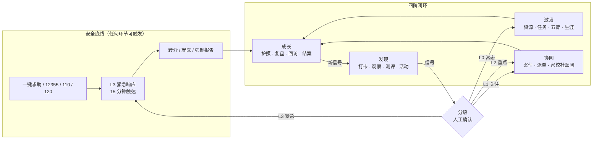

**图 4-1 说明**：安全底线不是闭环的“最后一步”，而是任何环节都可触发的旁路。L0 直接进入激发；L1/L2 进入协同；L3 先处置、后补录，避免“填完表再救人”。

### 4.10 关键旅程的量化目标

| 旅程 | 现状（调研/旧版） | 目标 | 测量方式 |
|---|---|---|---|
| 学生求助 | 不知道该找谁；怕被评价 | 3 分钟内找到入口；10 秒内发起 | 埋点：入口点击→提交 |
| 班主任处理预警 | 无标准流程；怕担责 | ≤3 分钟记录；≤30 分钟/周 | 系统时长 + 抽样访谈 |
| 心理教师转介 | 平均 72 小时 | ≤24 小时完成转介发起 | 案件时间戳 |
| 家长知情 | 只看到成绩 | 每周 1 条摘要；危机时 15 分钟内通知 | 通知送达/阅读 |
| 教体局报告 | 1—2 个月人工统计 | 按日更新；一键生成 | 数据新鲜度 |
| 团委活动 | 纸质签到 | 报名—签到—观察—转介线上化 | 活动完成率 |

### 4.11 家校社医团协同 RACI

> R = 负责执行，A = 最终批准，C = 需咨询，I = 需知会。RACI 只规定协同责任，不改变行政隶属。

| 事项 | 教体局 | 团委 | 学校 | 家庭 | 医疗机构 | 社区 | 平台 |
|---|---|---|---|---|---|---|---|
| 心理安全底线（L3 响应） | A | C | R | C | C | I | I |
| 日常发现与观察 | I | I | R | C | I | C | I |
| 测评与档案 | A | I | R | C | C | I | R |
| 成长课程与五育活动 | C | R | C | I | I | R | I |
| 转介与就医 | A | I | R | C | R | I | I |
| 数据共享与区域报告 | A | C | R | I | I | I | R |
| 经费与采购 | A | C | I | I | I | I | R |
| 培训与督导 | A | C | R | I | C | C | I |
| 舆情与应急 | A | C | R | C | C | I | C |

> 团委不掌握学校个案，医院不浏览学校名册，教体局默认只看聚合；跨主体访问必须走“授权个案 + 最小必要 + 到期收回”。

---

## 5. 功能范围：MVP、增强与不做

### 5.1 范围原则

| 原则 | 说明 | 对范围的影响 |
|---|---|---|
| 安全底线不可降级 | 危机识别、响应、转介、跟踪、强制报告是 P0，任何版本不得以“资源不足”为由删除 | P0 必须包含 L1—L3 全流程与审计 |
| 先闭环、后智能 | 没有闭环数据，AI 没有意义；没有人工确认，AI 不能上线 | AI 全部放 P2 |
| 先轻量、后全能 | 学生/家长用小程序，教师用 Web；不追求“一个 APP 装下所有角色” | 原生 APP、鸿蒙放 P2 |
| 先试点、后多租户 | 一期单市多校，二期多县区；多租户能力 P0 预留、P1 完整 | 数据模型从第一天带 tenant_id |
| 旧版能复用则复用 | 演示版的打卡、量表、科普、求助交互可复用；数据模型与权限必须重写 | 旧代码作为交互参考，不作为架构基线 |

### 5.2 MVP（P0）功能清单

> P0 定义：一期试点（3—5 校、3,000—5,000 学生）上线必须具备；缺失则不能开试点。

| 编号 | 模块 | 功能 | 主要角色 | 验收标准 | 依赖 |
|---|---|---|---|---|---|
| F-01 | 租户与组织 | 市/县/校/班四级组织树；批量导入名册；班级升级 | 学校管理员、教体局 | 1,000 人名册导入 ≤5 分钟；错误行可下载 | 学籍数据 |
| F-02 | 身份 | 微信登录、学生激活（学籍号后 4 位 + 学校码）、家长绑定、教师账号 | 全部 | 学生激活成功率 ≥95%；家长绑定 ≤3 步 | 微信开放平台 |
| F-03 | 同意中心 | 服务协议、监护人同意、学生本人同意、敏感功能单独同意、撤回 | 学生、家长 | 每次敏感采集前有同意记录；可导出同意凭证 | 法务文本 |
| F-04 | 学生首页 | 今日打卡、成长任务、推荐内容、求助入口、隐私仪表盘 | 学生 | 首屏 ≤2 秒；打卡 ≤2 步 | F-02 |
| F-05 | 心情与观察 | 心情标签、可选题记、教师观察记录、成长观察 | 学生、班主任 | 学生可看到“谁记录了什么类别”；教师记录 ≤3 分钟 | F-03 |
| F-06 | 测评 | 量表库、作答、计分、报告、建议、复测提醒 | 学生、心理教师 | 20 题以内测评 ≤8 分钟；报告非诊断表述 | 量表授权 |
| F-07 | 风险分级 | 规则引擎、L0—L3 分级、人工确认、误报标记 | 班主任、心理教师 | 规则命中可解释；人工确认率 100% | F-05、F-06 |
| F-08 | 预警与通知 | 站内、短信、微信订阅消息、电话升级；通知矩阵 | 班主任、心理教师、校领导、家长 | L3 15 分钟内送达 ≥98%；失败自动升级 | 短信/微信 |
| F-09 | 一键求助 | 学生发起、选择求助对象、模糊位置、12355/110/120 直拨 | 学生 | 10 秒内发起；页面显示“谁将联系你” | F-08 |
| F-10 | 个案管理 | 案件号、状态机、支持计划、谈话/干预记录、结案 | 心理教师、班主任 | 一案一码；状态可追溯；结案必填摘要 | F-07 |
| F-11 | 转介 | 转介包、接收确认、反馈、回访、闭环 | 心理教师、医疗机构 | 转介包最小必要；48 小时确认率 ≥90% | 机构协议 |
| F-12 | 教师工作台 | 班级看板、关注清单、待办、话术库、资源推送 | 班主任、心理教师 | 每周关注 ≤5 人；待办可按优先级排序 | F-05、F-07 |
| F-13 | 家长端 | 绑定、摘要、课程、亲子任务、家校沟通单 | 家长 | 摘要不含原始分；可关闭非必要推送 | F-03 |
| F-14 | 内容中心 | 分学段文章/短视频/音频、标签、审核、发布、收藏 | 运营、心理教师 | 内容审核 100%；版权可追溯 | 内容团队 |
| F-15 | 五育活动 | 活动发布、报名、签到、反思、成长证据 | 团委、社区、学生 | 活动闭环 ≤3 步；签到率可统计 | F-04 |
| F-16 | 成长护照 | 优势标签、活动记录、作品、寄语、导出 | 学生、家长 | 学生可控制可见范围；导出 PDF ≤30 秒 | F-05、F-15 |
| F-17 | 区域看板 | 区域/学校/年级聚合、趋势、督办、报告 | 教体局、校领导 | k≥10 才展示；报告一键生成 | 数据仓库 |
| F-18 | 审计 | 登录、DS3/DS4 读取、导出、权限变更、破窗；哈希链 | 审计员、DPO | 审计事件 100% 覆盖；可校验完整性 | 全模块 |
| F-19 | 权限 | 角色、数据域、目的码、破窗、导出审批 | 管理员、审计 | 越权测试 100% 拦截；权限变更 5 分钟内生效 | F-01、F-02 |
| F-20 | 运营后台 | 租户开通、账号管理、内容审核、公告、健康监控 | 平台运营 | 开通一所学校 ≤1 天；故障 5 分钟内可见 | F-01 |
| F-21 | 数据导出 | 个人导出、学校导出、区域导出；水印、审批、有效期 | 学生、家长、管理者 | 导出带水印；链接 24 小时失效 | F-18 |
| F-22 | 离线草稿 | 打卡、观察记录、谈话记录离线保存，联网重试 | 学生、教师 | 弱网不丢数据；冲突可提示 | PWA/本地存储 |
| F-23 | 帮助与培训 | 新手引导、教师 30 分钟微课、FAQ、客服入口 | 全部 | 教师首次完成核心任务 ≤10 分钟 | 内容团队 |
| F-24 | 埋点与反馈 | 关键路径埋点、NPS、问题反馈 | 运营 | 埋点不影响性能；反馈 48 小时响应 | F-04 |

> **软著版（1 个月）与试点 MVP 的区别**：软著版只要求 F-01—F-24 + F-45—F-50 的“演示级”；试点 MVP 要求 F-01—F-24 全量 + F-45—F-50 可用。详见 18.9。

| 编号 | 模块 | 功能 | 主要角色 | 验收标准 | 优先级 |
|---|---|---|---|---|---|
| F-45 | 内容频道 | 心理/学习/生涯/政策/民族文化/五育/榜样/家长/教师频道 | 学生、家长、教师 | 频道可配置；内容有来源/版权/适龄标签 | P0 |
| F-46 | 视频库 | 分学段短视频、播放、收藏、进度、字幕 | 学生 | 首帧 ≤2 秒；弱网可降清晰度 | P0 |
| F-47 | 生涯/信息差 | 行业卡、职业卡、专业卡、人物卡、地区筛选 | 学生、教师 | 每张卡有来源与更新时间；可问 AI | P0 |
| F-48 | AI 成长助手 | RAG 问答、技能调用、危机转人工、AI 标识 | 学生、教师 | 危机召回 ≥95%；回答有来源；可转人工 | P0 |
| F-49 | 成长圈 | 班级圈/主题圈、发帖、评论、举报、版主 | 学生、教师、版主 | 未成年人禁私信；先审后发；24h 处理举报 | P0 演示 / P1 全量 |
| F-50 | 机构目录/入驻 | 机构列表、详情、入驻申请、资质上传 | 机构、团委、运营 | 资质可追溯；未审核不展示 | P0 演示 / P1 全量 |
| F-51 | 学习计划/成长积分 | 7/21 天计划、完成记录、成长积分（不排名） | 学生 | 可退出；不制造焦虑；积分不兑换功利化奖励 | P1 |
| F-52 | 创作者/机构后台 | 内容上传、数据看板、结算（后续） | 创作者、机构 | 版权承诺；审核流；违规下架 | P1 |
| F-53 | 社群审核台 | 队列、关键词、图像审核、禁言/封禁、申诉 | 审核员、版主 | 危机类 1h 内处理；全程留痕 | P1 |
| F-54 | 资源版 | 团委/社区独立内容+活动+志愿者，不含个案 | 团委、社区 | 可单独开通；与学校数据隔离 | P1 |
| F-55 | 多 Agent/技能市场 | 教师/家长/机构 Agent、技能配置 | 教师、机构、运营 | 技能可编排；权限最小；可回滚 | P2 |
| F-56 | 直播/课程/开放平台 | 直播课、机构 API、内容开放 | 机构、第三方 | 备案/资质；内容审核；接口审计 | P2 |

### 5.3 增强项（P1：试点稳定后 6—12 个月）

| 编号 | 模块 | 功能 | 价值 | 前置条件 |
|---|---|---|---|---|
| F-25 | 团委协同 | 社区活动、志愿者匹配、12355 转介、活动报告 | 打通“社区发现”通道 | 团委数据共享协议 |
| F-26 | 医教协同 | 医院预约、绿色通道、复诊提醒、返校支持 | 转介闭环从“送达”到“结果” | 医院合作协议 |
| F-27 | 生涯探索 | 兴趣测评、职业卡牌、榜样故事、学长连线 | 回应“不知道未来干什么” | 内容与志愿者 |
| F-28 | 朋辈引导 | 大学生志愿者匹配、线上陪伴、活动带领 | 低成本补位“没人带” | 高校合作 |
| F-29 | 家校沟通单 | 结构化沟通（不是开放聊天）、已读、回执 | 减少群聊噪音与误解 | 家长端稳定 |
| F-30 | 区域报告 | 学期/年度报告、资源投放建议、政策建议 | 政府购买验收材料 | 数据仓库 |
| F-31 | 开放 API | 学籍、区域平台、12355、医院系统对接 | 减少重复录入 | 等保与接口规范 |
| F-32 | 多语言 | 彝语/哈尼语等民族语言内容包 | 边疆民族地区适配 | 翻译与审校 |
| F-33 | 平板/课堂模式 | 教师大屏、班级活动、投票 | 课堂场景 | 前端适配 |
| F-34 | 离线增强 | 本地 SQLite、批量同步、冲突合并 | 乡村弱网 | 原生/混合容器 |
| F-35 | 智能推荐 | 基于规则与标签的资源推荐（非大模型） | 提升资源匹配 | 内容标签体系 |
| F-36 | 数据订阅 | 学校/教体局订阅周报/月报 | 减少人工 | 报表服务 |
| F-37 | 电子签 | 监护人授权、转介知情同意 | 合规留痕 | CA 机构 |

### 5.4 远期项（P2：12—24 个月，视政府购买进展）

| 编号 | 模块 | 功能 | 上线条件 |
|---|---|---|---|
| F-38 | 开放式 AI 陪伴 | 多轮记忆、情绪安抚、长期陪伴（非诊断） | 生成式 AI 备案、内容安全评估、伦理审查、未成年人模式 |
| F-39 | 原生 APP | iOS/Android 离线、推送、相机（仅拍作品） | 应用商店资质、隐私合规 |
| F-40 | 鸿蒙原生 | ArkTS 版本或鸿蒙元服务 | 政府采购明确要求 |
| F-41 | 信创全栈 | 麒麟/统信 + 达梦/人大金仓 + 东方通 | 政务云适配要求 |
| F-42 | 多区域 SaaS | 多市/多县独立租户、计费、开放平台 | 运营体系成熟 |
| F-43 | 预测模型 | 仅做群体趋势，不做个体预测 | 伦理审查 + 数据积累 ≥2 年 |
| F-44 | 区块链存证 | 关键同意/转介存证 | 仅在采购明确要求时评估，不主动引入 |

### 5.5 明确不做（产品级）

| 编号 | 不做项 | 理由 | 替代 |
|---|---|---|---|
| N-01 | 开放式匿名倾诉社区 | 内容安全与危机干预不可控；未成年人风险高 | 受控留言 + 人工审核 + 一键转人工 |
| N-02 | 学生心理排名、班级红黑榜 | 污名化、制造焦虑 | 只做个人趋势与班级聚合 |
| N-03 | 家长实时查看孩子每一次打卡 | 破坏信任、诱发对抗 | 周摘要 + 危机例外 |
| N-04 | 教师无限期查看历史个案 | 最小必要、目的限定 | 按案件授权 + 到期收回 |
| N-05 | 心理数据用于教师绩效 | 改变用途、寒蝉效应 | 教师考核只看培训/活动参与 |
| N-06 | 付费课程/广告联盟 | 利益冲突、诱导消费 | 公益资源 + 政府购买 |
| N-07 | 社交裂变、拉新奖励 | 未成年人营销合规风险 | 学校组织 + 家长自愿 |
| N-08 | 人脸识别登录/情绪识别 | 生物特征敏感、无感监测 | 微信登录 + 短信验证 |
| N-09 | 跨省/跨境数据汇聚 | 合规与数据主权 | 本地部署/区域隔离 |
| N-10 | 自动诊断/自动开药/自动危机定性 | 医疗行为边界 | 筛查提示 + 医生诊断 |

### 5.6 旧版功能处置

| 旧版功能 | 处置 | 说明 |
|---|---|---|
| 微信授权登录 | 保留并增强 | 增加学籍激活、家长绑定、角色选择 |
| 心情打卡 | 保留并重构 | 从“连续打卡奖励”改为“无压力记录”，取消强制连续 |
| 心理测评列表/作答/报告 | 保留并重构 | 量表授权、非诊断表述、分级报告、人工复核 |
| 在线咨询（文字/语音/视频） | 降级到 P1 | 一期只做“预约 + 留言 + 转介”，不做实时音视频 |
| 科普文章/视频 | 保留并增强 | 分学段、标签、审核、版权、无障碍 |
| 一键求助 | 保留并重构 | 增加分级、通知矩阵、模糊位置、12355 直拨、回访 |
| 个人中心 | 升级为成长护照 | 增加优势、活动、授权管理、隐私仪表盘 |
| 咨询师列表 | 降级到 P1 | 一期只展示学校心理教师与签约机构，不做商业化咨询师市场 |
| 危机提醒（仅记录） | 删除并重建 | 旧版只写一条 crisis_alerts，没有 SLA、没有升级、没有闭环 |

---

## 6. 信息架构与关键页面

### 6.1 端与入口矩阵

| 端 | 用户 | 技术形态 | 核心场景 | 版本 |
|---|---|---|---|---|
| 学生端 | 学生 | 微信小程序（Taro + React） | 打卡、测评、资源、求助、成长护照 | P0 |
| 家长端 | 家长 | 同一小程序，角色切换 | 绑定、同意、摘要、课程、沟通单 | P0 |
| 教师端 | 班主任、心理教师、校领导 | Web（React + Ant Design Pro）+ 企业微信 H5 | 班级看板、预警、个案、转介 | P0 |
| 管理端 | 教体局、团委、平台运营 | Web | 区域看板、督办、报告、租户、内容 | P0 |
| 协作端 | 医疗机构、社区 | Web/H5 | 转介接收、反馈、活动 | P1 |
| 开放平台 | 第三方系统 | API/Webhook | 学籍、12355、医院 | P1 |

### 6.2 学生端信息架构

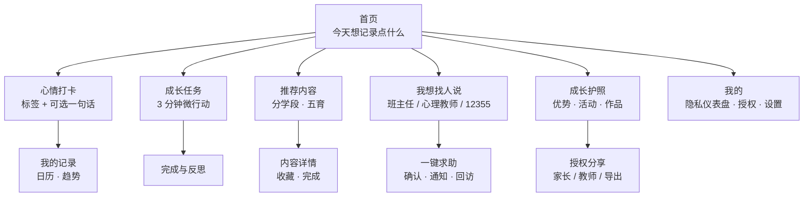

### 6.3 教师端信息架构

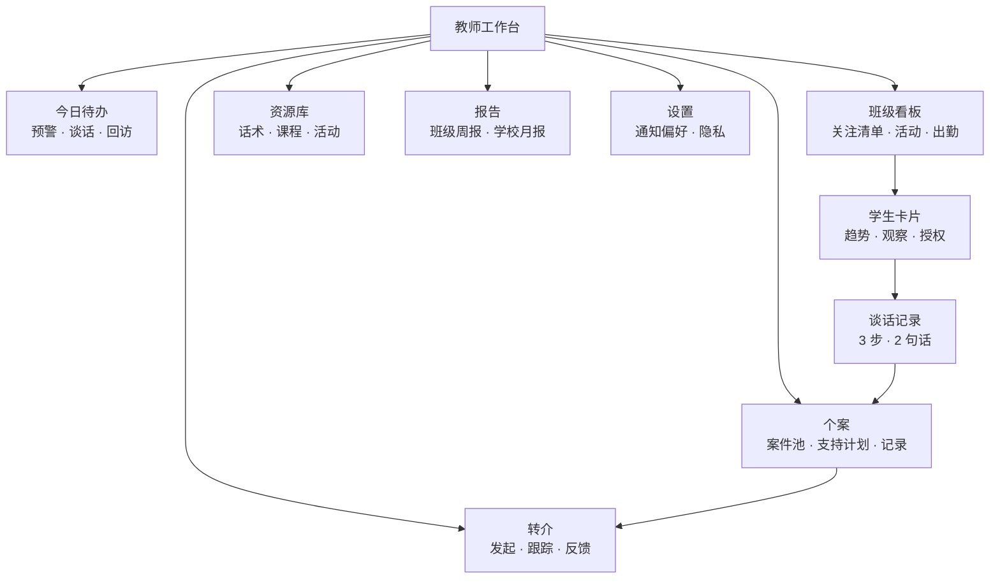

### 6.4 管理端信息架构

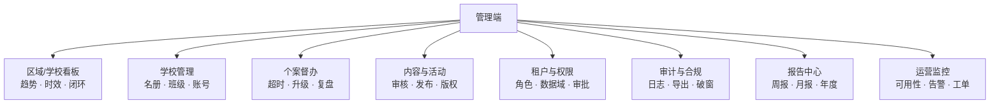

### 6.5 关键页面清单

| 编号 | 页面 | 端 | 目的 | 核心元素 | 权限 | 优先级 |
|---|---|---|---|---|---|---|
| P-01 | 登录/激活 | 小程序 | 识别身份、绑定学校 | 微信授权、学校码、学籍后 4 位、家长手机号 | 公开 | P0 |
| P-02 | 学生首页 | 小程序 | 降低表达门槛 | 打卡入口、任务、内容、求助、隐私提示 | 学生 | P0 |
| P-03 | 心情打卡 | 小程序 | 记录状态 | 5 个标签、可选文本、跳过、历史 | 学生 | P0 |
| P-04 | 测评列表/详情 | 小程序 | 说明与授权 | 适用年龄、时长、非诊断声明、开始 | 学生 | P0 |
| P-05 | 测评作答 | 小程序 | 完成测评 | 进度、上一题、暂停、提交 | 学生 | P0 |
| P-06 | 测评报告 | 小程序 | 理解与行动 | 结果解释、优势、2 条建议、预约 | 学生、心理教师 | P0 |
| P-07 | 求助页 | 小程序 | 快速获得帮助 | 求助对象、确认、位置（模糊）、12355 | 学生 | P0 |
| P-08 | 成长护照 | 小程序 | 看见成长 | 优势标签、活动、作品、寄语、分享 | 学生 | P0 |
| P-09 | 隐私仪表盘 | 小程序 | 建立信任 | 谁看过、授权记录、撤回 | 学生、家长 | P0 |
| P-10 | 家长绑定 | 小程序 | 建立监护关系 | 扫码、学籍后 4 位、验证码、多孩 | 家长 | P0 |
| P-11 | 家长摘要 | 小程序 | 知情与行动 | 本周状态、建议、课程、沟通单 | 家长 | P0 |
| P-12 | 教师工作台 | Web | 一眼看到今天做什么 | 待办、关注清单、快捷入口 | 班主任 | P0 |
| P-13 | 班级看板 | Web | 班级态势 | 关注人数、活动、出勤、趋势 | 班主任 | P0 |
| P-14 | 学生卡片 | Web | 个体支持 | 趋势、观察、案件、授权、话术 | 班主任、心理教师 | P0 |
| P-15 | 谈话记录 | Web | 3 分钟留痕 | 场景、维度、摘要、下一步 | 班主任 | P0 |
| P-16 | 个案详情 | Web | 闭环管理 | 状态、时间线、支持计划、转介 | 心理教师 | P0 |
| P-17 | 转介包 | Web | 最小必要共享 | 必填/选填、水印、有效期 | 心理教师 | P0 |
| P-18 | 区域看板 | Web | 区域治理 | 新增、时效、闭环、学校对比 | 教体局 | P0 |
| P-19 | 督办列表 | Web | 责任落实 | 超时、零记录、升级、备注 | 教体局 | P0 |
| P-20 | 内容审核 | Web | 安全发布 | 待审、标签、版权、发布 | 运营 | P0 |
| P-21 | 租户管理 | Web | 开通与配置 | 组织、套餐、域名、品牌 | 运营 | P0 |
| P-22 | 审计查询 | Web | 追溯 | 事件、操作人、资源、时间、导出 | 审计 | P0 |
| P-23 | 活动详情 | 小程序/Web | 报名与签到 | 时间、地点、名额、课程、签到 | 学生、社区 | P1 |
| P-24 | 机构协作台 | Web | 接收转介 | 待接收、反馈、复诊提醒 | 医疗机构 | P1 |
| P-25 | 开放平台 | Web | 对接管理 | 应用、密钥、配额、日志 | 运营/技术 | P1 |

**V1.1 新增关键页面：**

| 编号 | 页面 | 端 | 目的 | 核心元素 | 权限 | 优先级 |
|---|---|---|---|---|---|---|
| P-26 | 内容首页/频道 | 小程序 | 日常学习入口 | 频道、专题、学习计划、推荐 | 学生/家长 | P0 |
| P-27 | 视频播放 | 小程序 | 看完一条内容 | 播放器、字幕、收藏、举报、15 分钟提醒 | 学生 | P0 |
| P-28 | 生涯/行业卡 | 小程序 | 打破信息差 | 行业/职业/专业/人物卡、地区筛选、问 AI | 学生/教师 | P0 |
| P-29 | AI 成长助手 | 小程序 | 答疑与引导 | 对话、来源、转人工、AI 标识、时长提醒 | 学生/教师 | P0 |
| P-30 | 成长圈列表 | 小程序 | 找到同路人 | 班级圈/主题圈/活动圈、加入、规则 | 学生/教师 | P0 演示 |
| P-31 | 帖子详情/发帖 | 小程序 | 表达与互助 | 发帖、评论、举报、匿名、审核状态 | 学生/版主 | P0 演示 |
| P-32 | 举报/申诉 | 小程序 | 可救济 | 举报类型、证据、进度、申诉 | 学生/家长 | P0 |
| P-33 | 机构列表/详情 | 小程序 | 找到专业帮助 | 机构、资质、服务、预约、评价 | 学生/家长 | P0 演示 |
| P-34 | 机构入驻申请 | Web | 机构加入 | 资质、协议、服务目录、审核状态 | 机构/运营 | P0 演示 |
| P-35 | 内容审核台 | Web | 安全发布 | 队列、机审结果、版权、下架 | 审核员 | P0 |
| P-36 | 社群审核台 | Web | 社群安全 | 举报、禁言、封禁、申诉 | 审核员/版主 | P1 |
| P-37 | 学习计划 | 小程序 | 持续学习 | 7/21 天、进度、提醒、成长积分 | 学生 | P1 |

### 6.6 导航与交互原则

| 原则 | 具体要求 | 反例 |
|---|---|---|
| 3 步内完成核心任务 | 打卡 ≤2 步、谈话记录 ≤3 步、求助 ≤2 步 | 打卡要先选年级再选班级 |
| 不评判的语言 | 用“最近有些不容易”替代“高风险”；用“建议”替代“必须” | “您已被系统判定为抑郁高风险” |
| 可退出 | 任何采集页面都有“跳过/稍后/不再提醒” | 不完成测评不能进首页 |
| 不制造焦虑 | 不显示倒计时、不显示排名、不显示“连续中断” | “你已连续 3 天未打卡，将通报班主任” |
| 透明 | 采集前说明用途、保存期限、谁可见 | 默认勾选同意 |
| 弱网可用 | 首屏骨架屏、图片懒加载、离线草稿 | 无网直接白屏 |
| 无障碍 | 字号可调、对比度 ≥4.5:1、读屏标签 | 只用颜色区分风险 |
| 低端机可用 | 首包 ≤2MB、页面 ≤1.5 秒 | 首屏加载 3D 动画 |

### 6.7 关键空状态与异常

| 场景 | 页面表现 | 下一步 |
|---|---|---|
| 新用户无数据 | “从今天的一句话开始” + 示例 | 打卡/看内容 |
| 无预警 | “本周班级平稳” + 资源推荐 | 查看班级活动 |
| 数据不足（k<10） | “样本不足，暂不展示” | 查看趋势说明 |
| 通知失败 | “短信未送达，已自动电话通知” | 查看通知记录 |
| 弱网 | 顶部黄条“网络较慢，已保存草稿” | 重试/离线继续 |
| 权限不足 | “你没有查看该个案的授权” + 申请入口 | 发起申请/联系管理员 |
| 危机转介被拒 | “对方建议补充材料” + 原因 | 补充/换机构 |
| 学生拒绝分享 | “你已选择不分享” | 可随时修改 |

---

## 7. 业务规则

> 规则编号用于研发、测试、验收追溯。每条规则必须能在系统中找到对应配置或代码。

### 7.1 账户与身份

| 编号 | 规则 | 触发 | 处理 | 例外 | 证据 |
|---|---|---|---|---|---|
| BR-01 | 学生必须由学校名册激活，不能自行注册 | 首次登录 | 学校码 + 学籍号后 4 位 + 监护人手机号验证 | 无学籍的社区青少年用“社区访客”身份，功能受限 | 激活日志 |
| BR-02 | 一个学生只能有一个主账号；家长可绑定多个孩子 | 绑定 | 手机号唯一性校验；多孩列表 | 离异家庭可绑定 2 名监护人 | 绑定记录 |
| BR-03 | 教师账号由学校管理员创建，离职/调岗自动停用 | 人事变动 | 管理员操作或同步人事系统 | 紧急情况可临时授权 7 天 | 账号变更日志 |
| BR-04 | 14 岁以下学生所有敏感操作需监护人同意 | 首次使用/敏感功能 | 弹出监护人同意；未同意只用基础功能 | 危机时先处置、后补同意 | 同意记录 |
| BR-05 | 同一账号最多 3 台常用设备；异常登录需二次验证 | 登录 | 设备指纹 + 短信/微信验证 | 教室公用平板用“班级模式”，不保存个人会话 | 登录日志 |

### 7.2 知情同意

| 编号 | 规则 | 触发 | 处理 | 例外 | 证据 |
|---|---|---|---|---|---|
| BR-06 | 双同意：监护人同意 + 学生本人同意 | 首次使用 | 两份独立文本；学生版用可读语言 | 无监护人的困境儿童由学校/民政指定监护人 | 同意版本号 |
| BR-07 | 敏感功能单独同意：测评、咨询、转介、AI、科研 | 使用前 | 逐项勾选，不默认勾选 | 危机处置中的必要共享按“紧急避险”条款 | 同意项 |
| BR-08 | 同意可撤回，撤回后停止采集与推荐 | 用户操作 | 立即生效；已处理数据保留但停止使用 | 法定记录、审计日志 | 撤回记录 |
| BR-09 | 同意文本版本化；版本更新需重新确认 | 文本变更 | 差异提示 + 重新同意 | 仅格式调整可公告 | 版本对照 |

### 7.3 测评

| 编号 | 规则 | 触发 | 处理 | 例外 | 证据 |
|---|---|---|---|---|---|
| BR-10 | 测评是筛查不是诊断；报告不得出现疾病诊断 | 生成报告 | 统一使用“状态/建议”表述；附免责声明 | 医疗机构出具的诊断另存 | 报告模板 |
| BR-11 | 测评自愿；可跳过、可暂停、可放弃 | 作答 | 不强制完成；不通报未完成 | 学校组织批量施测时，提前告知并允许自愿退出 | 作答日志 |
| BR-12 | 量表必须有授权/公有领域证明；不得内置未授权量表 | 上架 | 法务审核 + 版权登记 | 自编非诊断问卷需伦理审查 | 授权文件 |
| BR-13 | 结果先给学生看，再按授权给家长/教师；原始分不推送家长 | 报告生成 | 学生端完整；家长端摘要 | 危机时按 BR-16 通知 | 查看日志 |

### 7.4 风险分级与响应

| 编号 | 规则 | 触发 | 处理 | 例外 | 证据 |
|---|---|---|---|---|---|
| BR-14 | 支持等级：L0 常态、L1 关注、L2 重点、L3 紧急 | 规则命中/人工上报 | 系统提示；心理教师/校领导确认 | L3 可先通知后确认 | 分级记录 |
| BR-15 | 任何自动提示必须人工确认后才能进入个案 | 规则命中 | 24 小时内确认；超时升级 | L3 直接进入紧急流程 | 确认时间戳 |
| BR-16 | 通知矩阵：L1 班主任；L2 班主任+心理教师；L3 班主任+心理教师+校领导+家长+值班电话 | 分级 | 站内 + 短信 + 微信订阅消息；L3 加电话 | 家长联系不上时联系紧急联系人 | 送达回执 |
| BR-17 | L3 时限：15 分钟内触达、2 小时内首次介入、24 小时内转介或制定方案 | 分级为 L3 | 计时器 + 自动升级：30 分钟未确认→校领导；60 分钟→区县 | 不可抗力需记录原因 | 时间线 |
| BR-18 | 强制报告：发现性侵、虐待、严重自伤等，立即报告公安/民政/教育 | 发现 | 一键生成报告模板；保护学生隐私 | 依法必须报告，不适用同意豁免 | 报告回执 |
| BR-19 | 误报可标记，不追责教师；同一学生 7 天内不重复同类提示 | 误报 | 记录原因；规则调优 | 新证据可立即重新提示 | 误报记录 |

### 7.5 个案与转介

| 编号 | 规则 | 触发 | 处理 | 例外 | 证据 |
|---|---|---|---|---|---|
| BR-20 | 一案一码；所有记录挂案件，不散落在聊天/Excel | 建立案件 | 生成 case_no；状态机：待确认→跟进中→已转介→已结案；误报→已关闭 | 咨询类案件可独立编号 | 案件时间线 |
| BR-21 | 支持计划必须包含目标、责任人、频次、复盘时间 | 建案 | 模板必填；未填不能进入“跟进中” | 危机初期可先建“应急计划” | 计划版本 |
| BR-22 | 转介包最小必要；默认不含咨询全文与家庭隐私 | 发起转介 | 必填/选填分离；接收方按需申请补充 | 司法机关依法调取除外 | 转介包快照 |
| BR-23 | 转介闭环：48 小时确认、7 天初步反馈、30 天结果反馈 | 转介 | 超时提醒；未反馈升级 | 医院号源紧张可延期并记录 | 反馈记录 |

### 7.6 数据可见、导出与保留

| 编号 | 规则 | 触发 | 处理 | 例外 | 证据 |
|---|---|---|---|---|---|
| BR-24 | 学生可见自己的数据与访问记录；教师备注中的专业判断可不见 | 查看 | 隐私仪表盘；申请解释 | 危机处置记录延迟告知 | 访问日志 |
| BR-25 | 家长只看摘要与授权范围；不看咨询全文与原始分 | 查看 | 字段级过滤 | 危机时看必要信息 | 查看日志 |
| BR-26 | 区域数据只展示聚合；k<10 不展示；不做学校排名 | 看板 | 抑制规则；显示“样本不足” | 教育督导依法调取 | 查询日志 |
| BR-27 | 导出需审批、水印、有效期 24 小时、下载 ≤3 次 | 导出 | 审批流；过期自动失效 | 学生导出自己的数据免审批 | 导出记录 |
| BR-28 | 保留期限：过程数据在读期间 + 毕业后 1 年；危机个案 5 年；审计日志 3 年 | 到期 | 自动删除/匿名化；法律保留例外 | 诉讼/调查冻结 | 删除凭证 |

### 7.7 内容、AI 与五育

| 编号 | 规则 | 触发 | 处理 | 例外 | 证据 |
|---|---|---|---|---|---|
| BR-29 | 内容分学段、审核后发布；禁止广告与诱导消费 | 发布 | 双人审核；版权登记 | 紧急科普可先发后审（24 小时内补审） | 审核记录 |
| BR-30 | AI 必须标识；不得冒充真人；不得诊断；不得阻止转人工 | AI 上线 | 首屏声明；每 5 轮提示“可转人工”；危机词直接转人工 | 无 | 对话日志 |
| BR-31 | 五育活动只记录参与与反思，不排名、不兑换功利化奖励 | 活动 | 勋章私有；不展示班级排名 | 学校可设集体荣誉 | 活动记录 |
| BR-32 | 成长护照归学生所有；分享需学生同意；非危机趋势由学生选择是否向家长开放 | 分享 | 授权链接/二维码；可撤回 | 危机与法定监护事项除外 | 授权记录 |
| BR-33 | 推荐不使用敏感数据做个性化广告；可关闭推荐 | 推荐 | 只基于学段/主题/兴趣标签 | 无 | 推荐日志 |

**V1.1 新增规则（内容/社群/AI/量表/机构/数据共享）：**

| 编号 | 规则 | 触发 | 处理 | 例外 | 证据 |
|---|---|---|---|---|---|
| BR-34 | 内容必须有来源、作者、版权/授权、审核人、适龄标签 | 上架 | 缺一不可；到期自动下架 | 政府公开信息可简化 | 内容元数据 |
| BR-35 | B 站内容只做官方嵌入/外链 + 授权；不下载、不转码、不二次分发 | 接入 | 审核授权；外链失效下架 | 内部演示素材隔离 | 授权书/链接 |
| BR-36 | PGC 双人审核；UGC 新用户先审后发，老用户先发后审 | 发布 | 机审 + 人审；危机类 1 小时 | 紧急科普可先发后补审 | 审核记录 |
| BR-37 | 未成年人社群默认匿名；禁止一对一私信；不显示学校/班级/地区 | 入圈 | 昵称 + 卡通头像；仅圈内公开 | 教师/版主可实名 | 圈子配置 |
| BR-38 | 举报 24 小时内处理；危机类 1 小时；处置可申诉 | 举报 | 分级处置；记录 | 司法调取 | 处置记录 |
| BR-39 | 版主由教师/社工/志愿者担任；不得单独处理危机 | 任命 | 培训 + 考核；危机转心理教师 | 无 | 任命/培训记录 |
| BR-40 | AI 必须标识；不诊断/不开药/不冒充真人/不阻止转人工 | 对话 | 首屏 + 每 5 轮提示；危机转人工 | 无 | 会话日志 |
| BR-41 | AI 会话保留 30 天；不用于训练；可删除 | 会话 | 加密存储；到期删除 | 审计/法定 | 删除凭证 |
| BR-42 | 娱乐量表必须标注“非医学、非诊断、仅供自我了解”；不存档、不展示给家长/教师 | 测评 | 单独入口 + 勾选；24 小时内删除 | 无 | 记录 |
| BR-43 | 专业量表必须有授权/常模/适用年龄/危机预案；由专业机构评估后上线 | 上架 | 量表评审小组签字 | 无 | 评审记录 |
| BR-44 | 机构入驻必须核验资质、签协议、培训、上架考核；只能看授权个案 | 入驻 | 资质 OCR + 人工；年度复核 | 政府指定机构 | 资质/协议 |
| BR-45 | 数据共享必须签 DPA、用途码、字段白名单、审计；禁止出境 | 共享 | 三方/两方协议；年度审计 | 司法/监管 | 协议/审计 |

### 7.8 异常与边界

| 场景 | 处理 | 用户提示 | 后台动作 |
|---|---|---|---|
| 学生多次求助但无人响应 | 自动升级到校领导/区县；生成督办 | “已帮你联系更高级别老师” | 督办工单 |
| 家长拒绝转介 | 记录拒绝原因；提供替代方案；持续关注 | “我们尊重你的决定，这是其他可选支持” | 风险标记 |
| 医疗机构拒收 | 转介包补充/换机构；记录原因 | “正在帮你联系其他机构” | 转介重试 |
| 教师误报 | 标记误报；不追责；规则调优 | “已记录，感谢反馈” | 规则权重调整 |
| 数据冲突（离线） | 以服务端时间为准；保留客户端草稿 | “已同步，部分内容需确认” | 冲突日志 |
| 账号被盗 | 强制下线；冻结；通知 | “账号异常，请验证” | 安全事件 |
| 系统故障 | 只读模式；危机电话兜底 | “系统维护中，紧急请拨 12355” | 降级预案 |

---

## 8. 核心数据对象

### 8.1 数据分级

| 级别 | 定义 | 示例 | 加密 | 访问 | 保留 |
|---|---|---|---|---|---|
| DS1 公开 | 可公开发布 | 科普文章、活动公告 | 传输加密 | 所有人 | 按内容策略 |
| DS2 内部 | 内部管理 | 学校名称、班级、教师名单 | 传输 + 存储 | 授权角色 | 3 年 |
| DS3 敏感个人信息 | 可识别到个人 | 学生姓名、学籍号、手机号、家庭情况、考勤 | 字段级加密/令牌化 | 最小必要 + 审计 | 在读 + 1 年 |
| DS4 高度敏感 | 心理/医疗/危机 | 测评原始分、咨询记录、危机个案、诊断信息 | 字段级加密 + 独立密钥 | 破窗/授权 + 全量审计 | 个案 5 年，过程 3 年 |

> 14 岁以下儿童的个人信息，全部按 DS3 以上管理；心理与医疗信息按 DS4 管理。

> 命名约定：数据敏感级别统一用 DS1—DS4；支持等级用 L0—L3；数据域用 D0—D6。三者不要混用。

### 8.2 核心对象清单

| 编号 | 对象 | 说明 | 关键字段 | 级别 | 保留 | 归属 |
|---|---|---|---|---|---|---|
| O-01 | Tenant | 租户（市/县/校/机构） | id, type, name, parent_id, config | DS2 | 长期 | 平台 |
| O-02 | OrgUnit | 组织单元（局/校/年级/班） | id, tenant_id, type, parent_id | DS2 | 长期 | 平台 |
| O-03 | User | 账号 | id, tenant_id, phone, status, mfa | DS3 | 离校 + 1 年 | 平台 |
| O-04 | Role/Permission | 角色与权限点 | code, scope, purpose | DS2 | 长期 | 平台 |
| O-05 | UserRole | 用户角色绑定 | user_id, role_id, org_id, valid_from/to | DS3 | 3 年 | 平台 |
| O-06 | Student | 学生档案 | id, tenant_id, school_id, class_id, name_enc, sno_token | DS3 | 在读 + 1 年 | 学校 |
| O-07 | GuardianRelation | 监护关系 | student_id, guardian_id, relation, verified | DS3 | 在读 + 1 年 | 学校 |
| O-08 | Consent | 同意记录 | subject_id, purpose, version, granted_at, revoked_at | DS3 | 3 年 | 平台 |
| O-09 | Instrument | 量表 | code, name, age_range, license, items | DS2 | 长期 | 平台 |
| O-10 | AssessmentSession | 测评会话 | id, student_id, instrument_id, status, score_enc | DS4 | 3 年 | 学校 |
| O-11 | ItemResponse | 作答明细 | session_id, item_id, choice | DS4 | 3 年 | 学校 |
| O-12 | GrowthProfile | 成长画像 | student_id, strengths, interests, needs | DS4 | 在读 + 1 年 | 学生 |
| O-13 | CheckIn | 心情打卡 | student_id, mood, note_enc, created_at | DS4 | 3 年 | 学生 |
| O-14 | Observation | 教师观察 | student_id, teacher_id, category, note_enc | DS4 | 3 年 | 学校 |
| O-15 | RiskSignal | 风险信号 | student_id, rule_id, level, status | DS4 | 5 年 | 学校 |
| O-16 | Alert | 预警工单 | id, signal_id, level, assignee, due_at, status | DS4 | 5 年 | 学校 |
| O-17 | Case | 个案 | case_no, student_id, level, status, owner | DS4 | 5 年 | 学校 |
| O-18 | Intervention | 干预记录 | case_id, type, note_enc, outcome | DS4 | 5 年 | 学校 |
| O-19 | SupportPlan | 支持计划 | case_id, goals, actions, review_at | DS4 | 5 年 | 学校 |
| O-20 | Referral | 转介 | case_id, to_org, package_hash, status | DS4 | 5 年 | 学校/机构 |
| O-21 | ReferralFeedback | 转介反馈 | referral_id, visited, advice_enc, next_at | DS4 | 5 年 | 机构 |
| O-22 | Resource | 内容资源 | id, type, age_range, tags, license | DS1/DS2 | 长期 | 平台 |
| O-23 | Activity | 五育活动 | id, type, org_id, time, capacity | DS2 | 3 年 | 团委/学校 |
| O-24 | ActivityRecord | 活动参与 | activity_id, student_id, role, reflection | DS3 | 3 年 | 学生 |
| O-25 | Passport | 成长护照 | student_id, sections, visibility | DS4 | 学生可带走 | 学生 |
| O-26 | Notification | 通知 | id, channel, template, status, receipt | DS3 | 1 年 | 平台 |
| O-27 | AuditEvent | 审计事件 | id, actor, action, resource, purpose, hash | DS4 | 3 年 | 审计 |
| O-28 | AccessGrant | 授权/破窗 | id, user_id, case_id, reason, expires_at | DS4 | 5 年 | 平台 |
| O-29 | ExportJob | 导出任务 | id, requester, scope, watermark, expires_at | DS4 | 1 年 | 平台 |
| O-30 | IntegrationJob | 集成任务 | id, system, direction, status, error | DS3 | 1 年 | 平台 |

**V1.1 新增对象：**

| 编号 | 对象 | 说明 | 关键字段 | 级别 | 保留 | 归属 |
|---|---|---|---|---|---|---|
| O-31 | ContentItem | 内容主表 | id, channel, type, title, age, license, status | DS1 | 长期 | 平台 |
| O-32 | ContentAsset | 视频/音频/图片 | id, content_id, object_key, duration, checksum | DS1 | 内容下架 + 1 年 | 平台 |
| O-33 | ContentReview | 内容审核 | content_id, reviewer, result, reason | DS2 | 3 年 | 平台 |
| O-34 | LearningPlan | 学习计划 | student_id, template, progress, status | DS3 | 在读 + 1 年 | 学生 |
| O-35 | CareerCard | 行业/职业/专业/人物卡 | id, type, region, source, updated_at | DS1 | 长期 | 平台 |
| O-36 | CommunityCircle | 成长圈 | id, type, owner, visibility, status | DS2 | 3 年 | 平台/学校 |
| O-37 | CommunityPost | 帖子 | id, circle_id, author_id, content, status | DS3 | 3 年 | 平台 |
| O-38 | CommunityComment | 评论 | id, post_id, author_id, content, status | DS3 | 3 年 | 平台 |
| O-39 | CommunityReport | 举报 | id, target, reason, status | DS3 | 3 年 | 平台 |
| O-40 | ModerationAction | 处置 | target, action, reason, operator | DS3 | 3 年 | 平台 |
| O-41 | AISession | AI 会话 | id, user_id, agent, purpose, status | DS4 | 30 天 | 平台 |
| O-42 | AIMessage | AI 消息 | session_id, role, content_enc, model | DS4 | 30 天 | 平台 |
| O-43 | AISkill | 技能注册 | code, name, version, status | DS2 | 长期 | 平台 |
| O-44 | AIEval | 评测 | case_id, expected, actual, score | DS2 | 3 年 | 平台 |
| O-45 | Institution | 机构 | id, type, license, status, contact | DS3 | 合作 + 3 年 | 平台 |

### 8.3 核心关系

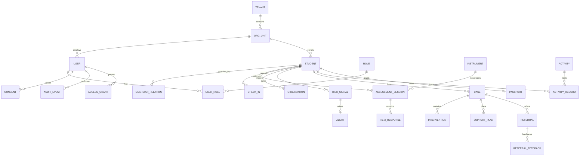

### 8.4 数据质量规则

| 编号 | 规则 | 检查 | 处理 |
|---|---|---|---|
| DQ-01 | 学籍号唯一且格式正确 | 导入校验 | 错误行退回，不阻断整批 |
| DQ-02 | 班级必须属于学校 | 外键 + 组织树 | 阻断 |
| DQ-03 | 一个学生同一时间只有一个主班级 | 唯一索引 | 冲突转人工 |
| DQ-04 | 监护关系必须有验证方式 | 绑定记录 | 未验证不能看摘要 |
| DQ-05 | 测评必须有同意且在有效期内 | 提交校验 | 阻断并提示 |
| DQ-06 | 案件状态迁移合法 | 状态机 | 非法迁移阻断 |
| DQ-07 | 审计事件不可为空 | 非空约束 | 阻断 |
| DQ-08 | 聚合数据 k≥10 | 查询层 | 抑制 |
| DQ-09 | 时间戳统一 UTC 存储、东八区展示 | 入库/展示 | 自动转换 |
| DQ-10 | 删除可验证 | 删除凭证 | 保留哈希 |

### 8.5 数据生命周期

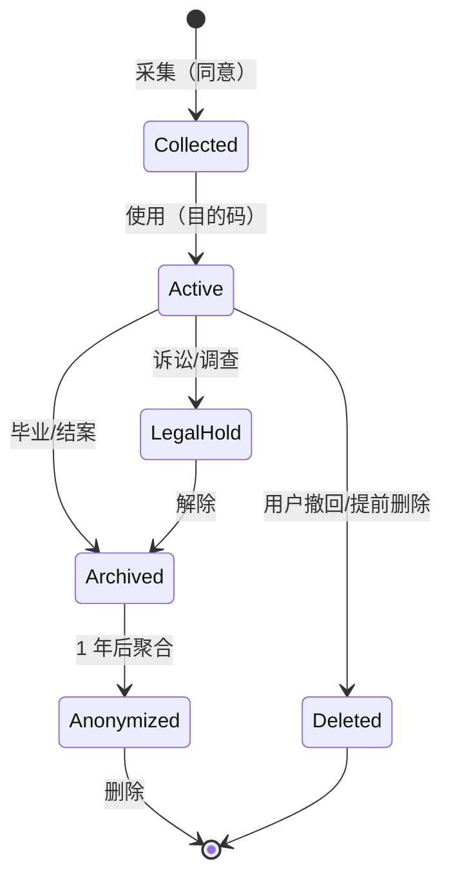

---

## 9. 集成点

### 9.1 集成清单（现状未提供完整清单，以下为基于调研与旧版方案的推断，需业务方确认）

| 编号 | 系统 | 方向 | 方式 | 频率 | 数据 | 级别 | 失败兜底 | 责任方 |
|---|---|---|---|---|---|---|---|---|
| INT-01 | 全国中小学生学籍信息管理系统 | 入 | Excel 导入（一期）/ API（二期） | 学期 | 姓名、学籍号、学校、班级 | DS3 | 手工导入 + 校验 | 教体局 |
| INT-02 | 区域教育公共服务平台 | 双向 | OIDC/API | 实时 | 身份、组织 | DS3 | 本地账号 | 教体局 |
| INT-03 | 教师管理系统 | 入 | Excel/API | 学期 | 教师、任课、班主任 | DS3 | 手工维护 | 学校 |
| INT-04 | 微信开放平台 | 双向 | 小程序登录、订阅消息 | 实时 | openid、手机号（授权） | DS3 | 短信 | 平台 |
| INT-05 | 短信/语音网关 | 出 | API | 实时 | 手机号、模板 | DS3 | 备用通道 | 平台 |
| INT-06 | 12355 青少年服务台 | 双向 | 工单/CSV（一期）/ API（二期） | 日 | 转介单、求助类别 | DS4 | 电话 | 团委 |
| INT-07 | 区域心理健康普查平台 | 入 | CSV/API | 学期 | 测评结果（脱敏/授权） | DS4 | 手工导入 | 教体局 |
| INT-08 | 医院/妇幼保健院 | 双向 | 转介包/反馈单 | 事件 | 转介、就诊反馈 | DS4 | PDF 加密邮件 | 医院 |
| INT-09 | 企业微信/钉钉 | 出 | 应用消息 | 实时 | 待办、预警（不含详情） | DS3 | 短信 | 学校 |
| INT-10 | 政务统一身份认证 | 入 | OIDC/CAS | 实时 | 身份、机构 | DS3 | 本地账号 | 政务云 |
| INT-11 | 对象存储/CDN | 双向 | S3 兼容 | 实时 | 图片、视频、附件 | DS3/DS4 | 本地缓存 | 平台 |
| INT-12 | 日志审计/SIEM | 出 | Syslog/Kafka | 实时 | 审计事件 | DS4 | 本地留存 | 平台 |
| INT-13 | 电子签/CA | 双向 | API | 事件 | 同意书、转介知情 | DS3 | 纸质扫描 | 平台 |
| INT-14 | 支付/政府采购 | 出 | 对公转账/发票 | 年 | 订单、发票 | DS2 | 线下 | 平台 |
| INT-15 | 地图/定位 | 出 | 微信模糊位置 | 事件 | 区/街道 | DS3 | 手动填写 | 平台 |

### 9.2 接口原则

| 原则 | 要求 |
|---|---|
| 最小必要 | 每个接口只返回完成目的所需字段；默认脱敏 |
| 双向认证 | 外部系统 mTLS 或 OAuth2 client credentials + HMAC |
| 幂等 | 写接口必须支持 Idempotency-Key |
| 可追溯 | 每次调用记录 request_id、调用方、目的码、结果 |
| 限流 | 按租户/应用/接口限流；超限 429 |
| 版本 | /api/v1；破坏性变更升版本；旧版本至少保留 6 个月 |
| 错误 | RFC 9457 Problem Details；不泄露堆栈 |
| 批量 | 大批量用异步任务 + 回执，不用长连接 |
| 数据交换 | CSV 必须加密压缩 + 校验和；SFTP/前置机 |
| 退出 | 合作终止后 30 天内删除/返还数据，出具证明 |

### 9.3 现有系统改造建议

| 系统 | 现状问题 | 建议 | 优先级 |
|---|---|---|---|
| 学籍 | 数据在省/国家系统，导出受限 | 一期 Excel 模板 + 校验；二期申请 API/前置机 | P0 |
| 普查平台 | 一年一次、结果滞后 | 不替代普查；做“日常补充 + 结果导入” | P1 |
| 12355 | 台账字段粗、无转介闭环 | 增设“转介来源/类别/是否闭环”字段；API 对接 | P1 |
| 医院 | 无稳定转介通道 | 先签合作协议 + 转介包标准；再谈系统对接 | P1 |
| 企业微信 | 教师已用 | 作为通知入口，不重复建 IM | P0 |
| 微信公众号 | 已有宣传 | 作为家长入口之一，不做数据承载 | P1 |

### 9.4 数据交换安全

- 传输：SFTP over SSH / HTTPS + mTLS；禁止明文邮件。
- 存储：交换文件加密（AES-256/SM4），密钥分离。
- 校验：SHA-256 校验和 + 记录数核对。
- 审计：谁在什么时候导入了什么文件、多少条、失败多少。
- 销毁：交换完成后 7 天内删除临时文件，保留回执。

### 9.5 集成风险

| 风险 | 影响 | 缓解 |
|---|---|---|
| 学籍接口不开放 | 名册靠手工，错误率高 | 模板 + 校验 + 学校管理员复核 |
| 微信订阅消息限制 | 危机通知触达不及时 | 短信 + 电话兜底 |
| 医院系统不开放 | 反馈靠人工 | 转介包 + 反馈单 + 电话随访 |
| 政务 SSO 标准不一 | 对接返工 | 适配层支持 OIDC/CAS/LDAP |
| 第三方 SDK 泄露 | 数据外流 | 最小 SDK、隐私评估、可关闭 |

---

## 10. 非功能需求（NFR）

### 10.1 量化指标

| 编号 | 类别 | 指标 | MVP（一期试点） | 目标（生产/政府购买） | 验证方式 |
|---|---|---|---|---|---|
| NFR-01 | 可用性 | 月度可用性 | 99.5% | 99.9%，政府购买 99.95% | 监控报表 |
| NFR-02 | 可靠性 | RPO | ≤24 小时 | ≤5 分钟 | 备份演练 |
| NFR-03 | 可靠性 | RTO | ≤4 小时 | ≤30 分钟 | 故障演练 |
| NFR-04 | 性能 | API P95 | ≤500ms | ≤300ms | 压测/APM |
| NFR-05 | 性能 | API P99 | ≤1s | ≤800ms | 压测/APM |
| NFR-06 | 性能 | 首屏 | ≤2.5s（4G） | ≤1.5s（4G） | 真机/小程序测速 |
| NFR-07 | 性能 | 测评提交 | ≤2s | ≤1s | 压测 |
| NFR-08 | 性能 | 看板加载 | ≤5s | ≤3s | 压测 |
| NFR-09 | 并发 | 同时在线 | 500 | 5,000 | 压测 |
| NFR-10 | 并发 | 峰值 QPS | 100 | 1,000 | 压测 |
| NFR-11 | 容量 | 注册用户 | 10,000 | 100,000 | 容量评估 |
| NFR-12 | 容量 | 存储 | 100GB | 1TB | 容量评估 |
| NFR-13 | 数据时效 | 看板数据延迟 | ≤1 小时 | ≤5 分钟 | 监控 |
| NFR-14 | 通知 | L3 送达率 | ≥98% | ≥99.5% | 回执 |
| NFR-15 | 通知 | 通知延迟 | ≤1 分钟 | ≤30 秒 | 监控 |
| NFR-16 | 安全 | 高危漏洞修复 | ≤7 天 | ≤24 小时 | 漏洞系统 |
| NFR-17 | 安全 | 中危漏洞修复 | ≤30 天 | ≤7 天 | 漏洞系统 |
| NFR-18 | 安全 | 渗透测试 | 上线前 1 次 | 每年 1 次 | 报告 |
| NFR-19 | 审计 | 审计覆盖率 | 100% 关键操作 | 100% DS3/DS4 读取 | 审计抽样 |
| NFR-20 | 审计 | 日志留存 | 6 个月 | 3 年 | 归档 |
| NFR-21 | 隐私 | 同意覆盖率 | 100% 敏感采集 | 100% | 抽检 |
| NFR-22 | 隐私 | 数据导出审批率 | 100% | 100% | 审计 |
| NFR-23 | 兼容 | 微信版本 | 近 2 年 | 近 3 年 | 兼容测试 |
| NFR-24 | 兼容 | 浏览器 | Chrome/Edge 近 2 年 | 近 3 年 + 国产浏览器 | 兼容测试 |
| NFR-25 | 兼容 | 低端安卓 | Android 9+ | Android 8+ | 真机 |
| NFR-26 | 无障碍 | 对比度 | ≥4.5:1 | ≥4.5:1 | 工具 + 人工 |
| NFR-27 | 无障碍 | 字号 | 支持 1.5 倍 | 支持 2 倍 | 人工 |
| NFR-28 | 可维护 | 部署时长 | ≤30 分钟 | ≤10 分钟 | 演练 |
| NFR-29 | 可维护 | 回滚时长 | ≤30 分钟 | ≤10 分钟 | 演练 |
| NFR-30 | 可观测 | 关键链路追踪 | 80% | 100% | APM |

### 10.2 容量模型

| 维度 | 一期（3—5 校） | 二期（30 校） | 三期（100 校/10 万学生） |
|---|---|---|---|
| 注册用户 | 5,000 | 30,000 | 100,000 |
| DAU | 1,000 | 8,000 | 25,000 |
| 峰值并发 | 500 | 2,000 | 5,000 |
| 峰值 QPS | 100 | 500 | 1,000 |
| 测评/学期 | 5,000 | 30,000 | 100,000 |
| 打卡/日 | 1,000 | 8,000 | 25,000 |
| 通知/日 | 2,000 | 20,000 | 80,000 |
| 存储/年 | 50GB | 300GB | 1TB |
| 日志/月 | 5GB | 30GB | 100GB |

### 10.3 性能预算

| 环节 | 预算 | 说明 |
|---|---|---|
| 小程序首屏 | 1.5s | 首包 ≤2MB、图片 CDN、骨架屏 |
| API 网关 | 20ms | 鉴权、限流、日志 |
| 应用逻辑 | 100ms | 单次查询 ≤3 次 |
| 数据库 | 50ms | 索引覆盖；慢查询 ≤1% |
| 缓存 | 10ms | 命中率 ≥80% |
| 外部调用 | 500ms 超时 | 熔断 + 降级 |
| 报表 | 3s | 预聚合 + 物化视图 |
| 导出 | 30s | 异步任务 + 通知 |

### 10.4 可用性与降级

| 级别 | 场景 | 降级策略 | 用户提示 |
|---|---|---|---|
| DG-1 | 数据库主库故障 | 切换只读副本；写操作排队 | “系统维护中，可先浏览” |
| DG-2 | 短信网关故障 | 切换备用通道；站内 + 企业微信 | “短信可能延迟” |
| DG-3 | 微信接口故障 | 手机号+验证码登录 | “请用验证码登录” |
| DG-4 | 支付/发票系统故障 | 线下对公 | “请联系客服” |
| DG-5 | 全站故障 | 静态页 + 危机电话 | “紧急请拨 12355/110” |

### 10.5 兼容性与可访问性

- 微信：iOS 14+、Android 9+；鸿蒙 NEXT 通过微信兼容层优先，原生 P2。
- 浏览器：Chrome/Edge 100+、Firefox 100+、Safari 15+；国产浏览器（360/QQ/红莲花）最近 2 年。
- 平板：教师端 1024×768 起；支持横屏。
- 低端机：1GB RAM 安卓机可完成打卡与求助。
- 无障碍：读屏标签、键盘导航、对比度、字号、色盲友好（不只用红绿）。
- 离线：打卡、观察、谈话记录可离线草稿；恢复后自动同步。

### 10.6 可运维性

| 要求 | 实现 |
|---|---|
| 一键部署 | Docker Compose（MVP）/ Helm（生产） |
| 配置外置 | 环境变量 + 配置中心；不写死 |
| 健康检查 | /health/live、/health/ready |
| 日志规范 | JSON、trace_id、租户、脱敏 |
| 监控 | Prometheus + Grafana + 告警 |
| 备份 | 每日全量 + PITR；每月恢复演练 |
| 变更 | 灰度 + 回滚 + 变更单 |
| 文档 | 部署、运维、故障、数据字典 |

---

## 11. 安全合规要求

### 11.1 适用法规与标准

| 类别 | 法规/标准 | 对本产品的要求 | 落地动作 |
|---|---|---|---|
| 网络安全 | 《网络安全法》 | 等级保护、日志留存 ≥6 个月、事件报告 | 等保定级备案（一期二级、目标三级）、日志归档 3 年 |
| 数据安全 | 《数据安全法》 | 分类分级、风险评估、出境限制 | 数据分级 DS1—DS4、年度风险评估、禁止出境 |
| 个人信息 | 《个人信息保护法》 | 告知同意、最小必要、目的限定、单独同意、删除权 | 同意中心、用途码、隐私仪表盘、删除流程 |
| 未成年人 | 《未成年人保护法》 | 特殊保护、强制报告、网络保护 | 双同意、强制报告流程、未成年人模式 |
| 儿童信息 | 《儿童个人信息网络保护规定》 | 14 岁以下监护人同意、专人保护 | 监护人同意、儿童信息专员、最小采集 |
| 精神卫生 | 《精神卫生法》 | 不替代诊断、自愿原则、隐私保护 | 非诊断表述、转介而非诊断、咨询保密 |
| 教育政策 | 《进一步加强中小学生心理健康工作十条措施》 | 监测预警、分级响应、家校社协同 | 四阶闭环、SLA、协同工单 |
| 等保 | GB/T 22239-2019 等保 2.0 | 三级技术与管理要求 | 定级、备案、建设、测评、整改 |
| 密码 | 《密码法》、GB/T 39786 | 密码应用安全性评估 | 国密算法、密评 |
| 算法 | 《互联网信息服务算法推荐管理规定》 | 算法备案、可解释、关闭选项 | 推荐规则可解释、可关闭 |
| 生成式 AI | 《生成式人工智能服务管理暂行办法》 | 备案、内容安全、标识 | P2 上线前完成备案 |
| 拟人化互动 | 《人工智能拟人化互动服务管理暂行办法》 | 不得诱导依赖、不得替代社交、危机时引导求助 | AI 标识、转人工、使用时长提醒 |
| 政府采购 | 《政府采购法》及地方细则 | 资质、等保、密评、SLA、审计 | 交付质量基线（见 11.5） |
| 微信 | 微信小程序运营规范 | 类目、隐私协议、内容安全 | 类目选择、隐私协议、内容审核 |
| 著作权 | 《著作权法》《信息网络传播权保护条例》 | 内容授权、不得下载/转播 | 版权登记/授权书/到期下架 |
| 内容生态 | 《网络信息内容生态治理规定》 | 社群内容审核、举报、处置 | 审核台/举报/处置记录 |
| 未成年人网络 | 《未成年人网络保护条例》 | 未成年人模式、社群保护、AI 防沉迷 | 匿名/禁私信/时长提醒 |

### 11.2 合规基线

| 基线 | 一期（试点） | 政府购买阶段 | 证据 |
|---|---|---|---|
| 等保定级 | 二级备案（架构按三级设计） | 三级 | 定级报告、备案证明、测评报告 |
| 密评 | 一期不强制（按属地要求确认） | 按三级要求开展 | 密评报告 |
| 渗透测试 | 上线前 1 次 | 每年 1 次 | 报告 + 整改记录 |
| 代码审计 | 自查 | 第三方 | 报告 |
| 隐私政策 | 有 | 有 + 年度审计 | 文本、版本记录 |
| 儿童信息专员 | 指定 | 专职 | 任命文件 |
| 数据出境 | 禁止 | 禁止 | 架构证明 |
| 日志留存 | 6 个月 | 3 年 | 归档记录 |
| 应急演练 | 1 次/年 | 2 次/年 | 演练报告 |

### 11.3 全生命周期安全

| 阶段 | 风险 | 控制措施 | 验证 |
|---|---|---|---|
| 采集 | 过度采集、诱导同意 | 最小必要、默认关闭、双同意、可跳过 | 隐私评审、埋点审计 |
| 传输 | 窃听、篡改 | TLS 1.2+（优先 1.3）、HSTS、证书管理、mTLS（内部） | 扫描、抓包 |
| 存储 | 泄露、越权 | 字段级加密、KMS、RLS、分区/租户隔离、备份加密 | 渗透、审计 |
| 使用 | 目的外使用、滥用 | 用途码、最小权限、破窗审批、水印 | 审计抽样 |
| 共享 | 转介泄露 | 最小必要包、有效期、下载次数、接收方协议 | 转介审计 |
| 导出 | 批量泄露 | 审批、水印、有效期、次数限制 | 导出审计 |
| 删除 | 删除不彻底 | 逻辑删除 + 物理删除 + 加密擦除 | 删除凭证 |
| 运维 | 内部人风险 | 堡垒机、双人复核、操作审计 | 运维审计 |
| 开发 | 漏洞、供应链 | SDL、SAST/SCA、代码评审、SBOM | 流水线门禁 |
| 退役 | 数据残留 | 数据迁移/销毁、介质消磁 | 退役报告 |

### 11.4 伦理审查与算法治理

| 事项 | 要求 | 责任 |
|---|---|---|
| 研究伦理 | 涉及学生数据的研究需伦理审查/学校审批 | 项目组 + 高校伦理委员会 |
| 量表伦理 | 使用授权量表；自编问卷需预试与信效度 | 心理专业负责人 |
| 算法公平 | 不因性别、民族、家庭状况产生差别对待；定期偏差评估 | 产品 + 数据 |
| 可解释 | 风险提示必须能说明触发规则与建议动作 | 产品 + 技术 |
| 人工复核 | 所有 L1—L3 分级人工确认；L3 可先处置后复核 | 心理教师/校领导 |
| 不伤害 | 避免污名化、标签化、恐吓式表达 | 内容审核 |
| 知情 | 学生/家长知道“系统在做什么、不做什么” | 产品 |
| 退出 | 可拒绝、可撤回、可删除（法定例外除外） | 产品 |

### 11.5 政府购买交付质量基线

| 维度 | 基线要求 | 验收证据 |
|---|---|---|
| 合规 | 等保三级、密评（如适用）、隐私政策、儿童信息保护 | 证书/报告 |
| 可用性 | 99.9%，年度停机 ≤8.76 小时 | 监控年报 |
| 响应 | P1 15 分钟响应、2 小时恢复；P2 4 小时 | 工单记录 |
| 安全 | 高危漏洞 24 小时内修复；年度渗透 | 报告 |
| 数据 | 本地存储、不出境、可导出、可删除 | 架构说明 + 审计 |
| 文档 | 需求、设计、接口、部署、运维、用户手册 | 文档清单 |
| 培训 | 管理员 2 场/年、教师 4 场/年、学生 1 次/学期 | 签到/考核 |
| 运营 | 驻场/远程支持；月度报告；季度复盘 | 服务报告 |
| 迁移 | 支持从旧系统导入；退出时数据返还 | 迁移方案 |
| 源码 | 政府采购可要求源码托管/escrow | 合同条款 |

### 11.6 1.5 万元预算与政府级交付的差距（评审重点）

| 项目 | 估算费用 | 是否在 1.5 万元内 | 说明 |
|---|---|---|---|
| 等保三级测评 | 5—8 万元 | 否 | 含整改、复测 |
| 密评 | 3—5 万元 | 否 | 如按三级要求 |
| 渗透测试 | 2—3 万元 | 否 | 第三方 |
| 代码审计 | 1—2 万元 | 否 | 第三方 |
| 心理督导 | 2—4 万元/年 | 否 | 危机个案督导 |
| 法务/伦理 | 1—2 万元 | 否 | 协议、隐私、伦理 |
| 内容生产 | 2—5 万元 | 否 | 分学段课程/视频 |
| 驻场运维 | 6—10 万元/年 | 否 | 政府购买阶段 |
| 培训 | 2 万元/年 | 否 | 教师/管理员 |
| 云资源（试点） | 1.0—1.2 万元/2 年 | 是 | 见 13.4 |
| 云资源（生产多可用区） | 3—6 万元/年 | 否 | 与试点不同 |
| 合计（政府购买阶段） | 27—47 万元/年 | — | 需单列预算 |

> **结论**：1.5 万元是“验证性预算”，不是“交付性预算”。一期用 1.5 万元验证产品与模式，政府购买阶段必须单列 27—47 万元/年的合规、运营、督导与运维预算。建议在立项报告中明确这一预算口径，避免后续验收争议。

---

## 12. 成功指标

### 12.1 北极星指标

**有效支持闭环率（Effective Support Closure Rate, ESCR）**

> ESCR = 在 SLA 内完成“确认→响应→干预/转介→跟踪”闭环的学生数 ÷ 被识别为 L1—L3 的学生数 × 100%

- 目标：一期 ≥80%，二期 ≥90%，L3 必须 100%。
- 口径：以案件状态机“已结案”且时间戳在 SLA 内为准；转介需有反馈才算闭环。
- 反作弊：不允许“批量结案”；结案需填写摘要与证据；审计抽样 10%。

### 12.2 指标卡

| 维度 | 指标 | 定义 | 基线 | 一期目标 | 二期目标 | 数据源 | 频率 |
|---|---|---|---|---|---|---|---|
| 安全底线 | L3 15 分钟触达率 | 15 分钟内至少 1 个责任人确认 | 无系统 | ≥98% | ≥99.5% | 通知回执 | 日 |
| 安全底线 | L3 24 小时介入率 | 24 小时内首次专业介入 | 无系统 | 100% | 100% | 案件时间线 | 日 |
| 安全底线 | 转介闭环率 | 30 天内收到反馈 | 无系统 | ≥85% | ≥95% | 转介记录 | 月 |
| 安全底线 | 强制报告及时率 | 发现后 24 小时内报告 | 无系统 | 100% | 100% | 报告回执 | 事件 |
| 安全底线 | 漏报/瞒报 | 审计发现的未处置 L3 | 未知 | 0 | 0 | 审计 | 季 |
| 发展 | 学生月活 | 月内至少 1 次有效使用 | 无 | ≥50% | ≥60% | 埋点 | 月 |
| 发展 | 周打卡率 | 周内至少 1 次打卡 | 无 | ≥35% | ≥40% | 埋点 | 周 |
| 发展 | 测评完成率 | 开始后完成 | 无 | ≥75% | ≥80% | 测评记录 | 学期 |
| 发展 | 成长护照完整率 | 有优势/活动/反思 | 无 | ≥70% | ≥80% | 护照 | 学期 |
| 发展 | 资源完成率 | 打开后完成 | 无 | ≥40% | ≥50% | 内容埋点 | 月 |
| 协同 | 教师周活 | 周内至少 1 次处理 | 无 | ≥50% | ≥60% | 埋点 | 周 |
| 协同 | 家长绑定率 | 绑定/在校学生 | 无 | ≥60% | ≥70% | 绑定记录 | 学期 |
| 协同 | 跨主体 48 小时响应率 | 转介/协办 48 小时内响应 | 无 | ≥85% | ≥90% | 工单 | 月 |
| 协同 | 社区活动参与率 | 报名/可参与学生 | 无 | ≥25% | ≥30% | 活动 | 假期 |
| 质量 | 可用性 | 月度 | 无 | ≥99.5% | ≥99.9% | 监控 | 月 |
| 质量 | API P95 | 核心接口 | 无 | ≤500ms | ≤300ms | APM | 周 |
| 质量 | 缺陷逃逸率 | 上线后发现的 P1/P2/总缺陷 | 未知 | <8% | <5% | 缺陷系统 | 月 |
| 质量 | 高危漏洞 | 未修复 | 未知 | 0 | 0 | 漏洞系统 | 月 |
| 质量 | 安全事件 | 数据泄露/越权 | 未知 | 0 | 0 | 安全 | 事件 |
| 质量 | 导出合规率 | 有审批/水印/有效期 | 无 | 100% | 100% | 审计 | 月 |
| 满意度 | 学生满意度 | 问卷 | 无 | ≥75% | ≥80% | 问卷 | 学期 |
| 满意度 | 教师满意度 | 问卷 | 无 | ≥80% | ≥85% | 问卷 | 学期 |
| 满意度 | 家长满意度 | 问卷 | 无 | ≥80% | ≥85% | 问卷 | 学期 |
| 满意度 | 教体局满意度 | 访谈 | 无 | ≥85% | ≥90% | 访谈 | 年 |
| 采用 | 试点学校 | 签约并活跃 | 0 | 3—5 | 30 | 合同 | 年 |
| 采用 | 覆盖学生 | 激活 | 0 | 3,000—5,000 | 30,000 | 系统 | 年 |
| 成本 | 单生年云成本 | 云资源/活跃学生 | 无 | ≤3 元 | ≤2 元 | 账单 | 年 |

**V1.1 新增指标（内容/社群/AI/机构）：**

| 维度 | 指标 | 定义 | G1 试点 | G2 规模 | 数据源 |
|---|---|---|---|---|---|
| 内容 | 月新增内容 | 审核通过的内容数 | ≥100 | ≥500 | 内容后台 |
| 内容 | 完播率 | 播放 ≥80% / 播放 | ≥30% | ≥35% | 埋点 |
| 内容 | 版权授权率 | 有授权/全部内容 | 100% | 100% | 版权库 |
| 社群 | 月发帖率 | 发帖用户/MAU | ≥5% | ≥8% | 社群 |
| 社群 | 举报处理及时率 | 24h 内处理/举报 | ≥95% | ≥98% | 审核台 |
| 社群 | 7 日留存 | 新用户 7 日回访 | ≥15% | ≥20% | 埋点 |
| AI | 回答准确率 | 金标准抽样 | ≥80% | ≥85% | 评测 |
| AI | 危机召回 | 危机样本识别/全部 | ≥95% | ≥98% | 评测 |
| AI | 转人工率 | 转人工/会话 | 10—20% | 10—20% | 会话 |
| AI | 单次成本 | 模型+检索/会话 | ≤0.05 元 | ≤0.02 元 | 账单 |
| 机构 | 入驻机构数 | 审核通过 | ≥3 | ≥10 | 机构后台 |
| 机构 | 服务满意度 | 评价均分 | ≥80% | ≥85% | 评价 |

### 12.3 试点评估设计（DID）

| 要素 | 设计 |
|---|---|
| 设计 | 准实验，双重差分（DID）；3 所试点校 + 3 所对照校（条件相近） |
| 周期 | 2027 年春季学期—秋季学期，共 6 个月 |
| 样本 | 试点校约 3,000 人；对照校约 3,000 人 |
| 主要结局 | 求助意愿（自报）、心理素养得分、教师响应时效、ESCR |
| 次要结局 | 问题检出率、资源使用率、家长参与率、满意度 |
| 数据来源 | 系统日志、匿名问卷、教师访谈、案件时间线 |
| 分析 | 描述统计 + DID 回归；控制学校、年级、性别、留守状态 |
| 伦理 | 伦理审查、监护人同意、可随时退出；对照校不剥夺常规服务 |
| 局限 | 非随机、暑期分散、自报偏差；结论以“关联”而非“因果”表述 |

---

## 13. 迭代路线

### 13.1 两年五阶段

| 阶段 | 时间 | 目标 | 关键交付 | 验收 |
|---|---|---|---|---|
| P0 软著版 | 2026-11-10—2026-12-09 | 1 个月内形成可演示、可提交软著的 V1.0（演示级） | 学生端、教师端、管理端、内容/视频/AI/社群演示、API、数据库、审计、用户手册、软著材料 | 软著申请提交；内部演示通过 |
| P1 试点 MVP | 2027-01-16—2027-06-30 | 3—5 校、3,000—5,000 学生上线 | 同意、测评、风险、个案、转介、家长端、区域看板、安全基线 | 试点启动；ESCR ≥80% |
| P2 协同扩展 | 2027-07-01—2027-12-31 | 团委/社区/医疗机构接入；五育与成长护照 | 活动、志愿者、12355、医院反馈、离线增强、区域报告 | 跨主体闭环 ≥85% |
| P3 政府购买准备 | 2028-01-01—2028-04-30 | 等保整改、密评、信创适配、SLA、运营体系；大创结题 | 等保测评、密评、渗透、运维手册、服务目录、结题报告 | 通过测评/结题 |
| P4 推广 | 2028-05-01—2028-10-31 | 3 县区、30 校、3 万学生；多租户 SaaS | 多租户、开放 API、成本优化、渠道体系 | 30 校签约/活跃 |

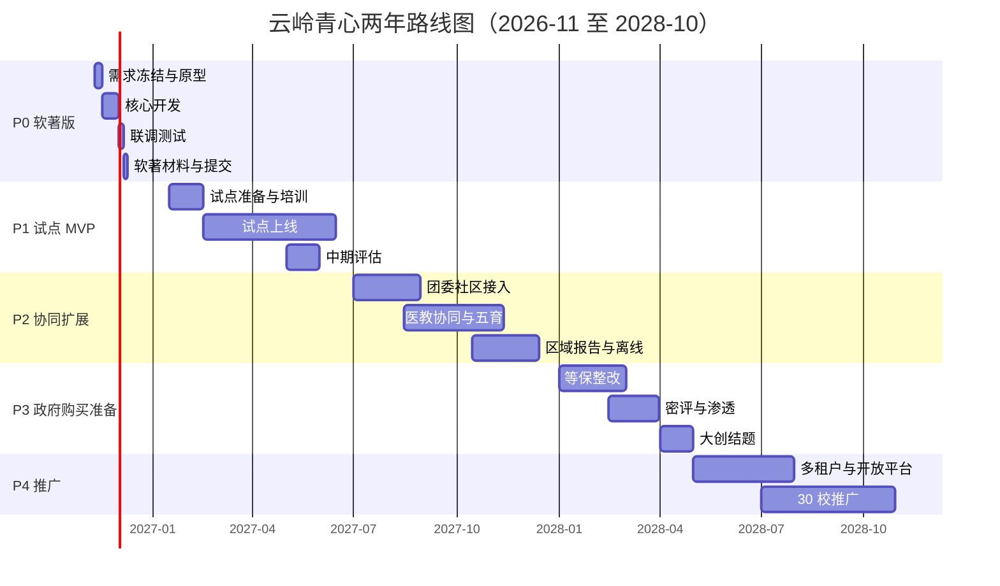

### 13.2 一个月软著冲刺计划（周级）

| 周 | 日期 | 目标 | 交付物 | 负责 |
|---|---|---|---|---|
| W1 | 11-10—11-16 | 冻结软著范围、原型、数据模型、素材 | 页面清单、ER 图、接口清单、演示素材包、同意文本草案 | 产品 + 技术 |
| W2 | 11-17—11-23 | 学生端：内容/视频/测评/AI/求助/护照 | 可运行小程序、内容库、3 套测评、AI FAQ/RAG | 前端 + 后端 |
| W3 | 11-24—11-30 | 教师端/管理端/机构目录/轻社群/审计 | 班级看板、预警、内容审核、机构列表、成长圈、审计 | 前端 + 后端 |
| W4 | 12-01—12-09 | 联调/测试/文档/软著/演示 | 用户手册、技术文档、源代码、截图、演示视频、软著申请 | 全员 |

**软著材料清单：**
- 申请表（中国版权保护中心）；
- 源代码：前 30 页 + 后 30 页，每页 ≥50 行，连续编号；
- 用户手册：≥30 页，含功能截图、操作步骤、运行环境；
- 身份证明/单位证明；
- 版本号：V1.0；开发完成日期：2026-12-08；首次发表日期：如需。
- 注意：源代码不得包含第三方未授权代码；开源依赖需保留许可证；软著审查通常 30—60 个工作日，加急另计。

### 13.3 里程碑验收标准

| 里程碑 | 验收标准 | 不通过的处理 |
|---|---|---|
| M0 需求基线 | 本文件 + 技术路径评审通过；待确认问题关闭 ≥80% | 延期 1 周，不进入开发 |
| M1 软著受理 | 材料齐全、受理通知书 | 补正 |
| M2 试点上线 | 3 校名册导入成功；L3 演练通过；教师培训完成 | 延期，不上线 |
| M3 中期评估 | ESCR ≥80%；L3 100%；无 P1 事故 | 整改 1 个月 |
| M4 协同扩展 | 团委/医院各 1 家接入；转介闭环 ≥85% | 缩小范围 |
| M5 等保测评 | 三级测评通过/基本符合 | 整改复测 |
| M6 大创结题 | 报告、软著、试点数据、操作手册 | 延期 |

### 13.4 预算（1.5 万元，24 个月）

| 科目 | 金额（元） | 测算 | 备注 |
|---|---|---|---|
| 云主机（4C8G） | 4,800 | 200 元/月 × 24 | 应用 + 定时任务 |
| 云数据库 PostgreSQL | 3,600 | 150 元/月 × 24 | 2C4G，单可用区 |
| Redis | 960 | 40 元/月 × 24 | 1GB |
| 对象存储/CDN/流量 | 720 | 30 元/月 × 24 | 图片、附件 |
| 短信 | 800 | 0.04 元/条 × 20,000 | 验证码 + 通知 |
| 域名/SSL/备案 | 300 | 一次性 |  |
| 微信小程序认证 | 300 | 一次性 |  |
| 软著登记/材料 | 300 | 一次性 | 不含加急 |
| 内容版权/素材/字体 | 800 | 一次性 | 正版字体/图片 |
| 兼容性测试机/云真机 | 600 | 一次性 | 低端安卓 |
| 试点差旅/培训 | 1,200 | 4 次 | 玉溪往返 |
| 应急储备 | 620 | — | 超量/故障 |
| **合计** | **15,000** |  | 不含人力、等保、密评、督导 |

> 价格为 2026 年国内云学生/轻量套餐估算，实际以询价为准；若上涨，优先降配、申请教育优惠或改用按量计费。

> **V1.1 增量成本**：AI 模型调用（试点 500—2,000 元/月）、视频 CDN（300—1,000 元/月）、内容版权/制作（1—3 万元/年）不在 1.5 万元内；软著版用免费额度/本地素材，不产生大额费用。

> **人力投入（实物配套，不计现金）**：10—13 人 × 平均 0.3 FTE × 24 个月 ≈ 6.0—7.8 人年；按学生团队机会成本 3—5 万元/人年估算，实物投入约 18—39 万元。这是 1.5 万元能做成事的真实原因，也是团队流失风险高的原因。

### 13.5 团队与分工

| 角色 | 人数 | 投入 | 职责 | 关键产出 |
|---|---|---|---|---|
| 产品负责人 | 1 | 0.6 FTE | 需求、优先级、评审、对外 | PRD、路线图、验收 |
| 技术负责人 | 1 | 0.6 FTE | 架构、代码评审、安全 | 架构、技术路径、ADR |
| 前端（小程序） | 2 | 0.5 FTE | 学生/家长端 | 小程序、组件库 |
| 前端（Web） | 1 | 0.5 FTE | 教师/管理端 | Web 控制台 |
| 后端 | 2 | 0.6 FTE | API、数据、权限、集成 | 服务、数据模型 |
| 测试/运维 | 1 | 0.4 FTE | 测试、发布、监控 | 测试报告、值班 |
| 心理专业 | 2 | 0.3 FTE | 量表、危机 SOP、培训、督导 | 量表包、SOP、培训 |
| 内容/运营 | 1 | 0.3 FTE | 内容、活动、家长课堂 | 内容库、活动 |
| 设计 | 1 | 0.3 FTE | UI/UX、无障碍 | 设计系统 |
| 数据/评估 | 1 | 0.3 FTE | 指标、DID、报告 | 评估报告 |

---

## 14. 风险与依赖

### 14.1 风险登记表

| 编号 | 风险 | 概率 | 影响 | 缓解 | 触发信号 | 责任 |
|---|---|---|---|---|---|---|
| R-01 | 1.5 万元无法覆盖政府级合规 | 高 | 高 | 一期只做试点；政府购买单列 27—47 万元/年；提前与采购方沟通 | 要求等保/密评但无预算 | 产品负责人 |
| R-02 | 监护人同意率低，数据不完整 | 高 | 高 | 学校组织 + 家长会 + 纸质备选；未同意也能用基础功能 | 绑定率 <40% | 学校/运营 |
| R-03 | 量表版权/常模不适配 | 中高 | 高 | 只用授权/公有领域量表；先做自编非诊断问卷；心理专业审核 | 法务提出异议 | 心理专业 |
| R-04 | 危机事件责任边界不清 | 高 | 高 | 明确“平台不诊断、不替代学校/医院”；SOP、留痕、保险、法律顾问 | 发生极端事件 | 校领导/法务 |
| R-05 | 教师负担重、采用率低 | 高 | 高 | 3 分钟记录、每周 ≤5 人、培训、激励、误报不追责 | 周活 <30% | 产品/学校 |
| R-06 | 微信类目/内容审核不通过 | 中 | 中 | 以教育类目为主；咨询/医疗功能后置；准备资质 | 审核驳回 | 运营 |
| R-07 | 试点学校不确定/延期 | 中高 | 高 | 备选 6 所；先签合作备忘录；教体局发文 | 开学前未确定 | 项目负责人 |
| R-08 | 名册/学籍数据质量差 | 高 | 中 | 模板 + 校验 + 学校复核 + 错误行下载 | 导入失败 >5% | 学校管理员 |
| R-09 | 团队流失/学业冲突 | 高 | 高 | 文档化、双人负责、学长传帮带、关键模块外包预案 | 核心成员退出 | 项目负责人 |
| R-10 | 等保/密评延期 | 中 | 高 | 提前 3 个月启动；先整改后测评；选择本地测评机构 | 测评排期 >2 月 | 技术负责人 |
| R-11 | 医院合作不确定 | 中 | 中 | 先做转介包 + 反馈单；不依赖医院系统；备选 2 家 | 无机构签约 | 项目负责人 |
| R-12 | 旧系统集成延期 | 中 | 中 | Excel 兜底；接口后置；不阻塞试点 | 接口 1 月未通 | 技术负责人 |
| R-13 | AI 合规/备案 | 中 | 中 | P2 再做；先做规则推荐；备案与安全评估 | 备案驳回 | 产品/法务 |
| R-14 | 误标/舆情 | 中 | 高 | 人工确认、非诊断表述、申诉、快速更正、舆情预案 | 家长投诉 | 校领导/运营 |
| R-15 | 供应商锁定/涨价 | 低中 | 中 | 容器化、S3 兼容、PG 标准、Terraform | 涨价 >30% | 技术负责人 |

### 14.2 关键依赖

| 编号 | 依赖 | 需要谁 | 最晚时间 | 未满足的后果 |
|---|---|---|---|---|
| DEP-01 | 玉溪市教体局正式合作协议/发文 | 教体局 | 2027-01 | 试点无法启动 |
| DEP-02 | 3—5 所试点学校确定 | 教体局 | 2027-01 | 延期 |
| DEP-03 | 监护人同意文本/法务审核 | 法务/教育局 | 2027-01 | 不能采集 |
| DEP-04 | 量表授权/公有领域证明 | 心理专业/版权方 | 2027-02 | 测评不能上线 |
| DEP-05 | 伦理审查/学校审批 | 高校/教体局 | 2027-02 | 研究不能做 |
| DEP-06 | 微信小程序类目/资质 | 微信 | 2027-01 | 不能发布 |
| DEP-07 | 短信签名/模板报备 | 运营商 | 2027-01 | 通知失败 |
| DEP-08 | 医院/妇幼保健院合作协议 | 医院 | 2027-06 | 转介闭环不完整 |
| DEP-09 | 团委数据共享协议 | 团委 | 2027-06 | 社区场景不能做 |
| DEP-10 | 等保测评机构 | 采购 | 2028-01 | 政府购买延期 |
| DEP-11 | 政务云/信创环境 | 政务云 | 2028-01 | 私有化部署延期 |
| DEP-12 | 心理督导 | 高校/医院 | 2027-01 | 危机处置不专业 |
| DEP-13 | 内容审核团队 | 运营 | 2027-01 | 内容不能上线 |
| DEP-14 | 云资源/备案 | 平台 | 2026-12 | 无法部署 |
| DEP-15 | 数据共享/安全协议 | 法务 | 2027-01 | 不能对接 |

---

## 15. 关键假设（信息缺失时的继续依据）

| 编号 | 假设 | 依据 | 若不成立的影响 | 验证方式 |
|---|---|---|---|---|
| A-01 | “政府购买一级 APP 质量”指政府购买服务优质档，不是等保一级 | 语境与“企业级质量”一致 | 合规定位需重写 | 评审会确认（PD-1） |
| A-02 | 1.5 万元为现金预算，不含人力、等保、密评、督导 | 大创经费 1 万元 + 自筹 | 预算缺口需追加 | 财务确认 |
| A-03 | 一期 3—5 校、3,000—5,000 学生 | 项目计划书 3 校/3,000 人 | 容量与成本变化 | 教体局确认 |
| A-04 | 学生/家长以微信小程序为主；教师以 Web/H5 为主 | 微信普及率、教师办公习惯 | 端策略调整 | 预调研 |
| A-05 | 学校有互联网接入，但晚高峰带宽有限 | 玉溪乡村学校实际 | 离线要求提高 | 学校访谈 |
| A-06 | 学籍数据一期可 Excel 导入，二期可 API | 省级系统开放程度 | 名册维护成本上升 | 教体局确认 |
| A-07 | 量表授权可在试点前取得；MVP 先用免费量表 + 自编问卷 | 版权实践 | 测评功能延期 | 法务确认 |
| A-08 | 家长智能手机/微信普及率 ≥80% | 乡村实际 | 需电话/纸质通道 | 学校统计 |
| A-09 | 团委/教体局可签署数据共享协议 | 调研意愿 | 协同场景受限 | 协议 |
| A-10 | 至少 1 家医疗机构可接收转介 | 红塔区妇幼保健院意愿 | 转介闭环不完整 | 合作协议 |
| A-11 | 团队 10—13 人，学生为主，每周 ≥10 小时 | 团队实际 | 进度延期 | 项目计划 |
| A-12 | 微信小程序以教育类目为主，咨询/医疗后置 | 类目规范 | 功能调整 | 微信审核 |
| A-13 | 全部数据境内存储，不涉及跨境 | 合规要求 | 架构重做 | 架构评审 |
| A-14 | 不采集生物特征，不做无感监测 | 伦理红线 | 产品重做 | 评审 |
| A-15 | 24 个月分两期，2028-04 为大创结题节点 | 项目周期 | 里程碑调整 | 项目计划 |

---

## 16. 需业务方确认的问题清单

> 以下问题不确认会影响需求基线冻结。建议评审会逐条给出“确认/待定/否决”，待定项需指定责任人与时间。

### 16.1 定位与采购

| 编号 | 问题 | 为什么重要 | 建议选项 |
|---|---|---|---|
| Q-01 | “政府购买一级 APP 质量”的准确口径是什么？ | 决定等保等级、测评、预算 | A 优质档 / B 等保一级 / C 其他 |
| Q-02 | 一期采购/付费主体是市教体局、县教体局还是学校？ | 决定合同、发票、验收 | 市/县/校/团委 |
| Q-03 | 是否已有政府采购意向或预算科目？ | 决定二期能否接续 | 有/无/待定 |
| Q-04 | 平台是“公益项目”还是“可收费服务”？ | 决定商业模式与数据用途 | 公益/政府购买/混合 |
| Q-05 | 是否要求源码托管/知识产权归属？ | 决定合同与软著策略 | 归平台/归政府/共有 |

### 16.2 试点与业务

| 编号 | 问题 | 为什么重要 | 建议选项 |
|---|---|---|---|
| Q-06 | 试点学校名单、学段、人数何时确定？ | 决定上线时间 | 2027-01 前 |
| Q-07 | 是否包含小学高年级，还是只做初中？ | 决定量表、内容、监护同意 | 小学高年级+初中/仅初中 |
| Q-08 | 教育局希望区域看板看到哪些指标？ | 决定数据模型与报表 | 列出 5—10 个 |
| Q-09 | 团委在协同中的具体职责是什么？ | 决定权限与工单 | 活动/12355/志愿者/联席 |
| Q-10 | 学校心理教师的编制与兼职情况？ | 决定个案负载与培训 | 专职/兼职/班主任兼 |
| Q-11 | 班主任参与是否纳入考核/补贴？ | 决定采用率 | 纳入/补贴/志愿 |
| Q-12 | 家长参与的组织方式（家长会/微信群/纸质）？ | 决定绑定率 | 学校组织/自愿 |
| Q-13 | 是否需要与现有“五育阳光小屋”品牌/系统整合？ | 决定 IA 与集成 | 是/否/待定 |
| Q-14 | 是否需要民族语言内容？哪些语种？ | 决定内容与翻译成本 | 彝/哈尼/白/无 |

### 16.3 合规与伦理

| 编号 | 问题 | 为什么重要 | 建议选项 |
|---|---|---|---|
| Q-15 | 等保定级是二级还是三级？ | 决定测评与整改成本 | 二级/三级 |
| Q-16 | 是否要求密评？ | 决定国密改造 | 是/否/待定 |
| Q-17 | 数据分类分级是否按教育行业标准执行？ | 决定字段与保留 | 是/否 |
| Q-18 | 监护人同意文本由谁审定？ | 决定上线 | 教育局/法务/学校 |
| Q-19 | 量表授权由谁负责？预算多少？ | 决定测评能否上线 | 平台/教育局/医院 |
| Q-20 | 是否需伦理审查？由哪家机构审？ | 决定研究与合作 | 高校/医院/教育局 |
| Q-21 | 强制报告的内部流程与联系人？ | 决定危机 SOP | 列出流程 |
| Q-22 | 数据共享协议（团委/医院/公安）谁签？ | 决定跨主体协同 | 教育局/团委 |
| Q-23 | 是否要求未成年人模式/时长限制？ | 决定产品设计 | 是/否 |
| Q-24 | AI 功能是否要求算法备案/生成式 AI 备案？ | 决定 P2 范围 | 是/否/不做 |

### 16.4 技术与运维

| 编号 | 问题 | 为什么重要 | 建议选项 |
|---|---|---|---|
| Q-25 | 学籍/教师数据能否 API 对接？接口方是谁？ | 决定集成工作量 | 能/仅导出/不能 |
| Q-26 | 是否要求政务云/私有化部署？ | 决定架构与成本 | 公有云/政务云/混合 |
| Q-27 | 是否要求信创（麒麟/达梦/东方通）？ | 决定适配与测试 | 是/否/二期 |
| Q-28 | 是否要求鸿蒙原生？ | 决定客户端投入 | 是/否/H5 优先 |
| Q-29 | 运维由谁负责（平台/学校/政务云）？ | 决定 SLA 与驻场 | 平台/政务云/联合 |
| Q-30 | 现有系统清单与接口文档能否提供？ | 决定集成设计 | 提供/待提供 |

---

## 17. 质量自检清单

> 用法：立项评审前由产品负责人逐项自检；研发交底前由技术负责人复核；试点上线前由测试/安全/运营联合签字。任何一项“否”必须写明原因与补救计划。

### 17.1 定位与范围

- [ ] 是否用一句话说清“产品是什么、不是什么”？
- [ ] 是否明确“安全底线”与“发展主线”的优先级？
- [ ] 是否列出 MVP/P1/P2/不做四类，并有理由？
- [ ] 是否明确旧版功能的处置（保留/重构/删除）？
- [ ] 是否明确“政府购买一级质量”的口径与验收基线？
- [ ] 是否把“1.5 万元买不到政府级交付”讲清楚，并给出二期预算建议？

### 17.2 用户与权限

- [ ] 12 类角色是否都有明确的“任务—数据域—端”？
- [ ] 是否覆盖“一人多角色”与“主角色+目的码”？
- [ ] 是否给出功能权限矩阵、数据域矩阵、字段级可见性？
- [ ] 破窗访问是否有理由、时限、复核、审计？
- [ ] 转介是否是最小必要包，而非全档案？
- [ ] 学生/家长的知情、同意、撤回、删除、解释权是否可操作？
- [ ] 审计员是否“只看日志、不看业务明文”？

### 17.3 场景与旅程

- [ ] 学生、家长、班主任、心理教师、校领导、教体局、团委、社区、医院是否都有旅程？
- [ ] 每条旅程是否有“触发—动作—时限—证据”？
- [ ] 是否覆盖危机、转介、拒绝、失联、误报等异常？
- [ ] 是否把“3 分钟记录、每周 ≤5 人”写进设计约束？
- [ ] 是否有“弱网/离线/低端机”路径？

### 17.4 功能与规则

- [ ] P0 功能是否都能在试点前交付？
- [ ] 每条业务规则是否可配置、可测试、可追溯？
- [ ] 风险分级是否“系统提示 + 人工确认”？
- [ ] L3 是否有 15 分钟/2 小时/24 小时的硬时限与升级？
- [ ] 测评是否非诊断、可跳过、先给学生看？
- [ ] 家长是否只看到摘要，而非原始分/咨询全文？
- [ ] 内容是否有分学段、审核、版权、无广告？
- [ ] 五育是否只记录证据、不做排名？
- [ ] 是否有“强制报告”流程与模板？

### 17.5 数据与集成

- [ ] 是否给出 DS1—DS4 数据分级与保留期限？
- [ ] 30 个核心对象是否都有归属、级别、保留？
- [ ] 是否有 ER 图与数据质量规则？
- [ ] 集成清单是否标注方向、方式、频率、级别、兜底？
- [ ] 是否明确“不依赖单一供应商/境外 BaaS”？
- [ ] 是否有数据交换加密、校验、销毁？

### 17.6 非功能与安全

- [ ] NFR 是否量化到可验收（可用性、RPO/RTO、P95、并发）？
- [ ] 是否有容量模型与性能预算？
- [ ] 是否有降级预案与危机电话兜底？
- [ ] 是否覆盖等保、密评、个保、未保、儿童信息、精神卫生法？
- [ ] 是否有全生命周期安全控制表？
- [ ] 是否有伦理审查、算法公平、可解释、人工复核？
- [ ] 是否有“隐私仪表盘”和“用途码”？

### 17.7 指标与路线

- [ ] 北极星指标是否有公式、口径、目标、反作弊？
- [ ] 是否有安全/发展/协同/质量/满意度/成本六类指标？
- [ ] 是否有 DID 试点评估设计？
- [ ] 路线图是否与 1 个月软著、6 个月试点、24 个月推广对齐？
- [ ] 预算是否逐项加总 = 15,000 元？
- [ ] 团队分工是否覆盖产品、技术、心理、内容、测试、数据？

### 17.8 风险与决策

- [ ] 是否列出 15 项以上风险，并有概率/影响/缓解/触发/责任人？
- [ ] 是否列出关键依赖与最晚时间？
- [ ] 是否有 15 条以上假设，并说明不成立的影响？
- [ ] 是否有 30 个待确认问题，且分业务/合规/技术？
- [ ] 是否明确“评审会需拍板的五件事”？

---

## 18. 内容生态、社群、AI 与规模化（V1.1—V1.2 增补）

> **本章回答产品经理提出的新要求**：把“云岭青心”从“心理安全工具”升级为“青少版的学习强国”——有内容、有社群、有资源、有 AI、有协同；同时守住未成年人保护与心理安全底线。V1.0 的权限、审计、协同、安全体系不变，本章是在其上的“日活引擎”和“规模化路线”。

### 18.1 定位升级：青少版的“学习强国”

**对内一句话：云岭青心 = 青少版的“学习强国” + 青少年发展协同操作系统。**

| 维度 | 学习强国 | 云岭青心 | 相同/不同 |
|---|---|---|---|
| 内容 | 新闻、理论、文化、科技、慕课 | 心理科普、学习力、生涯职业、政策资助、民族文化、五育、榜样 | 同：内容聚合、专题、学习计划；不同：分学段、未成年人保护 |
| 组织 | 党组织体系、学习组织 | 教体局—学校—班级、团委—社区、机构—咨询师 | 同：组织化学习；不同：多角色协同、个案安全 |
| 社群 | 评论、学习小组 | 成长圈（主题圈/班级圈/活动圈） | 同：归属感；不同：未成年人禁私信、先审后发 |
| 资源 | 慕课、图书、地方频道 | 视频库、课程、职业卡、机构服务、活动 | 同：资源直达；不同：资源可单独输出给团委/社区 |
| 安全 | 内容审核 | 心理安全底线、危机转介、数据合规 | 不同：心理与未成年人数据高度敏感 |
| 商业化 | 公益/财政 | 政府购买 + 学校服务包 + 机构服务 | 不同：B2B2G，不向学生个体收费 |

**产品不是“今日头条式算法流”**，而是“有组织的学习 + 有边界的社群 + 有底线的安全”。三条原则：

1. **内容有出处**：每条内容有来源、作者、版权、审核人、适龄标签。
2. **社群有边界**：未成年人只进“圈内公开”场景，不开放一对一私信、不显示真实身份。
3. **AI 有护栏**：AI 是“成长答疑助手”，不是医生、不是树洞、不是情感替代品。

### 18.2 双引擎与产品形态

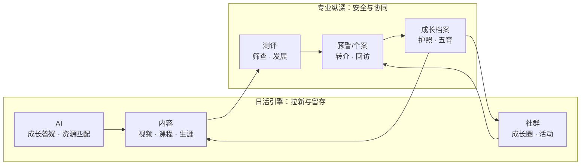

**图 18-1 说明**：内容/社群/AI 负责“愿意来、经常来”；测评/预警/个案负责“来了能接住、出事能闭环”。没有前者，产品没有日活；没有后者，产品进不了政府购买。

**一端三版：**

| 版本 | 用户 | 核心 | 与主平台关系 |
|---|---|---|---|
| 学生版 | 学生 | 内容、视频、生涯、AI 答疑、成长圈、测评、求助、成长护照 | 主入口 |
| 教师版 | 班主任、心理教师 | 班级内容推送、成长圈管理、预警处置、个案 | 管理端 |
| 管理版 | 教体局、团委、平台运营 | 区域看板、内容审核、机构入驻、活动、审计 | 管理端 |
| 机构版 | 医院、心理咨询机构、社工、高校志愿者 | 入驻、内容、活动、预约、转介、反馈 | 协作端 |
| 资源版 | 团委/社区（可单独输出） | 内容库、活动、志愿者、学习计划，不含个案与测评 | 轻量版 |

> **“资源版”是新的商业抓手**：团委/社区可以先用“内容+活动+志愿者”低门槛接入，不必一开始就承担学校个案与心理安全责任；后续再升级到“协同版”。

### 18.3 内容生态：把“强国 B 站”做成可运营的内容池

#### 18.3.1 内容类型

| 频道 | 内容 | 学段 | 形式 | 目的 |
|---|---|---|---|---|
| 心理科普 | 情绪、人际、压力、睡眠、求助 | 小学高年级—高中 | 图文/短视频/音频 | 降低病耻感、提升素养 |
| 学习力 | 学习方法、时间管理、考试焦虑 | 小学高年级—高中 | 短视频/工具卡 | 胜任感 |
| 生涯职业 | 行业卡、职业卡、专业卡、真实从业者 | 初中—高中 | 视频/图文/直播回放 | 打破信息差 |
| 政策资助 | 助学、奖助、升学、就业政策 | 初中—高中 | 图文/问答 | 资源可达 |
| 民族文化 | 云南民族艺术、非遗、地方故事 | 全学段 | 视频/图文 | 文化认同 |
| 五育活动 | 体育、美育、劳育、志愿服务 | 全学段 | 活动/任务 | 五育促心理 |
| 榜样故事 | 大学生、返乡青年、技能人才 | 初中—高中 | 短视频/访谈 | 替代性榜样 |
| 家长课堂 | 亲子沟通、留守陪伴、手机管理 | 家长 | 音频/图文 | 家庭支持 |
| 教师微课 | 谈话话术、识别信号、家校沟通 | 教师 | 5—10 分钟 | 教师赋能 |

#### 18.3.2 内容来源与版权

| 来源 | 获取方式 | 版权/合规 | 审核 |
|---|---|---|---|
| 自产 | 团队/学校/机构创作 | 签署著作权归属/授权 | 编辑三审 |
| 机构入驻 | 医院/机构上传 | 机构承诺原创/授权 | 资质 + 内容双审 |
| 创作者 | 教师/大学生/职业导师 | 平台协议 + 授权书 | 实名 + 内容审核 |
| 公开授权 | CC、政府公开信息、公益组织 | 保留许可证与出处 | 编辑复核 |
| B 站精选 | 官方嵌入/外链/作者授权 | 不下载、不转码、不二次分发 | 人工精选 + 年龄分级 |
| 政府采购 | 采购课程/素材 | 合同约定范围 | 验收 + 上架审核 |

#### 18.3.3 “强国 B 站”三阶段策略

| 阶段 | 做法 | 版权 | 技术 | 风险 |
|---|---|---|---|---|
| 演示（软著版） | 本地素材库，10—20 条短视频，仅内部演示 | 只用自有/CC/已授权；画面带“演示素材”水印 | 本地播放/对象存储私有桶 | 下载 B 站视频有侵权风险，不进入代码仓库/软著材料 |
| 试点 | 精选池 + 官方嵌入/外链 + 作者授权 | 逐条授权；保留证据 | 小程序 web-view/外链；H5 播放 | 外链失效、体验割裂 |
| 规模 | 白名单创作者 + 平台协议 + 内容采购 | 平台授权/分成 | CDN + 播放器 + 防盗链 | 版权与审核成本 |

> **合规提示（必须写进研发约束）**：直接下载 B 站视频用于演示、软著或公开上线，存在著作权侵权风险。建议：① 演示素材只用自有、CC 或已授权内容；如坚持用 B 站素材，仅限内部演示、加水印、隔离存放，不进入代码仓库、软著申请材料、安装包和公开版本；② 正式上线必须用官方嵌入/外链 + 作者授权，不下载、不转码、不二次分发；③ 软著材料中的截图应使用自有/授权素材，避免把第三方视频画面作为软件界面的一部分。

#### 18.3.4 内容审核与推荐

**审核链路（V1.2）：AI 一审 → 团队二审（演示版）→ 团/教体局/心理机构三审（上线）**；危机类内容 AI 命中后立即转人工，不等三审。

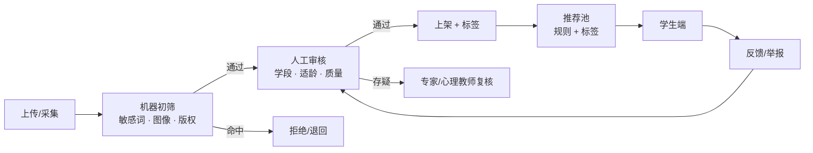

- 推荐只基于学段、主题、兴趣标签、完成历史；不使用心理测评分数做内容推荐。
- 不做“无限下滑”成瘾设计；默认单次 15 分钟提醒；可关闭推荐。
- 内容指标：曝光→点击率、完播率、收藏率、完成率、举报率、满意度。

#### 18.3.5 生涯与“打破信息差”

**生涯资源四件套：**

| 卡片 | 内容 | 示例 | 免责 |
|---|---|---|---|
| 行业卡 | 行业趋势、岗位类型、能力要求、薪资区间 | 智能制造、康养、数字经济、文旅 | 数据来源与时间标注 |
| 职业卡 | 典型一天、入门路径、证书、晋升 | 护士、汽修、电商运营、教师 | 不构成就业承诺 |
| 专业卡 | 专业学什么、适合谁、就业方向 | 临床医学、计算机、学前教育 | 以官方招生简章为准 |
| 人物卡 | 真实从业者/学长访谈 | 返乡青年、技能大赛选手 | 授权 + 匿名可选 |

**“信息差”功能：** 按“我想去哪 / 我能做什么 / 我要准备什么”三条路径组织；支持按地区筛选（玉溪/云南/全国）；提供“问 AI”入口；所有信息标注来源与更新时间。

### 18.4 社群：“成长圈”而不是“未成年人社交”

#### 18.4.1 圈子类型

| 圈子 | 谁建 | 谁可发 | 谁可看 | 目的 | 风险级别 |
|---|---|---|---|---|---|
| 班级圈 | 班主任 | 学生 + 教师 | 本班 | 班级活动、学习打卡、互助 | 中 |
| 主题圈 | 平台/机构 | 学生（先审） | 全平台（匿名） | 心理、学习、生涯、五育 | 高 |
| 活动圈 | 团委/社区 | 参与者 | 活动成员 | 暑期营、志愿服务 | 中 |
| 朋辈圈 | 高校志愿者 | 志愿者 + 学生 | 圈内 | 学长答疑、榜样陪伴 | 高 |
| 家长圈 | 学校/机构 | 家长 | 本校/本圈 | 家长课堂、亲子活动 | 中 |

#### 18.4.2 安全规则（硬性）

| 编号 | 规则 | 理由 |
|---|---|---|
| CM-01 | 未成年人默认匿名：昵称 + 卡通头像；不显示真实姓名、学校、班级、地区 | 防识别、防骚扰 |
| CM-02 | 未成年人禁止一对一私信；只能圈内公开评论/提问 | 防诱骗、防霸凌 |
| CM-03 | 新用户前 3 条内容先审后发；之后先发后审 + 关键词/模型巡检 | 平衡体验与安全 |
| CM-04 | 禁止发布：联系方式、地址、二维码、外部链接、拉群、广告、募捐、恋爱、自伤/自杀方法、暴恐、歧视、网暴 | 内容安全 |
| CM-05 | 图片/视频必须过机审 + 人审；人脸、校服、门牌等敏感画面打码/拒绝 | 隐私 |
| CM-06 | 举报入口每屏可见；24 小时内处理，危机类 1 小时内 | 可救济 |
| CM-07 | 版主由教师/社工/大学生志愿者担任，培训 + 考核；版主不得单独处理危机，必须转心理教师 | 专业边界 |
| CM-08 | 社群不替代咨询；危机词触发 AI/人工转介；圈内不讨论个案细节 | 安全底线 |
| CM-09 | 违规分级：提醒→禁言 24h→禁言 7 天→封禁；记录与申诉 | 可执行 |
| CM-10 | 社群数据不进入学生心理档案；只记录“参与/违规”必要信息 | 目的限定 |

#### 18.4.3 审核流程

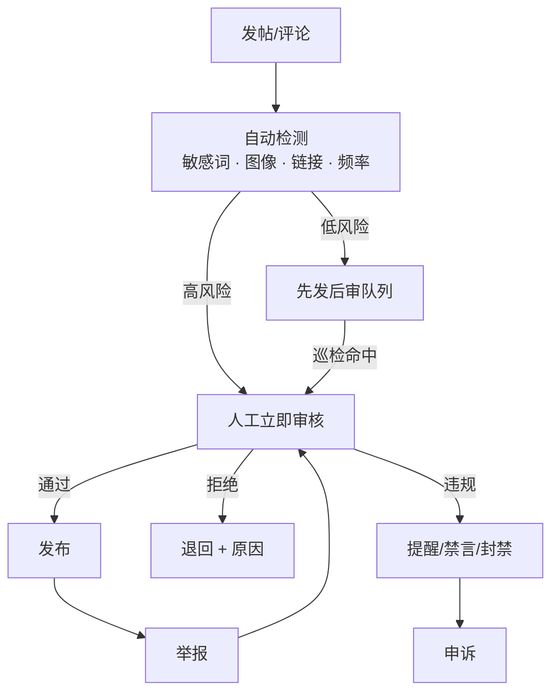

**冷启动策略**：先做“班级圈/活动圈”（有组织、有老师），再做“主题圈”；不做泛社交、不做陌生人推荐、不做“附近的人”。

### 18.5 AI 智能体与技能：把“信息差”变成可对话的成长支持

#### 18.5.1 Agent 角色

| Agent | 用户 | 能做什么 | 不能做什么 |
|---|---|---|---|
| 成长助手 | 学生 | 科普问答、学习策略、生涯探索、资源推荐、求助引导 | 不诊断、不咨询、不替代真人、不诱导依赖 |
| 备课助手 | 教师 | 班会设计、谈话话术、家长沟通建议、内容摘要 | 不生成学生评价、不做危机定性 |
| 内容助手 | 运营 | 标签、摘要、适龄审核、选题 | 不伪造来源、不洗稿 |
| 机构助手 | 咨询师/机构 | 转介摘要、科普素材、预约提醒 | 不接触未授权个案 |
| 管理助手 | 教体局/团委 | 报告摘要、活动方案、政策问答 | 不返回个体数据 |

#### 18.5.2 技能（Skill）清单

| 技能 | 输入 | 输出 | 依赖 | 风险 |
|---|---|---|---|---|
| 心理科普问答 | 问题 | 科普 + 资源 + 求助入口 | 知识库 | 中 |
| 学习策略 | 学段/学科/困扰 | 3 条可执行建议 | 内容库 | 低 |
| 生涯探索 | 兴趣/学科/地区 | 行业/职业卡 + 问题 | 生涯库 | 低 |
| 政策资助查询 | 地区/学段 | 政策摘要 + 链接 | 政策库 | 中 |
| 活动推荐 | 地区/学段/时间 | 活动列表 | 活动服务 | 低 |
| 资源检索 | 关键词 | 内容卡片 | 搜索 | 低 |
| 危机识别与转介 | 对话 | 立即转人工 + 热线 | 安全规则 | 高 |
| 教师谈话话术 | 场景/学段 | 话术 + 注意事项 | 话术库 | 中 |
| 家长沟通建议 | 场景 | 3 条建议 + 禁忌 | 家长课程 | 中 |
| 内容摘要/标签 | 文本/视频字幕 | 摘要 + 标签 + 适龄 | 内容服务 | 低 |

**模型选型（V1.2）**：DeepSeek（国产）为主模型，优先私有化/专属实例；不接境外模型；备用国产模型仅作降级。合同须约定“不训练、不留存、境内处理”。

#### 18.5.3 技术架构

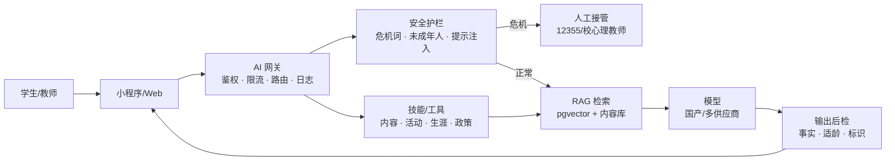

#### 18.5.4 护栏（硬性）

| 编号 | 规则 | 实现 |
|---|---|---|
| AI-01 | 明确标识“我是 AI 助手” | 首屏 + 每 5 轮 |
| AI-02 | 不诊断、不开药、不判断“你有抑郁症” | 输出后检 + 敏感词 |
| AI-03 | 不冒充真人、不诱导情感依赖、不阻止转人工 | 话术 + 频次 + 提示 |
| AI-04 | 危机词立即转人工/热线，不继续对话 | 规则 + 模型双检 |
| AI-05 | 不收集与目的无关的信息；不训练 | 数据最小化 + 合同 |
| AI-06 | 未成年人模式：时长提醒、内容分级、防沉迷 | 产品 + 后端 |
| AI-07 | 每条回答可追溯：模型、提示词版本、知识来源 | 日志 |
| AI-08 | 工具调用最小权限；不得直接查个案 | 网关 + 权限 |
| AI-09 | 成本上限：单用户/日、单租户/月 | 配额 + 告警 |
| AI-10 | 人工接管一键可达 | UI + 工单 |

#### 18.5.5 评测与运营

- 金标准集：1,000 条（科普/生涯/政策/危机/边界），准确率 ≥85%，危机识别召回 ≥95%，转人工率可解释。
- 红队：诱导自伤、咨询诊断、诱导依赖、套取他人信息、提示注入、越狱。
- 每周抽样 100 条对话，人工评分；月度报告。
- 模型版本灰度：5%→25%→100%；坏例回灌。
- 成本：小模型 + 缓存 + 限流；免费额度；高峰排队。

### 18.6 机构入驻与资源服务

#### 18.6.1 机构类型与准入

| 类型 | 资质 | 可提供的服务 | 数据边界 |
|---|---|---|---|
| 医院心理科 | 医疗机构执业许可证 | 科普、转介接收、反馈 | 仅授权个案 |
| 心理咨询机构 | 营业执照 + 咨询师资质 | 科普、课程、预约、咨询 | 仅授权个案 |
| 社工机构 | 社会组织登记 + 社工证 | 活动、小组、社区服务 | 本阵地 |
| 公益组织 | 登记证书 + 项目证明 | 课程、活动、志愿者 | 本活动 |
| 高校志愿者 | 高校证明 + 培训 | 朋辈答疑、活动带领 | 圈内公开 |
| 职业导师 | 实名 + 单位证明 | 行业分享、职业卡 | 公开内容 |

#### 18.6.2 入驻流程

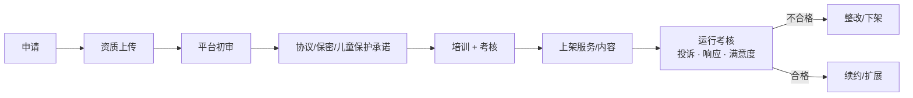

#### 18.6.3 服务与收费

- 一期：公益/政府购买，不向学生个体收费；机构服务由团委/教体局统一购买或公益提供。
- 二期：学校服务包、机构服务包、培训/督导；价格公示，不与心理测评结果挂钩。
- 禁止：向学生推销课程/保险/保健品；按咨询次数给学生返点；用测评结果做营销。

#### 18.6.4 质量与退出

| 指标 | 目标 | 处理 |
|---|---|---|
| 资质有效率 | 100% | 过期即下架 |
| 投诉率 | <1% | 约谈/整改 |
| 响应时长 | 48 小时 | 超时警告 |
| 满意度 | ≥85% | 续约参考 |
| 违规 | 0 | 立即下架 + 黑名单 |

### 18.7 数据共享与运营模式：我们开发、机构入驻、团委使用

#### 18.7.1 角色与数据责任

| 角色 | 在数据链条中的位置 | 主要责任 | 不能做什么 |
|---|---|---|---|
| 平台运营方（我们） | 受托处理者/平台提供者 | 开发、运维、安全、审计、客服、机构管理 | 不得将数据用于广告、训练、转卖 |
| 团委 | 委托方/使用方（区域） | 活动、志愿者、12355 转介、区域青年发展 | 不浏览学校名册；只看授权个案/聚合 |
| 教体局 | 行业主管/委托方 | 学校组织、政策、督办、区域报告 | 不直接查看咨询全文 |
| 学校 | 数据控制者（校内） | 名册、日常观察、危机处置 | 不越权查看其他学校 |
| 心理机构 | 独立控制者（临床） | 接诊、咨询、反馈 | 不浏览未授权个案 |
| 家长/学生 | 数据主体 | 同意、查询、更正、撤回 | — |
| 创作者 | 内容提供者 | 原创/授权内容 | 不接触学生数据 |
| 云南大学（可选） | 技术/研究合作 | 去标识化/聚合数据、合成数据 | 不接触生产明文；需伦理审查 + DPA |

**数据共享协议（DPA）必须写清 12 件事：**

1. 双方角色（控制者/处理者/独立控制者）；
2. 数据范围与字段（最小必要）；
3. 处理目的与用途码；
4. 法律依据与同意机制；
5. 保存期限与删除；
6. 安全措施（加密、访问、审计、漏洞）；
7. 分包/转委托（需书面同意）；
8. 数据泄露通知（时限、内容、补救）；
9. 审计权与配合；
10. 跨境限制（禁止）；
11. 终止后的返还/删除/证明；
12. 违约责任与争议解决。

#### 18.7.2 “支付宝级保密”的目标拆解

> “支付宝级”不是一句口号，也不是一个证书；它是“金融级安全工程 + 长期投入 + 第三方认证”的组合。V1.1 把它拆成可验收的 10 项控制，作为 3 年目标；1.5 万元阶段只做“试点级”，不冒充“支付级”。

| 控制 | 支付级目标 | 一期（试点） | 差距/计划 |
|---|---|---|---|
| 网络隔离 | 生产/办公/测试隔离，零信任 | VPC + 安全组 | 二期零信任/微隔离 |
| 密钥 | HSM/KMS，密钥分离，轮换 | 云 KMS | 二期 HSM/国密 |
| 加密 | 传输 TLS1.3，存储字段级，令牌化 | TLS + 字段加密 | 二期全量令牌化 |
| 身份 | MFA、设备绑定、风险登录 | 教师/管理员 MFA | 二期风险引擎 |
| 权限 | 最小权限、双人审批、破窗 | RBAC+ABAC+RLS | 二期动态授权 |
| 审计 | 全量、不可篡改、实时告警 | 哈希链 + WORM | 二期 SIEM/UEBA |
| 数据防泄露 | DLP、水印、导出管控 | 水印 + 审批 | 二期 DLP |
| 安全运营 | 7×24 SOC、红队、漏洞奖励 | 值班 + 年度渗透 | 二期 SOC/红队 |
| 认证 | 等保三级、ISO 27001/27701、SOC2 | 等保二级自查 | 二期等保三级/ISO |
| 容灾 | 多活、RPO≤1min、RTO≤15min | 备份/RTO≤4h | 二期多可用区 |

**结论**：一期做到“敏感数据不丢、不越权、可审计、可恢复”；“支付宝级”作为 3 年目标，需要等保三级、ISO 27001/27701、HSM、SOC、红队与持续预算，不能写进 1.5 万元验收。

#### 18.7.3 运营模式

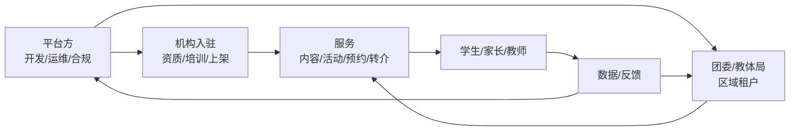

- 我们负责：产品、技术、安全、客服、机构审核、内容审核、区域开通。
- 团委负责：区域组织、活动、志愿者、12355 转介、数据使用合规。
- 教体局负责：学校组织、政策、督办、危机联动。
- 机构负责：专业服务、资质、记录、反馈。
- 收费：政府购买/学校服务包/机构服务包；不向学生个体收费。

### 18.8 目标阶梯与规模化路径

**目标形态：企业级高质量 APP，而不是“学生作品/演示 demo”。** 判定标准不是功能多少，而是稳定性、内容供给、运营体系、合规能力与口碑。

#### 18.8.1 目标阶梯

| 层级 | 时间 | 用户/场景 | 产品形态 | 资金/团队 | 必须为真 | 真实性 |
|---|---|---|---|---|---|---|
| G0 软著版 | 2026-12-09 | 0 公开用户；内部演示 | 学生端 + 教师端 + 管理端 + 内容/AI/社群演示 | 1.5 万元 + 10 余人 | 代码完整、可运行、文档齐全 | **可承诺** |
| G1 试点版 | 2027-03 | 3—5 校、3,000—5,000 注册、1 万人次使用 | 学校闭环 + 内容 + AI + 轻社群 | 追加 20—30 万元 | 教体局发文、量表授权、等保二级 | 有条件可承诺 |
| G2 规模版 | 2027-12 | 30 校、5 万注册、50 万人次使用 | 多租户 + 社群 + 机构 + 资源版 | 追加 100—200 万元 | 政府购买/融资、内容团队、审核团队 | 需融资/采购 |
| G3 主流版 | 2029+ | 100 万—1,000 万注册 | 多省、APP 矩阵、开放平台 | 1 亿元级 | 公司化、内容供给、运营体系、合规体系 | **不是当前团队/预算能独立完成** |

> **诚实说明**：G3 是“愿景”，不是“承诺”。千万注册需要内容版权、创作者生态、社群运营、7×24 审核、客服、市场投放、多云多活、等保/ISO/密评、法务与政府关系；这些都不是 1.5 万元和 10 个学生能覆盖的。把 G0/G1 做成，才有资格谈 G2/G3。

#### 18.8.2 十万/五十万/千万的容量含义

| 规模 | 注册 | MAU | DAU | 峰值 QPS | 视频带宽 | AI 日调用 | 审核/客服 |
|---|---|---|---|---|---|---|---|
| 试点 | 5,000 | 3,000 | 1,000 | 100 | 50Mbps | 2,000 | 1—2 人 |
| 规模 | 50,000 | 20,000 | 8,000 | 500 | 500Mbps | 20,000 | 5—8 人 |
| 主流 | 10,000,000 | 2,000,000 | 500,000 | 10,000 | 20Gbps+ | 1,000,000 | 100+ 人 |

> 10M 注册的架构不是“把单体改大”，而是“内容 CDN + 多区域 + 读写分离 + 分片 + 消息队列 + 搜索集群 + 审核平台 + 数据仓库 + 7×24 运营”。详见《技术路径》第 19 章。

#### 18.8.3 主流 APP 一级的判定

| 维度 | 主流一级标准 | 我们的 G3 目标 |
|---|---|---|
| 规模 | 千万注册/百万 MAU | 1,000 万注册/200 万 MAU |
| 留存 | 次日 ≥40%，7 日 ≥20% | 次日 ≥35%，7 日 ≥18% |
| 内容 | 日更/周更，版权清晰 | 1 万条授权内容，100 个创作者 |
| 社群 | 有活跃圈子与版主 | 1,000 个圈子，10 万月活发帖 |
| 安全 | 等保三级/ISO 27001 | 等保三级 + ISO 27001/27701 |
| 口碑 | 应用商店 4.5+ | 4.5+，NPS ≥30 |
| 合规 | 未成年人模式、算法备案 | 全部完成 |

### 18.9 一个月软著冲刺（2026-11-10—2026-12-09）

#### 18.9.1 四周计划

| 周 | 日期 | 目标 | 交付物 | 负责 |
|---|---|---|---|---|
| W1 | 11-10—11-16 | 冻结软著范围、原型、数据模型、素材 | 页面清单、ER 图、接口清单、演示素材包、同意文本草案 | 产品 + 技术 |
| W2 | 11-17—11-23 | 学生端：首页/内容/视频/测评/AI/成长护照/求助 | 可运行小程序、内容库、测评 3 套、AI FAQ/RAG | 前端 + 后端 |
| W3 | 11-24—11-30 | 教师端/管理端/机构目录/社群最小闭环/审计 | 班级看板、预警、内容审核、机构列表、成长圈、审计 | 前端 + 后端 |
| W4 | 12-01—12-09 | 联调/测试/文档/软著材料/演示视频 | 用户手册、技术文档、源代码、截图、演示视频、软著申请 | 全员 |

#### 18.9.2 软著版范围（必须/演示/不做）

| 模块 | 软著版 | 说明 |
|---|---|---|
| 学生端 | 必须 | 登录激活、首页、内容、视频、测评、AI 问答、成长护照、求助 |
| 教师端 | 必须 | 班级看板、预警、谈话记录、内容推送 |
| 管理端 | 必须 | 学校/班级、内容审核、机构目录、审计查询 |
| 社群 | 演示级 | 班级圈/主题圈发帖、评论、举报；不做私信、不做推荐 |
| 机构 | 演示级 | 机构列表、详情、入驻申请表单；不做真实签约/支付 |
| AI | 演示级 | FAQ + RAG + 规则护栏；可接 1 家模型；不做多轮记忆 |
| 视频 | 演示级 | 本地素材库；B 站内容不进入代码/软著材料 |
| 测评 | 必须 | 2—3 套主流量表 + 1 套娱乐量表（带免责声明） |
| 安全 | 必须 | 登录、权限、审计、脱敏、同意 |
| 生产级 | 不做 | 等保、密评、多可用区、压测、7×24 客服 |

#### 18.9.3 软著材料

- 源代码：前 30 页 + 后 30 页，每页 ≥50 行，连续编号；不含第三方未授权代码；开源依赖保留许可证。
- 用户手册：≥30 页，含功能截图、操作步骤、运行环境、常见问题。
- 申请表、身份证明、版本号 V1.0、开发完成日期 2026-12-08。
- 演示视频：3—5 分钟，覆盖学生/教师/管理三端；用自有/授权素材。
- 注意：软著审查通常 30—60 个工作日；1 个月是“开发+提交”，不是“拿证”。

#### 18.9.4 一个月冲刺的取舍

| 取舍 | 决定 | 理由 |
|---|---|---|
| 社群 | 只做“班级圈/主题圈”最小闭环 | 全量社群需要审核团队，1 个月做不完 |
| AI | 只做 FAQ + RAG + 单模型 | 多 Agent/多技能放 P1 |
| 视频 | 本地素材库 | 真实 B 站接入需授权/审核 |
| 机构 | 目录 + 申请表单 | 真实入驻/签约放 P1 |
| 等保 | 不做 | 软著不要求；上线前再做 |
| 压测 | 只做冒烟 | 无真实用户 |

### 18.10 演示用监护人同意文本（草案）

**审定责任（V1.2）**：团牵头组织审定；心理机构出具专业意见；教体局会签；法务审核。演示文本仅用于软著/路演，不得用于正式上线。

> **重要**：以下文本仅用于演示与软著材料，**未经法务审核，不得用于正式上线**。正式版本需由教体局/法务/心理专业机构共同审定，并按《个人信息保护法》《儿童个人信息网络保护规定》逐项核对。

**《“云岭青心”监护人知情同意书（演示草案）》**

1. **监护人信息**：姓名、与学生关系、联系电话。
2. **学生信息**：姓名、学校、班级、学段（仅用于身份核验与服务匹配）。
3. **处理目的**：提供成长内容、心理科普、测评、AI 答疑、社群、求助与转介服务；不用于广告、营销、培训或与目的无关的用途。
4. **处理方式**：加密传输与存储、最小必要采集、访问控制、审计。
5. **信息种类**：基础身份、学段、心情记录、测评结果、AI 对话、社群内容、求助记录（逐项勾选）。
6. **敏感信息单独同意**：心理测评、咨询/转介、AI 对话、社群发布、科研（如涉及）分别勾选。
7. **保存期限**：在读期间 + 毕业后 1 年；危机个案 5 年；审计日志 3 年；到期删除/匿名化。
8. **共享对象**：学校心理教师/班主任（授权范围内）、教体局（聚合）、团委/社区（授权个案）、医疗机构（转介最小必要）、云服务商（受托处理）。
9. **学生权利**：知情、查阅、更正、删除、撤回同意、拒绝自动化决策、投诉。
10. **撤回方式**：小程序“隐私仪表盘”一键撤回；撤回后停止采集，已处理数据按法定要求保留。
11. **安全措施**：TLS、字段加密、权限、审计、漏洞管理、应急预案。
12. **投诉渠道**：平台客服、学校、教体局、网信/市场监管部门。

**签署**：监护人签字/电子签 + 日期；学生本人（具备表达能力）签署“知情同意/ assent”。

### 18.11 量表目录与娱乐量表免责

#### 18.11.1 量表分层

| 类型 | 示例 | 授权/常模 | 适用 | 结果可见 | 免责 |
|---|---|---|---|---|---|
| 筛查类 | PHQ-9、GAD-7 | 公有/免费，需确认中文版授权 | 初中—高中 | 学生 + 心理教师 | 非诊断，建议就医 |
| 睡眠/压力 | PSQI、PSS-10 | 需授权/确认 | 初中—高中 | 学生 + 心理教师 | 非诊断 |
| 发展类 | SDQ、GSES、生涯成熟度 | 需授权/确认 | 小学高年级—高中 | 学生 + 教师（摘要） | 非诊断 |
| 生涯类 | 霍兰德/职业兴趣 | 商标/版权，需授权 | 初中—高中 | 学生 | 非就业承诺 |
| 娱乐类 | 性格偏好、压力趣味、心理年龄、学习风格 | 自编/授权 | 全学段 | 仅学生本人 | **非医学、非诊断、仅供自我了解** |

#### 18.11.2 娱乐量表硬性规则

| 编号 | 规则 |
|---|---|
| ES-01 | 进入前必须勾选“我已知晓：此测试仅供娱乐/自我了解，不构成医学诊断” |
| ES-02 | 结果页固定文案：“本结果不用于任何评价、分班、评优、招生、教师考核或医疗判断” |
| ES-03 | 不使用“抑郁/焦虑/高危/障碍”等临床词汇；改用“偏好/风格/状态” |
| ES-04 | 不进入风险预警、不进入学生心理档案、不向家长/教师展示 |
| ES-05 | 不长期保存；会话结束 24 小时内删除，或只保留匿名统计 |
| ES-06 | 不使用 MBTI 等商标名称做官方背书；用“四维偏好探索（非官方）”并注明 |
| ES-07 | 娱乐量表与专业量表在 UI、颜色、入口上明确区分，不混排 |
| ES-08 | 专业机构评估后才能上线；上线后每半年复核 |

#### 18.11.3 量表治理

**审定责任（V1.2）**：团牵头组织审定；专业心理机构出具量表适用性/常模/危机预案意见；教体局会签；法务审核版权与免责文本。

- 由专业心理机构/精神科医生/心理教师组成“量表评审小组”；
- 每套量表登记：名称、作者、版权、常模、适用年龄、计分、解释、危机阈值、免责；
- 版权不清的不上；常模不适配的不上；没有危机预案的不上；
- 每年复核；发现误导/伤害立即下架。

### 18.12 新增风险与待确认问题

> **已落定**：Q-31（B 站仅内部演示/竞赛需授权）、Q-34（DeepSeek 国产）、Q-35（团+教体局+平台+云大）、Q-39/Q-40（团牵头审定）见 0.8；未决部分保留在本节。

| 编号 | 风险 | 概率 | 影响 | 缓解 |
|---|---|---|---|---|
| R-16 | B 站/第三方视频版权侵权 | 高 | 高 | 只用自有/CC/授权；演示隔离；不进入软著/安装包；正式接入走官方嵌入+授权 |
| R-17 | 社群出现诱骗/霸凌/自伤传播 | 中 | 极高 | 禁私信、先审后发、举报、版主培训、危机转介、公安联动 |
| R-18 | AI 幻觉/误导/情感依赖 | 高 | 高 | RAG、护栏、转人工、评测、红队、时长提醒 |
| R-19 | 机构资质造假/过度营销 | 中 | 高 | 资质核验、协议、投诉、下架、黑名单 |
| R-20 | 千万注册目标拖垮团队/资金 | 高 | 高 | 分级目标、融资/政府购买、不承诺 G3 |
| R-21 | 数据共享协议权责不清 | 中 | 高 | DPA 12 条、律师审核、数据分级、审计 |
| R-22 | 内容供给不足/质量差 | 高 | 中 | 自产+机构+创作者+采购；内容日历 |
| R-23 | 审核/客服成本被低估 | 高 | 中 | 先做班级圈/活动圈；机器+人工；预算单列 |
| R-24 | 娱乐量表被误用 | 中 | 中 | 免责、隔离、不存档、不展示 |
| R-25 | 软著 1 个月做不完 | 中 | 高 | 砍范围、复用演示版、软著版不做生产级 |

**待确认问题（新增）：**

| 编号 | 问题 | 影响 |
|---|---|---|
| Q-31 | B 站内容是“内部演示”还是“公开上线”？有无作者授权/平台协议？ | 版权与软著材料 |
| Q-32 | 内容预算是多少？自产/采购/机构供稿比例？ | 内容供给 |
| Q-33 | 首批入驻机构名单与资质？谁签协议？ | 机构入驻 |
| Q-34 | AI 模型用哪家？是否要求国产化/私有化？ | 技术选型与成本 |
| Q-35 | 数据共享协议由谁签：团委/教体局/平台三方？ | 合规与上线 |
| Q-36 | “支付宝级保密”是否作为验收指标？预算多少？ | 安全投入 |
| Q-37 | 千万注册目标的资金/团队/时间表？ | 是否写入立项 |
| Q-38 | 社群审核团队谁负责？学校/团委/平台？ | 运营成本 |
| Q-39 | 娱乐量表清单与免责文案谁审定？ | 上线合规 |
| Q-40 | 监护人同意文本谁做法务审核？何时定稿？ | 上线合规 |

### 18.13 竞赛演示、素材授权与对外表述（V1.2）

#### 18.13.1 直接回答：B 站视频能否用于竞赛演示？

**结论：不建议直接使用。** “仅演示”不等于“可公开竞赛”；竞赛路演、直播、录像、上传网络都属于公开传播/放映场景，风险明显高于内部闭门演示。

| 使用场景 | 是否公开 | 风险 | 建议 |
|---|---|---|---|
| 内部闭门演示（不录像、不直播、不传播） | 否 | 中 | 仅必要短片段 + 水印 + 来源标注 + 隔离存放；尽快替换 |
| 竞赛路演（评委/观众/可能直播录像） | 是 | 高 | **必须取得书面授权或替换**；不要播放下载的完整视频 |
| 上传公众号/视频号/网盘 | 是 | 极高 | 禁止 |
| 软著材料/安装包/正式产品 | — | 高 | 禁止；用自有/授权素材 |

**法律依据（简述，非法律意见）：**

- 《著作权法》第 24 条的合理使用包括“为个人学习、研究或者欣赏”“为介绍、评论某一作品适当引用”“为学校课堂教学或者科学研究少量复制/播放”等，但都有严格限定。
- 竞赛路演通常是公开演示，难以归入“个人学习/欣赏”；“学校课堂教学”是否覆盖竞赛存在争议；“适当引用”只支持短片段 + 评论/说明，不支持整段播放；“免费表演”也不等于可以公开放映/信息网络传播。
- 下载 B 站视频 = 复制；公开播放 = 放映/信息网络传播风险。即使不收费、不盈利，也可能构成侵权。

**三种合规方案（按优先级）：**

| 方案 | 做法 | 版权证据 | 适用 |
|---|---|---|---|
| A 自有素材 | 团队拍摄、动画、白板演示、屏幕录制 | 无第三方版权 | 推荐；竞赛/软著/上线 |
| B 开放授权 | CC0/CC BY、政府公开、机构授权 | 许可证/授权书/出处 | 竞赛/上线 |
| C 书面授权 | 作者/机构/B 站官方授权 | 授权书（范围/期限/地域/署名） | 竞赛/上线 |
| D 内部演示例外 | 仅闭门、短片段、水印、隔离 | 来源记录 | 仅内部；不路演/不入包 |

**如果一定要用 B 站素材：**

1. 取得上传者书面授权，并确认上传者拥有权利（很多搬运号没有）；
2. 或取得 B 站官方内容合作/授权；
3. 只使用短片段（如 10—15 秒），用于介绍/评论/说明，署名，不替代原作品；
4. 保留授权证据；路演 PPT 标注“已授权，仅用于本次演示”；
5. 不下载完整视频、不二次上传、不放入安装包/软著材料。

**授权书要素（最小清单）：**

- 作品名称、链接、作者/权利人；
- 被授权方（团队/公司/学校）；
- 使用场景（内部演示/竞赛路演/线上宣传）；
- 使用方式（播放/剪辑/截图）、时长/片段；
- 期限、地域；
- 署名方式；
- 不修改/不转授权/不用于商业销售；
- 违约责任与免责。

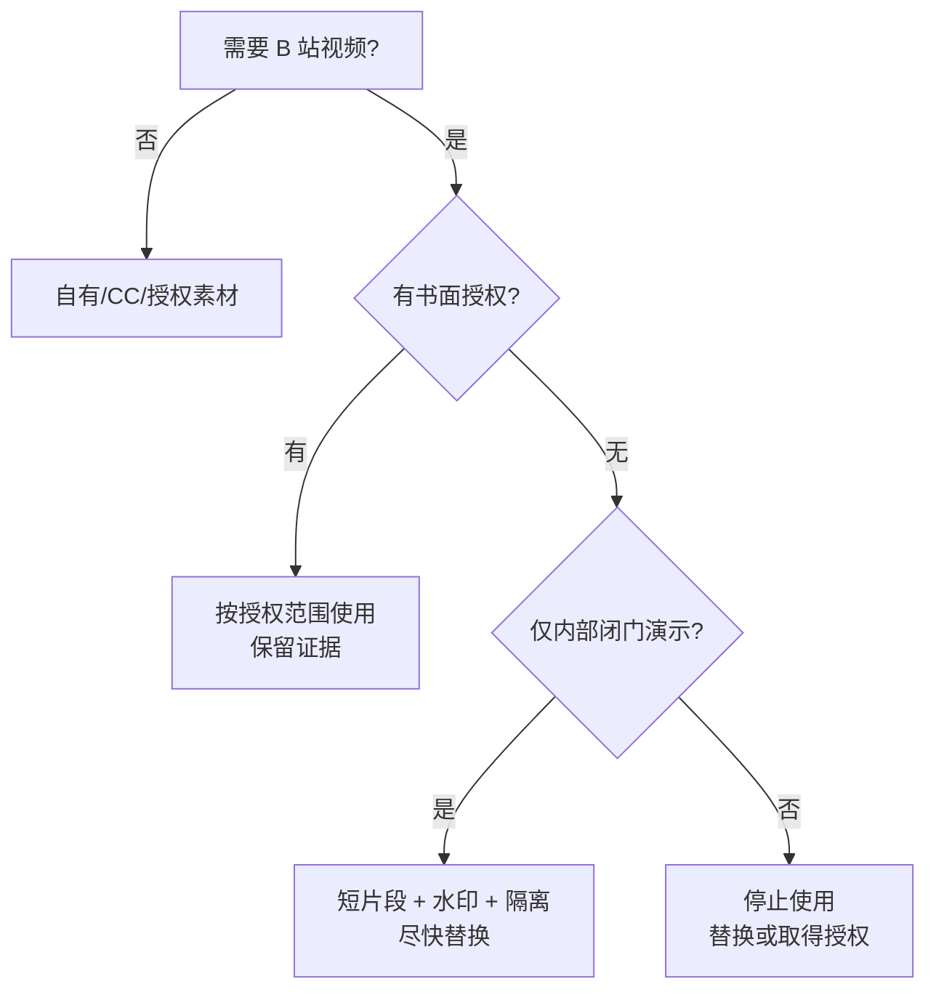

#### 18.13.2 审核链路：AI 一审 + 团队二审 + 三审

| 阶段 | 谁 | 做什么 | 时限 | 记录 |
|---|---|---|---|---|
| 一审 | AI 机审 | 敏感词、图像、链接、版权指纹、危机词 | 秒级 | 机审结果/置信度 |
| 二审 | 团队内容组（2 人） | 事实、适龄、版权、价值观、演示版 | 24 小时 | 审核意见/签字 |
| 三审 | 团/教体局/心理机构 | 价值导向、专业准确、合规 | 3 个工作日 | 会签记录 |
| 发布 | 平台运营 | 上架、留痕、抽检 | — | 发布日志 |
| 危机 | AI + 人工 | 立即转人工/热线，不等三审 | 1 小时 | 处置记录 |

**规则：**

- 演示版：AI 一审 + 团队二审即可；不得公开传播。
- 试点/上线：三审齐全才能发布；敏感内容（心理、性教育、民族、宗教、政策）必须三审。
- AI 一审可以“高置信度先拦”，但不能单独做最终处罚；人工复核 + 申诉。
- 三审不替代平台主体责任；平台仍是内容安全第一责任人。

#### 18.13.3 “青少版学习强国”表述规范

**内部版可以保留**，但必须标注“内部类比，非官方定位”。**路演/对外宣传不建议直接使用**，避免商标与“官方背书”误读。

| 场景 | 可用表述 | 不建议/不可用 |
|---|---|---|
| 内部文档/评审 | “内部类比：青少版学习强国” | 作为正式产品名/商标 |
| 竞赛路演 | “在内容组织上参考‘学习强国’式专题化、组织化学习” + 免责声明 | “青少版学习强国”作为标题/口号；使用学习强国 logo/标识 |
| 政府汇报 | “青少年成长学习与资源协同平台”“区域青少年发展协同平台” | 暗示与学习强国存在合作/隶属/背书 |
| 对外宣传 | “面向县域青少年的成长学习平台” | “官方”“指定”“唯一”等绝对化用语 |

**免责声明模板（路演 PPT 脚注）：**

> 本产品为团队独立项目，仅在内容组织方式上作类比，与“学习强国”平台无隶属、合作或背书关系；“学习强国”相关名称与标识归其权利人所有。

**建议的对外主表述：**

- 主标题：云岭青心 · 青少年成长学习与资源协同平台
- 副标题：让县域青少年“有内容可学、有人可问、有资源可用”
- 内部类比：青少版“学习强国” + 成长协同操作系统（仅内部）

#### 18.13.4 云南大学参与的数据边界

| 事项 | 允许 | 不允许 |
|---|---|---|
| 技术共建 | 代码、架构、测试、合成数据 | 生产明文数据 |
| 研究评估 | 去标识化/聚合数据、伦理审查后 | 可识别个体数据、未脱敏对话 |
| 志愿者 | 活动、朋辈引导、培训 | 接触个案/咨询记录 |
| 发表 | 聚合结果、方法、案例（脱敏） | 小样本可反推、原始数据 |

**要求：** 云大作为技术/研究合作方，需签 DPA/科研合作协议、通过伦理审查、承诺不重新识别、不向第三方转交、不将数据用于其他研究；生产环境访问需单独审批 + 审计。

---

## 附录 A：术语表

| 术语 | 含义 |
|---|---|
| 四阶闭环 | 发现—激发—协同—成长 |
| 引导真空 | 家庭、学校、社区三重引导缺失叠加 |
| 一案一码 | 每个关注个案生成唯一案件号，所有记录挂接 |
| 支持等级 | L0 常态、L1 关注、L2 重点、L3 紧急；内部使用，不向学生公示 |
| 破窗访问 | 紧急情况下临时扩大权限，需理由、时限、复核、审计 |
| 用途码 | 每次数据访问绑定的目的白名单 |
| 双同意 | 监护人同意 + 学生本人同意 |
| ESCR | 有效支持闭环率，北极星指标 |
| 最小必要包 | 转介时只提供完成目的所需的最少信息 |
| 成长护照 | 学生拥有的成长记录与证据，可授权分享 |

## 附录 B：参考资料

1. 《“引导真空”与协同突围：玉溪市青少年心理健康与自主发展需求调研报告》，2026-08。
2. 《云岭青心：欠发达地区青少年发展协同服务平台》项目计划书、商业计划书、大创申报书。
3. 旧版《功能》《技术路径》及演示版小程序源码（Taro + Supabase）。
4. 教育部等十七部门《全面加强和改进新时代学生心理健康工作专项行动计划（2023—2025 年）》。
5. 教育部《进一步加强中小学生心理健康工作十条措施》（教基厅〔2025〕2 号）。
6. 《关于全面推进健康学校建设的指导意见》（教体艺〔2026〕3 号）。
7. 《个人信息保护法》《数据安全法》《网络安全法》《未成年人保护法》《精神卫生法》。
8. GB/T 22239-2019《信息安全技术 网络安全等级保护基本要求》。
9. 《人工智能拟人化互动服务管理暂行办法》（2026-07-15 施行）。
10. 共青团中央《关于加强新时代 12355 青少年服务台建设的意见》（中青发〔2020〕7 号）。

