# 云岭青心 · 青少年发展协同服务平台
## 《技术路径》

| 项目 | 内容 |
|---|---|
| 文档版本 | V1.2（立项评审稿，含内容/社群/AI/竞赛演示决策） |
| 编制日期 | 2026-11-09 |
| 编制角色 | 技术架构组（代拟） |
| 适用阶段 | 立项评审、技术选型、研发交底、等保建设、运维交接 |
| 文档状态 | 待评审；评审通过后作为技术基线冻结 |
| 关联文档 | 《产品说明》V1.0、旧版《技术路径》、演示版小程序源码 |

> **阅读指引**：第 0 章给出 15 个架构决策与旧方案的问题；第 1—4 章是架构与端/后端方案；第 5—9 章是 API、数据、权限与安全；第 10—14 章是审计、可观测、CI/CD、发布与容灾；第 15—18 章是容量、成本、风险与自检。需要快速判断“这套技术能不能撑政府购买”的读者，可只读第 0、9、14、16、17 章。

---

## 0. 评审速览：技术决策一页纸

### 0.1 一句话技术路径

**国内云 + 模块化单体 + PostgreSQL（RLS 兜底）+ 自建 API + 微信小程序/React Web 双端 + 全链路审计。** 一期用最小成本做出可运行、可审计、可复制的闭环；二期按政府购买要求做等保三级、密评、信创适配与多租户；三期再做开放式 AI 与多区域。V1.1—V1.2 增补内容/视频、社群、AI Agent、机构入驻、竞赛演示与千万级演进，见第 19 章。

### 0.2 十八个架构决策（ADR 摘要）

| 编号 | 决策 | 选择 | 主要理由 | 代价/风险 | 重审条件 |
|---|---|---|---|---|---|
| ADR-01 | 后端形态 | 模块化单体（NestJS） | 10 余人团队、1 个月软著、事务一致性、调试简单 | 单点部署、模块边界靠纪律 | 团队 >3 个小组或独立扩容需求出现 |
| ADR-02 | 数据库 | PostgreSQL 16（国内云 RDS） | 关系模型、RLS、JSONB、全文检索、成熟生态 | 需自己做连接池与 RLS 上下文 | 信创强制达梦/金仓时 |
| ADR-03 | 多租户 | 共享库 + tenant_id + RLS | 成本低、开通快、聚合方便 | 隔离靠策略，误配风险高 | 大型租户要求独立库 |
| ADR-04 | 学生/家长端 | Taro 4 + React + TS 微信小程序 | 复用演示版代码、团队熟悉、触达成本低 | 微信审核、包体限制、离线弱 | 需要原生推送/离线/鸿蒙 |
| ADR-05 | 教师/管理端 | React 18 + Ant Design Pro + Vite | 表格/表单/权限成熟、桌面体验好 | 与小程序两套代码 | 需要统一设计系统时 |
| ADR-06 | 权限 | RBAC + ABAC + 数据域 + 目的码 + RLS | 细粒度、可审计、可解释 | 策略复杂、测试成本高 | 权限模型成为瓶颈 |
| ADR-07 | 消息 | BullMQ + Outbox | 无需额外中间件、够用 | 吞吐有限、无跨机房 | 日均 >100 万消息 |
| ADR-08 | 搜索 | PostgreSQL 全文 + pg_trgm | 零额外组件、内容量小 | 中文分词弱 | 内容 >10 万条 |
| ADR-09 | 文件 | S3 兼容对象存储（私有桶） | 便宜、可移植、签名 URL | 需自己做病毒扫描 | 政务云对象存储不兼容 |
| ADR-10 | 部署 | Docker Compose（MVP）→ Kubernetes（生产） | 低成本起步、可移植 | 单机无高可用 | 政府购买/多校上线 |
| ADR-11 | 可观测 | OpenTelemetry + Prometheus/Grafana/Loki/Sentry | 开源、可私有化、标准化 | 需自建、学习成本 | 托管 APM 更便宜时 |
| ADR-12 | 国密 | 可选双栈（AES + SM4） | 一期不强制密评、二期可切换 | 双栈增加复杂度 | 密评要求明确 |
| ADR-13 | 数据交换 | Excel/SFTP 一期，API 二期 | 学籍接口不开放、落地快 | 手工、时效差 | 接口开放 |
| ADR-14 | 报表 | 只读副本 + 物化视图 + Metabase | 不引数仓、够用 | 复杂分析受限 | 数据量 >1 亿行 |
| ADR-15 | AI | 受控 RAG 助手一期做；开放式陪伴 P2 | AI 是信息差入口；未成年人需护栏/转人工 | 模型成本/合规 | 备案与评测就绪 |
| ADR-16 | 内容/视频 | 对象存储 + CDN + 签名 URL；B 站只嵌入/外链 | 版权与带宽 | CDN 成本/审核 | 内容 >10 万条 |
| ADR-17 | 社群 | 圈内公开 + 先审后发 + 禁私信 | 未成年人安全 | 审核成本/舆情 | 审核团队就绪 |
| ADR-18 | 规模化 | 单体→按需拆；多区域后置 | 不过度设计 | 演进成本 | 50 万用户/多省 |

### 0.3 旧技术路径的五个硬问题（必须替换）

| 问题 | 旧方案 | 为什么不行 | 新方案 |
|---|---|---|---|
| P-01 数据出境/托管 | Supabase 托管 BaaS（演示版，境外） | 未成年人心理数据境内存储要求；等保/密评无法覆盖境外 PaaS；网络时延与可用性不可控 | 国内云 RDS PostgreSQL + 自建 API |
| P-02 权限模型过薄 | 仅靠 RLS + auth.uid | RLS 只能做行级粗粒度；教师/家长/团委/医院的数据域、目的码、字段级可见无法表达 | RBAC + ABAC + 数据域 + 目的码 + RLS 兜底 |
| P-03 审计缺失 | 仅设计“审计表” | 无不可篡改、无导出审批、无破窗、无 SIEM；难以通过等保测评 | 追加式审计 + 哈希链 + WORM + 审批流 |
| P-04 架构过重 | “微前端 + 边缘函数 + AI + 数仓”一次铺开 | 10 余人团队、1 个月软著，做不完也维护不了 | 模块化单体 + 按需演进 |
| P-05 安全与合规靠“声明” | 文档写“国密级加密”“毫秒级触达” | 没有密钥管理、没有国密改造、没有触达兜底；评审追问即难以自证 | 明确 KMS、双栈加密、短信/电话兜底、可验证指标 |

### 0.4 技术目标（可验收）

| 目标 | 一期 | 二期/政府购买 | 验证 |
|---|---|---|---|
| 可运行 | 3—5 校、5,000 用户 | 30 校、3 万用户 | 压测/监控 |
| 可审计 | 关键操作 100% 留痕 | DS3/DS4 读取 100% 留痕 | 审计抽样 |
| 可移植 | Docker Compose 一键部署 | K8s/政务云/私有化 | 部署演练 |
| 可合规 | 等保二级自查 | 等保三级 + 密评 | 测评报告 |
| 可演进 | 模块边界清晰 | 按需拆服务 | ADR/架构评审 |
| 成本 | ≤1.5 万元/2 年 | ≤5 万元/年云资源 | 账单 |

### 0.5 V1.1—V1.2 增补索引

| 主题 | 章节 | 一句话 |
|---|---|---|
| 内容/视频分发 | 19.2 | 对象存储 + CDN + 签名 URL；B 站只嵌入/外链 |
| 社群/内容安全 | 19.3 | 圈内公开、先审后发、禁私信、审核台 |
| AI Agent | 19.4 | AI 网关、RAG、技能、护栏、评测、审计 |
| 机构入驻 | 19.5 | 资质/协议/培训/上架/考核；机构租户 |
| 千万级容量 | 19.6 | 单体→读写分离→服务→多区域；成本量级 |
| 支付级安全 | 19.7 | 10 项控制；3 年目标，不是 1.5 万元承诺 |
| 数据共享 | 19.8 | 租户 + 用途码 + 字段白名单 + DPA |
| 一个月软著 | 19.9 | 演示级范围；素材/代码纪律 |
| 竞赛演示/DeepSeek | 19.11 | 素材隔离、路演环境、国产模型落地 |

### 0.6 本轮已定技术事项（V1.2）

| 编号 | 事项 | 落定 | 技术影响 |
|---|---|---|---|
| TD-1 | B 站素材 | 仅内部演示；路演需授权/替换；上线官方嵌入 | 演示 bucket 隔离；禁止入仓/入包 |
| TD-2 | 审核链路 | AI 一审 + 团队二审 + 团/教体局/心理机构三审 | 审核台状态机、会签、留痕 |
| TD-3 | 模型 | DeepSeek 国产；私有化/专属实例优先 | 模型网关、脱敏、禁训练、降级 |
| TD-4 | 数据共享 | 团 + 教体局 + 平台；云大可选（去标识化） | 租户/用途码/字段白名单/DPA |
| TD-5 | 量表/同意 | 团牵头，心理机构专业意见，教体局会签，法务审核 | 版本化、会签、留痕 |

---

## 1. 架构原则与约束

### 1.1 十条原则

| 编号 | 原则 | 含义 | 反例 |
|---|---|---|---|
| AP-01 | 安全默认 | 默认拒绝、默认脱敏、默认最小采集 | 默认公开学生档案 |
| AP-02 | 目的限定 | 每个请求带用途码，服务端校验 | 管理员“顺便看看” |
| AP-03 | 模块化单体优先 | 先把边界划清，再谈拆分 | 一上来 20 个微服务 |
| AP-04 | 数据境内 | 全部数据、备份、日志在境内 | 境外 BaaS/ CDN |
| AP-05 | 可移植 | 容器、标准 SQL、S3 兼容、避免专有 API | 绑定某家 Serverless |
| AP-06 | 可审计 | 关键动作追加式记录、可校验 | 只记应用日志 |
| AP-07 | 渐进演进 | Strangler Fig，按触发条件拆分 | 为未来而过度设计 |
| AP-08 | 简单优于聪明 | 能用规则不用模型，能用单库不用数仓 | 用 LLM 做风险分级 |
| AP-09 | 成本约束 | 每一层都能用免费/低价替代 | 一上来买全套商业 APM |
| AP-10 | 文档即代码 | ADR、OpenAPI、DDL、Runbook 入库 | 口头架构 |

### 1.2 关键约束

| 约束 | 内容 | 对架构的影响 |
|---|---|---|
| 预算 | 1.5 万元/24 个月 | 单机/单可用区起步；优先开源与托管基础版 |
| 团队 | 10—13 人，学生为主，TypeScript 熟 | 统一 TS 技术栈；避免 Java/Go 双栈 |
| 时间 | 1 个月软著、6 个月试点 | 复用 Taro 演示版；先做闭环 |
| 合规 | 未成年人敏感数据、等保三级目标 | 境内云、审计、加密、权限、体检 |
| 旧系统 | 学籍/普查/12355 接口不确定 | Excel 兜底、适配层 |
| 运维 | 无专职 SRE | 托管服务、自动化、少组件 |
| 终端 | 小程序/Web/平板/弱网/后续鸿蒙 | 双端 + PWA + 后续原生 |

### 1.3 技术选型总表

| 层 | 选择 | 版本 | 备选 | 选择理由 |
|---|---|---|---|---|
| 小程序 | Taro + React + TS | Taro 4.1 / React 18 | uni-app、原生 | 复用演示版、团队熟、多端 |
| Web | React + Ant Design Pro + Vite | React 18 / Vite 5 | Vue + Element Plus | 表格/权限/生态成熟 |
| 状态 | Zustand + TanStack Query | 最新稳定 | Redux Toolkit | 轻量、适合小程序 |
| UI | Tailwind + 自研组件 + Ant Design | — | NutUI、TDesign | 一致性与包体可控 |
| 后端 | NestJS + Fastify | NestJS 11 / Node 22 LTS | Spring Boot、Go | TS 全栈、开发快、模块化 |
| 校验 | Zod | 最新 | class-validator | 类型推断、前后端共享 |
| 数据访问 | Kysely + node-pg-migrate | 最新 | Prisma、TypeORM | 显式 SQL、RLS 友好 |
| 数据库 | PostgreSQL | 16 | MySQL、达梦 | RLS、JSONB、全文、成熟 |
| 缓存 | Redis | 7 | Memcached | 会话、限流、队列 |
| 队列 | BullMQ | 最新 | RabbitMQ、RocketMQ | 与 Redis 复用、够用 |
| 文件 | S3 兼容 OSS/MinIO | — | 本地磁盘 | 可移植、签名 URL |
| 搜索 | PostgreSQL FTS + pg_trgm | — | OpenSearch | 零组件、内容量小 |
| 报表 | 只读副本 + 物化视图 + Metabase | — | Superset、QuickBI | 轻量、可私有化 |
| 监控 | OTel + Prometheus + Grafana + Loki + Sentry | — | 云监控 | 开源、可迁移 |
| CI/CD | GitHub Actions / Gitee Go + Docker | — | Jenkins | 低成本、易用 |
| IaC | Terraform | 1.7+ | Pulumi | 主流、可审计 |
| 网关 | Nginx + 云 WAF | — | Kong/APISIX | 简单、够用 |
| 部署 | Docker Compose → K8s | — | ECS 直接部署 | 渐进 |

---

## 2. 总体架构

### 2.1 逻辑架构

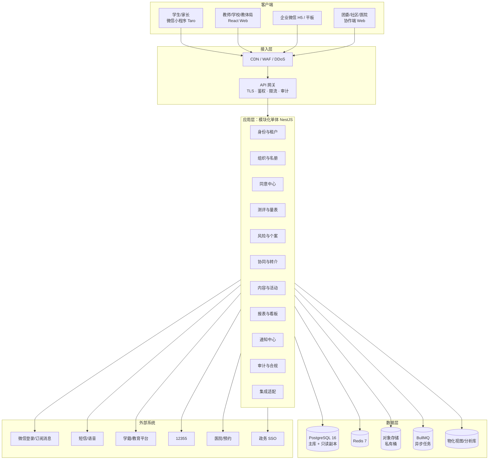

**图 2-1 说明**：应用层是“一个进程、多个模块”，模块之间通过应用服务与领域事件通信；数据库按 schema 分域（iam、org、asm、rsk、col、cnt、aud），但共享一个 PostgreSQL 实例（一期）。这样既能在 1 个月内交付，又为后续拆服务保留边界。

### 2.2 部署架构（一期云上）

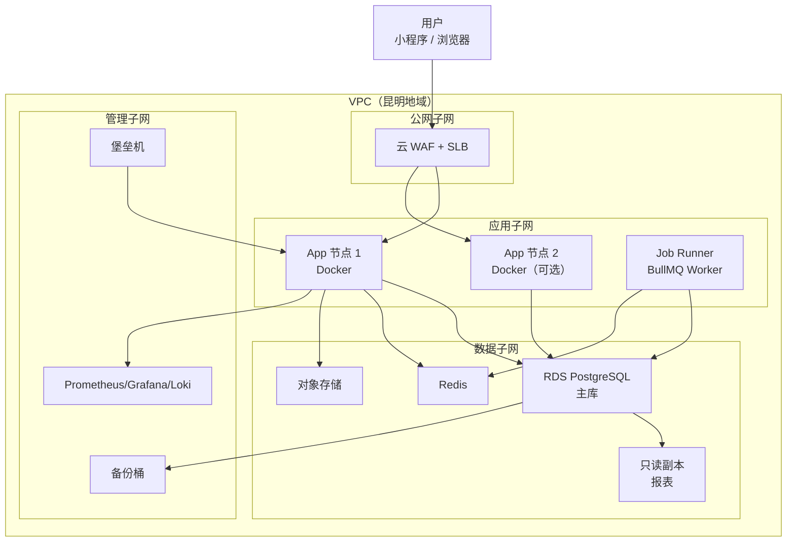

**图 2-2 说明**：一期为“单地域、单可用区、双节点可选”，数据库用云 RDS 自带备份；二期改为多可用区、只读副本、跨地域备份；政务云阶段把 RDS/Redis/OSS 替换为政务云服务或自建，应用容器不变。

### 2.3 关键数据流

| 流 | 路径 | 一致性 | 延迟 | 失败处理 |
|---|---|---|---|---|
| 登录 | 小程序 → 微信 code2Session → API → 用户/租户 → JWT | 强 | <500ms | 重试/验证码兜底 |
| 打卡 | 小程序 → API → PG → 事件 → 统计 | 强 | <300ms | 本地草稿 |
| 测评提交 | 小程序 → API → 计分 → PG → 报告任务 | 强 + 异步 | <1s | 幂等 |
| 风险信号 | API → 规则引擎 → 信号 → 人工确认 → 预警 | 强 + 事件 | <1s | 重试 + 死信 |
| 通知 | 事件 → 通知中心 → 短信/微信 → 回执 | 最终一致 | <1min | 升级/备用通道 |
| 报表 | CDC/定时 → 物化视图 → API | 最终一致 | <5min | 缓存兜底 |
| 审计 | 业务事务 → outbox → 审计表 → WORM | 最终一致 | <5s | 本地重试 |
| 导出 | API → 任务 → 生成 → OSS → 签名 URL | 异步 | <30s | 通知重试 |

---

## 3. 客户端方案

### 3.1 端矩阵

| 端 | 用户 | 技术 | 一期 | 二期 | 三期 |
|---|---|---|---|---|---|
| 微信小程序 | 学生、家长 | Taro 4 + React + TS | ● | ● | ● |
| Web 教师端 | 班主任、心理教师、校领导 | React + Ant Design Pro | ● | ● | ● |
| Web 管理端 | 教体局、团委、运营 | React + Ant Design Pro | ● | ● | ● |
| 企业微信 H5 | 教师 | H5 + 企微 JS-SDK | ○ | ● | ● |
| 平板/课堂 | 教师、学生 | 响应式 H5 | ○ | ● | ● |
| iOS/Android 原生 | 学生、家长、教师 | Taro RN 或原生壳 | — | ○ | ● |
| 鸿蒙 | 学生、家长 | H5/微信兼容 → ArkTS | — | ○ | ● |
| PWA/离线 | 学生、教师 | Service Worker + IndexedDB | ○ | ● | ● |

图例：● 交付；○ 部分/试点；— 不做。

### 3.2 跨平台选型对比

| 维度 | Taro + React | uni-app + Vue | Flutter | 原生双端 | 纯 Web/PWA |
|---|---|---|---|---|---|
| 团队现状 | 已有演示版，熟 | 需重写 | 需学 Dart | 需 2 套 | 熟 |
| 微信小程序 | 好 | 好 | 不支持 | 需嵌 H5 | 不支持 |
| H5/Web | 好 | 好 | 好 | 差 | 好 |
| 鸿蒙 | 插件/混合 | 较好 | 弱 | 需 ArkTS | 浏览器 |
| 离线/推送 | 弱 | 中 | 强 | 强 | 中 |
| 性能 | 中 | 中 | 高 | 高 | 中 |
| 包体 | 中 | 中 | 大 | 小 | 小 |
| 成本 | 低 | 中 | 高 | 高 | 低 |
| 结论 | **选** | 备选 | 不选 | 三期 | 辅助 |

**决策：Taro 4 + React 作为学生/家长端，Web 端独立用 React + Ant Design Pro。** 理由：
1. 演示版已是 Taro + React，1 个月软著不能重写；
2. 小程序是学生触达的最低成本入口，Taro 支持微信/H5；
3. 教师端需要复杂表格、批量操作、打印，Ant Design Pro 更合适；
4. Flutter 不支持微信小程序，且团队无 Dart 经验；
5. 原生双端成本高，放到三期。

**代价**：两套代码、设计系统需统一；小程序包体受限；离线能力弱。**缓解**：共享 TypeScript 类型与 API 客户端；设计 token 统一；PWA 作为离线补充；原生能力用插件封装。

### 3.3 学生/家长小程序设计

| 设计点 | 方案 | 理由 |
|---|---|---|
| 包体 | 主包 ≤1.5MB，分包按“测评/内容/我的” | 微信主包 2MB 限制 |
| 首屏 | 骨架屏 + 本地缓存 + 并行请求 | 弱网 2.5 秒内可用 |
| 登录 | 微信静默登录 + 学籍激活 | 降低门槛 |
| 离线 | Taro Storage 草稿 + 重试队列 | 乡村弱网 |
| 安全 | Token 内存 + 安全存储；敏感页水印；禁止复制 | 防截屏/泄露 |
| 隐私 | 首次启动隐私弹窗；逐项授权 | 合规 |
| 分享 | 成长护照授权链接，不是公开链接 | 防泄露 |
| 埋点 | 自研轻量 SDK，批量上报 | 不影响性能 |
| 兼容 | 微信基础库 2.30+；iOS 14+；Android 9+ | 覆盖主流 |

### 3.4 教师/管理 Web 设计

| 设计点 | 方案 | 理由 |
|---|---|---|
| 框架 | React 18 + Vite + Ant Design Pro 5 | 表格/表单/权限成熟 |
| 状态 | TanStack Query + Zustand | 服务端状态与本地状态分离 |
| 权限 | 路由级 + 按钮级 + 数据域 | 细粒度 |
| 大屏 | ECharts + 响应式 | 区域看板 |
| 打印 | 专用打印样式 + PDF | 迎检材料 |
| 弱网 | 请求重试 + 骨架屏 + 离线提示 | 学校网络 |
| 兼容 | Chrome/Edge 100+；国产浏览器 | 政府环境 |
| 无障碍 | 键盘导航、对比度、字号 | 合规 |

### 3.5 鸿蒙与原生策略

| 阶段 | 方案 | 触发条件 | 工作量 |
|---|---|---|---|
| 一期 | 微信小程序（鸿蒙兼容层）+ H5 | 无 | 0 |
| 二期 | H5 适配 + 企业微信 | 政府采购要求 | 2—4 人周 |
| 三期 | ArkTS 原生或 Taro Harmony 插件 | 明确要求鸿蒙原生 | 2—3 人月 |
| 三期 | iOS/Android 原生壳（WebView + 推送 + 离线 SQLite） | 需要推送/离线 | 2—3 人月 |

**不建议一期做鸿蒙原生**：用户量小、审核与适配成本高、团队无 ArkTS 经验；先用 H5/小程序覆盖。

### 3.6 离线与同步

| 场景 | 一期 | 二期 | 三期 |
|---|---|---|---|
| 打卡 | 本地草稿 + 重试 | IndexedDB 队列 | SQLite |
| 观察/谈话 | 本地草稿 | 离线队列 | SQLite + 冲突合并 |
| 测评 | 不支持离线 | 题目缓存 + 断点 | 完整离线 |
| 内容 | 缓存最近 20 条 | 预下载 | 离线包 |
| 冲突 | 服务端时间优先 | 版本号 + 提示 | CRDT（仅非敏感字段） |

**同步规则**：
- 客户端生成 client_id（UUID）与 client_ts；
- 服务端以 server_ts 为准，保留 client_ts 用于排查；
- 幂等键 = client_id + 操作类型；
- 冲突时保留两份，提示用户确认（不静默覆盖）；
- 离线数据加密存储，退出登录清除。

### 3.7 客户端安全

| 风险 | 控制 |
|---|---|
| 本地存储泄露 | 不存明文心理数据；Token 短时效；退出清除 |
| 截屏/录屏 | 敏感页水印；提示；不承诺技术阻断 |
| 剪贴板 | 敏感信息禁止复制；提示 |
| 越权路由 | 服务端校验为准；前端路由仅体验 |
| 第三方 SDK | 最小化；隐私评估；可关闭 |
| 调试包 | 生产关闭 vConsole；禁止日志打印敏感字段 |
| 降级 | 小程序审核失败时 H5 兜底 |

---

## 4. 后端架构

### 4.1 形态选择：模块化单体、微服务、Serverless

| 维度 | 模块化单体 | 微服务 | Serverless |
|---|---|---|---|
| 团队 10 人 | 合适 | 过重 | 合适但受限 |
| 1 个月软著 | 快 | 慢 | 快 |
| 事务一致性 | 强 | 最终一致 | 弱 |
| 调试/排障 | 简单 | 复杂 | 中 |
| 冷启动 | 无 | 无 | 有 |
| 成本 | 低 | 高 | 低流量低、高流量高 |
| 政府私有化 | 容易 | 较难 | 难 |
| 扩展 | 垂直 + 水平 | 独立 | 自动 |
| 结论 | **选** | 二期按需 | 不选 |

**决策：NestJS 模块化单体。** 理由：
1. 10 余人团队、1 个月软著，微服务的网络/部署/观测成本扛不住；
2. 个案、预警、转介需要事务一致性，单体更容易；
3. 政府私有化部署，单体容器更好交付；
4. NestJS 的模块/依赖注入天然支持边界，后续可按模块拆。

### 4.2 模块划分

| 模块 | 职责 | 主要表 | 对外接口 | 依赖 |
|---|---|---|---|---|
| iam | 身份、会话、MFA、SSO | user, session, role, user_role | /auth, /users | org |
| tenant | 租户、套餐、配置 | tenant, tenant_config | /tenants | — |
| org | 组织、学校、班级、名册 | org_unit, student, guardian_relation | /orgs, /students | tenant |
| consent | 同意、版本、撤回 | consent, consent_version | /consents | iam |
| asm | 量表、作答、计分、报告 | instrument, session, response | /assessments | consent |
| rsk | 规则、信号、预警、分级 | risk_rule, signal, alert | /alerts | asm, org |
| case | 个案、计划、干预、结案 | case, plan, intervention | /cases | rsk |
| col | 转介、机构、反馈、回访 | referral, org_partner, feedback | /referrals | case |
| cnt | 内容、活动、报名、签到 | resource, activity, record | /contents, /activities | org |
| not | 模板、通道、回执、升级 | notification, template | /notifications | iam |
| aud | 审计、导出、破窗、审批 | audit_event, export_job, grant | /audit | 全模块 |
| rpt | 看板、报表、导出 | mv_* | /reports | 只读副本 |
| int | 学籍、12355、医院、SSO | integration_job | /integrations | 全模块 |
| admin | 租户开通、配置、健康 | — | /admin | 全模块 |

> V1.1 新增模块：com-community、ai-agent、inst-institution、mod-moderation；内容模块 cnt 扩展为频道/视频/生涯。详见 19.1。

### 4.3 分层与依赖规则

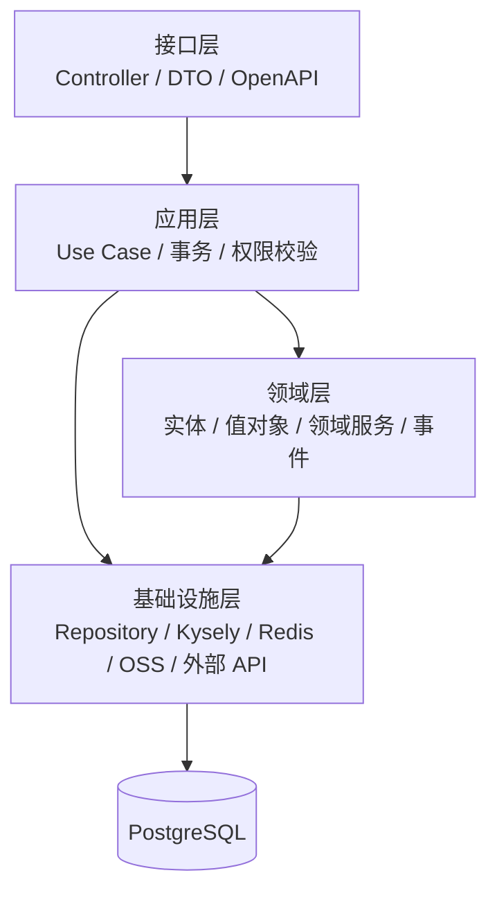

**规则**：
- 接口层不写业务逻辑，只做参数校验、鉴权、序列化；
- 应用层负责事务、权限、幂等、事件发布；
- 领域层不依赖框架与数据库；
- 基础设施层实现仓储接口，不反向依赖应用层；
- 跨模块只能调用对方应用服务或订阅事件，不直接读对方表；
- 共享类型放在 packages/contracts，不共享数据库实体。

### 4.4 事务、幂等与事件

| 机制 | 实现 | 适用 |
|---|---|---|
| 本地事务 | PostgreSQL BEGIN/COMMIT | 个案、预警、转介 |
| 幂等 | idempotency_key 表 + 唯一索引 | 提交测评、求助、转介 |
| Outbox | outbox 表 + 轮询/CDC | 通知、审计、报表 |
| 重试 | 指数退避 + 最大次数 + 死信 | 通知、集成 |
| 补偿 | 对账任务 + 人工工单 | 转介、支付 |
| 事件版本 | event_type + version | 兼容旧消费者 |

### 4.5 多租户实现

| 层 | 实现 | 说明 |
|---|---|---|
| 数据 | 所有业务表带 tenant_id；复合索引 (tenant_id, id) | 共享库 |
| 会话 | JWT 带 tenant_id；登录时选择/切换租户 | 防止跨租户 |
| 连接 | 每个事务 SET LOCAL app.tenant_id | RLS 依赖 |
| 查询 | Repository 自动注入 tenant_id | 防遗漏 |
| 缓存 | key 前缀 t:{tenant_id}: | 防串租户 |
| 队列 | job payload 带 tenant_id | 防串任务 |
| 文件 | 路径 tenants/{tenant_id}/ | 防越权 |
| 审计 | 所有事件带 tenant_id | 可追溯 |
| 报表 | 只读副本 + 物化视图按租户 | 防聚合泄露 |
| 大租户 | 独立 schema/独立库（二期） | 隔离升级 |

**RLS 示例**（所有业务表启用）：

```sql
ALTER TABLE student ENABLE ROW LEVEL SECURITY;
ALTER TABLE student FORCE ROW LEVEL SECURITY;

CREATE POLICY student_tenant_isolation ON student
  USING (tenant_id = current_setting('app.tenant_id', true)::uuid)
  WITH CHECK (tenant_id = current_setting('app.tenant_id', true)::uuid);

CREATE POLICY student_self_read ON student FOR SELECT
  USING (id = current_setting('app.student_id', true)::uuid);
```

**注意**：RLS 不是权限的全部。应用层仍必须做“角色 + 数据域 + 目的码 + 字段级”校验；RLS 是最后一道防线。连接池必须在事务内 SET LOCAL，事务结束自动失效，避免连接复用导致租户串号。

### 4.6 异步任务

| 队列 | 任务 | 并发 | 重试 | 死信 |
|---|---|---|---|---|
| notify | 短信、微信、企微、电话升级 | 20 | 3 次，指数退避 | 有 |
| report | 周报、月报、区域报告 | 2 | 2 次 | 有 |
| export | 数据导出、PDF | 2 | 2 次 | 有 |
| retention | 到期删除、匿名化 | 1 | 1 次 | 有 |
| integration | 学籍、12355、医院 | 5 | 5 次 | 有 |
| audit | 审计归档、哈希校验 | 2 | 3 次 | 有 |

### 4.7 演进路径（何时拆服务）

| 触发条件 | 拆分对象 | 方式 |
|---|---|---|
| 通知量大、影响主流程 | not | 独立服务 + 队列 |
| 报表拖慢主库 | rpt | 独立只读服务/数仓 |
| 测评峰值独立 | asm | 独立服务 + 独立库 |
| 团队 >3 组、发布冲突 | 按模块 | Strangler Fig |
| 100 万用户/多地域 | 按域 | 微服务 + 网关 |

**不拆的理由**：拆分带来网络、事务、观测、部署、调试成本；在 10 余人团队、3 万用户阶段，收益远小于成本。


---

## 5. API 设计

### 5.1 风格选择

| 风格 | 适用 | 不适用 | 决策 |
|---|---|---|---|
| REST + JSON | 资源 CRUD、管理端、开放平台 | 复杂聚合、实时订阅 | **主风格** |
| GraphQL | 多端字段裁剪、聚合 | 权限复杂、缓存难、团队不熟 | 不用 |
| gRPC | 内部高性能、跨语言 | 浏览器/小程序、调试成本 | 二期内部可选 |
| WebSocket | 实时预警、协作 | 一期用轮询/订阅消息即可 | 二期按需 |
| Webhook | 第三方事件 | 强一致 | 用于集成 |

**决策：REST + OpenAPI 3.0.3。** 理由：小程序/Web/第三方都易接入；OpenAPI 可生成 SDK、文档、契约测试；网关/审计/限流成熟；团队熟悉。

### 5.2 约定

| 项 | 约定 | 示例 |
|---|---|---|
| Base URL | https://api.example.com/api/v1 |  |
| 版本 | 路径版本；破坏性变更升 v2 | /api/v1 |
| 资源命名 | 复数、kebab-case | /assessment-sessions |
| 方法 | GET/POST/PATCH/DELETE | PATCH 局部更新 |
| 状态码 | 200/201/204/400/401/403/404/409/422/429/500 |  |
| 分页 | cursor（默认）；管理端可 page | ?cursor=...&limit=20 |
| 过滤 | 白名单字段；不拼接 SQL | ?status=open&level=L2 |
| 排序 | ?sort=-created_at |  |
| 幂等 | Idempotency-Key（UUID） | 写接口必填 |
| 并发 | ETag + If-Match | 个案更新 |
| 错误 | RFC 9457 Problem Details | application/problem+json |
| 追踪 | X-Request-Id、traceparent |  |
| 目的 | X-Purpose-Code | PUR-02 |
| 租户 | 默认从 JWT；平台管理员可 X-Tenant-Id | 仅平台角色 |
| 限流 | X-RateLimit-Limit/Remaining/Reset |  |
| 时间 | ISO 8601 UTC | 2027-01-10T02:00:00Z |
| 语言 | Accept-Language | zh-CN |

### 5.3 认证与授权

| 场景 | 方式 | Token 生命周期 | 备注 |
|---|---|---|---|
| 小程序学生/家长 | 微信 code2Session + 自有 JWT | access 15min / refresh 7d | 刷新轮换 |
| 教师/管理员 | 账号密码 + MFA（短信/TOTP） | 同上 | 强制 MFA |
| 政务 SSO | OIDC/CAS | 由 IdP 决定 | 适配层 |
| 第三方系统 | OAuth2 client credentials + HMAC | 1h | mTLS 可选 |
| Webhook | HMAC-SHA256 + timestamp + nonce | 5min 窗口 | 防重放 |

**JWT Claims**：

| Claim | 含义 | 示例 |
|---|---|---|
| sub | 用户 ID | uuid |
| tid | 租户 ID | uuid |
| roles | 角色码 | ["teacher"] |
| scope | 权限点 | ["alert:read","case:read"] |
| purpose | 允许目的码 | ["PUR-01","PUR-02"] |
| amr | 认证方式 | ["wechat","mfa"] |
| exp/iat/jti | 过期/签发/唯一 ID |  |

### 5.4 核心接口

| 编号 | 方法 | 路径 | 目的 | 权限 | 幂等 |
|---|---|---|---|---|---|
| API-01 | POST | /auth/wechat/login | 微信登录 | 公开 | 是 |
| API-02 | POST | /auth/activate | 学生激活 | 公开 + 学校码 | 是 |
| API-03 | POST | /auth/guardian/bind | 家长绑定 | 公开 + 验证码 | 是 |
| API-04 | GET | /me | 当前用户 | 登录 | — |
| API-05 | GET | /me/privacy | 隐私仪表盘 | 本人 | — |
| API-06 | POST | /consents | 提交同意 | 本人/监护人 | 是 |
| API-07 | DELETE | /consents/{id} | 撤回 | 本人/监护人 | 是 |
| API-08 | POST | /check-ins | 打卡 | 学生 | 是 |
| API-09 | GET | /assessments | 量表列表 | 学生/教师 | — |
| API-10 | POST | /assessment-sessions | 开始测评 | 学生 | 是 |
| API-11 | POST | /assessment-sessions/{id}/submit | 提交 | 学生 | 是 |
| API-12 | GET | /assessment-sessions/{id}/report | 报告 | 学生/心理教师 | — |
| API-13 | POST | /signals | 上报信号 | 学生/教师 | 是 |
| API-14 | POST | /alerts/{id}/ack | 确认预警 | 班主任/心理教师 | 是 |
| API-15 | POST | /alerts/{id}/escalate | 升级 | 班主任/心理教师 | 是 |
| API-16 | POST | /cases | 建案 | 心理教师 | 是 |
| API-17 | PATCH | /cases/{id} | 更新案件 | 心理教师 | ETag |
| API-18 | POST | /cases/{id}/interventions | 干预记录 | 心理教师/班主任 | 是 |
| API-19 | POST | /cases/{id}/referrals | 发起转介 | 心理教师 | 是 |
| API-20 | POST | /referrals/{id}/accept | 接收 | 医疗机构 | 是 |
| API-21 | POST | /referrals/{id}/feedback | 反馈 | 医疗机构 | 是 |
| API-22 | GET | /reports/region | 区域看板 | 教体局 | — |
| API-23 | POST | /exports | 申请导出 | 授权角色 | 是 |
| API-24 | GET | /audit/events | 审计查询 | 审计员 | — |
| API-25 | POST | /admin/tenants | 开通租户 | 平台运营 | 是 |

### 5.5 示例：提交求助

请求：

```http
POST /api/v1/signals HTTP/1.1
Authorization: Bearer <access_token>
Content-Type: application/json
Idempotency-Key: 6f1c2a9e-3b7d-4c1a-9f2e-8a1b2c3d4e5f
X-Purpose-Code: PUR-02

{
  "student_id": "0b7f...",
  "source": "one_click_help",
  "level_hint": "L3",
  "message": "我现在很难受，想找人说",
  "location": { "mode": "fuzzy", "district": "红塔区", "consent": true },
  "contact_preference": ["teacher", "guardian", "12355"]
}
```

响应：

```json
{
  "signal_id": "9a1e...",
  "alert_id": "c3d4...",
  "status": "notified",
  "sla": {
    "acknowledge_by": "2026-11-09T12:15:00Z",
    "intervene_by": "2026-11-09T14:00:00Z"
  },
  "notified": [
    { "role": "head_teacher", "channel": "sms", "status": "sent" },
    { "role": "psychologist", "channel": "phone", "status": "calling" },
    { "role": "guardian", "channel": "sms", "status": "sent" }
  ],
  "next": "页面显示：老师会在 15 分钟内联系你；紧急请拨 12355"
}
```

### 5.6 错误格式

```json
{
  "type": "https://errors.example.com/forbidden-purpose",
  "title": "Purpose not allowed",
  "status": 403,
  "detail": "当前请求目的码 PUR-03 不能访问个体数据",
  "instance": "/api/v1/cases/123",
  "request_id": "req_...",
  "code": "PURPOSE_DENIED"
}
```

### 5.7 Webhook 与开放平台

| 事件 | 触发 | 载荷 | 接收方 |
|---|---|---|---|
| assessment.completed | 测评提交 | 会话 ID、学生 ID（脱敏）、时间 | 区域平台 |
| alert.created | 预警生成 | 预警 ID、等级、时限 | 学校/团委 |
| referral.accepted | 转介接收 | 转介 ID、机构 | 学校 |
| referral.feedback | 反馈 | 转介 ID、结果 | 学校 |
| activity.completed | 活动结束 | 活动 ID、参与人数 | 团委 |

**安全**：HMAC-SHA256 签名（body + timestamp + nonce），5 分钟窗口，重放缓存；失败重试 5 次；提供事件 ID 幂等；开放平台按应用授权 scope。

### 5.8 API 安全清单

- [ ] 每个接口都做对象级授权（BOLA），不只做功能级。
- [ ] 每个接口都校验租户与数据域。
- [ ] 列表接口必须带 scope filter，禁止“先查全表再过滤”。
- [ ] 批量接口限制条数（≤100）。
- [ ] 文件上传限制类型/大小，服务端扫描，剥离 EXIF。
- [ ] 禁止客户端传 role/permission/tenant_id 作为授权依据。
- [ ] 错误不泄露堆栈、SQL、内部 ID。
- [ ] 限流按用户/IP/租户/接口。
- [ ] 所有写接口幂等。
- [ ] OpenAPI 契约测试入 CI。

---

## 6. 数据模型与存储

### 6.1 数据库选型

| 维度 | PostgreSQL 16 | MySQL 8 | 达梦/金仓 | MongoDB |
|---|---|---|---|---|
| 关系与约束 | 强 | 强 | 强 | 弱 |
| RLS | 原生 | 无 | 部分 | 无 |
| JSONB | 强 | 中 | 中 | 强 |
| 全文检索 | 中（可扩展） | 中 | 中 | 中 |
| 生态/云托管 | 强 | 强 | 政务 | 中 |
| 信创 | 可替换 | 可替换 | 原生 | 少 |
| 团队熟悉 | 中 | 高 | 低 | 中 |
| 决策 | **选** | 备选 | 二期适配 | 不选 |

**决策：PostgreSQL 16（国内云 RDS）。** 理由：RLS 是多租户兜底的关键；JSONB 适合量表答案/配置；窗口函数/物化视图够报表；云托管成熟；后续可迁 openGauss/金仓（需适配）。

### 6.2 Schema 与命名

| 项 | 约定 |
|---|---|
| Schema | iam、org、asm、rsk、col、cnt、aud、rpt、int |
| 表名 | 小写复数、下划线 |
| 主键 | uuid v7（时间有序） |
| 外键 | 必须；跨 schema 用逻辑外键 + 校验 |
| 时间 | timestamptz，UTC |
| 软删除 | deleted_at；唯一索引带 WHERE deleted_at IS NULL |
| 审计列 | created_at, created_by, updated_at, updated_by, version |
| 租户 | 所有业务表 tenant_id NOT NULL |
| 金额 | numeric(12,2) |
| 枚举 | 小写字符串 + CHECK，不用数据库 enum |
| 大文本 | 加密后 bytea；不放 JSONB 明文 |
| 分区 | audit_event 按月；notification 按月 |

### 6.3 核心表

| 表 | 关键列 | 索引 | 分区 | 说明 |
|---|---|---|---|---|
| tenant | id, type, name, parent_id, status, config | (type, status) | — | 租户 |
| org_unit | id, tenant_id, type, parent_id, name, code | (tenant_id, parent_id), (tenant_id, code) | — | 组织树 |
| app_user | id, tenant_id, phone_enc, phone_hash, status, mfa | (tenant_id, phone_hash) | — | 账号 |
| user_role | user_id, role_id, org_id, valid_from, valid_to | (user_id, org_id) | — | 角色 |
| student | id, tenant_id, school_id, class_id, name_enc, sno_token, status | (tenant_id, class_id), (tenant_id, sno_token) | — | 学生 |
| guardian_relation | id, tenant_id, student_id, guardian_id, relation, verified | (student_id), (guardian_id) | — | 监护 |
| consent | id, tenant_id, subject_id, purpose, version, granted_at, revoked_at | (subject_id, purpose) | — | 同意 |
| instrument | id, code, name, age_min, age_max, license, status | (code) | — | 量表 |
| assessment_session | id, tenant_id, student_id, instrument_id, status, score_enc, risk_level | (tenant_id, student_id, created_at) | — | 测评 |
| item_response | id, session_id, item_id, choice | (session_id) | — | 作答 |
| check_in | id, tenant_id, student_id, mood, note_enc, created_at | (tenant_id, student_id, created_at) | 月 | 打卡 |
| observation | id, tenant_id, student_id, teacher_id, category, note_enc | (tenant_id, student_id, created_at) | — | 观察 |
| risk_signal | id, tenant_id, student_id, rule_id, level, status | (tenant_id, status, level) | — | 信号 |
| alert | id, tenant_id, signal_id, level, assignee_id, due_at, status | (tenant_id, status, due_at) | — | 预警 |
| case_record | id, tenant_id, case_no, student_id, level, status, owner_id | (tenant_id, case_no), (tenant_id, status) | — | 个案 |
| intervention | id, tenant_id, case_id, type, note_enc, outcome | (case_id) | — | 干预 |
| referral | id, tenant_id, case_id, to_org_id, package_hash, status | (tenant_id, status) | — | 转介 |
| referral_feedback | id, referral_id, visited, advice_enc, next_at | (referral_id) | — | 反馈 |
| activity | id, tenant_id, type, title, start_at, capacity | (tenant_id, start_at) | — | 活动 |
| activity_record | id, activity_id, student_id, role, reflection_enc | (activity_id), (student_id) | — | 参与 |
| audit_event | id, tenant_id, actor_id, action, resource, purpose, result, hash, prev_hash, created_at | (tenant_id, created_at), (actor_id, created_at) | 月 | 审计 |
| access_grant | id, tenant_id, user_id, case_id, reason, expires_at | (user_id, expires_at) | — | 破窗 |
| export_job | id, tenant_id, requester_id, scope, status, expires_at | (tenant_id, status) | — | 导出 |

### 6.4 DDL 片段

```sql
CREATE TABLE org.student (
  id            uuid PRIMARY KEY DEFAULT gen_random_uuid(),
  tenant_id     uuid NOT NULL REFERENCES tenant.tenant(id),
  school_id     uuid NOT NULL REFERENCES org.org_unit(id),
  class_id      uuid REFERENCES org.org_unit(id),
  name_enc      bytea NOT NULL,
  name_hash     text NOT NULL,
  sno_token     text NOT NULL,
  gender        text CHECK (gender IN ('male','female','unknown')),
  birth_year    int,
  status        text NOT NULL DEFAULT 'active'
                CHECK (status IN ('active','graduated','transferred','inactive')),
  created_at    timestamptz NOT NULL DEFAULT now(),
  created_by    uuid,
  updated_at    timestamptz NOT NULL DEFAULT now(),
  updated_by    uuid,
  version       int NOT NULL DEFAULT 1,
  deleted_at    timestamptz
);

CREATE UNIQUE INDEX ux_student_sno
  ON org.student (tenant_id, sno_token)
  WHERE deleted_at IS NULL;

CREATE INDEX ix_student_class
  ON org.student (tenant_id, class_id)
  WHERE deleted_at IS NULL;

ALTER TABLE org.student ENABLE ROW LEVEL SECURITY;
ALTER TABLE org.student FORCE ROW LEVEL SECURITY;

CREATE POLICY p_student_tenant ON org.student
  USING (tenant_id = current_setting('app.tenant_id', true)::uuid)
  WITH CHECK (tenant_id = current_setting('app.tenant_id', true)::uuid);
```

```sql
CREATE TABLE aud.audit_event (
  id            uuid NOT NULL,
  tenant_id     uuid NOT NULL,
  actor_id      uuid,
  actor_role    text,
  action        text NOT NULL,
  resource_type text NOT NULL,
  resource_id   text,
  purpose       text,
  result        text NOT NULL,
  ip            inet,
  user_agent    text,
  request_id    text,
  trace_id      text,
  detail        jsonb,
  prev_hash     text,
  hash          text NOT NULL,
  created_at    timestamptz NOT NULL DEFAULT now(),
  PRIMARY KEY (id, created_at)
) PARTITION BY RANGE (created_at);

CREATE TABLE aud.audit_event_2027_01
  PARTITION OF aud.audit_event
  FOR VALUES FROM ('2027-01-01') TO ('2027-02-01');
```

### 6.5 加密字段设计

| 字段类型 | 存储 | 检索 | 密钥 | 说明 |
|---|---|---|---|---|
| 姓名 | name_enc bytea + name_hash | 精确匹配用 hash | 租户密钥 | 不存明文 |
| 手机号 | phone_enc + phone_hash | 登录用 hash | 租户密钥 | 展示脱敏 |
| 学籍号 | sno_token（HMAC） | 精确匹配 | 平台密钥 | 不可逆 |
| 咨询记录 | note_enc bytea | 不解密检索 | 个案密钥 | 仅授权解密 |
| 测评答案 | answers_enc bytea（加密） | 不可检索 | 会话密钥 | 服务端解密计分 |
| 附件 | OSS 私有 + SSE-KMS | 签名 URL | KMS | 病毒扫描 |

**信封加密**：数据密钥（DEK）加密字段，KMS 主密钥（KEK）加密 DEK；DEK 缓存 5 分钟；轮换 KEK 不影响历史数据（保留 key_id）。

### 6.6 对象存储

| 项 | 方案 |
|---|---|
| Bucket | 私有；按环境/租户前缀 |
| 路径 | tenants/{tenant_id}/{module}/{yyyy}/{mm}/{uuid} |
| 访问 | 签名 URL，5—15 分钟；禁止公共读 |
| 上传 | 服务端签发；限制类型/大小；病毒扫描 |
| 图片 | 压缩、WebP、剥离 EXIF |
| 视频 | 转码（可选）、防盗链 |
| 生命周期 | 30 天转低频；1 年归档；到期删除 |
| 备份 | 跨区域复制（二期） |
| 审计 | 上传/下载/删除记录 |

### 6.7 报表与分析

| 层 | 实现 | 数据 | 时效 |
|---|---|---|---|
| ODS | 只读副本 | 业务表 | 实时 |
| DWD | 物化视图 | 事实/维度 | 5 分钟 |
| 指标 | 预聚合表 | 区域/学校/年级 | 5 分钟 |
| 展示 | API + Metabase | 图表 | 实时 |
| 导出 | 异步 PDF/Excel | 水印 | 30 秒 |

**原则**：报表只读副本，不压主库；聚合 k≥10；不做个体排名；指标口径写入数据字典。

### 6.8 迁移与版本

| 项 | 方案 |
|---|---|
| 工具 | node-pg-migrate（SQL 优先） |
| 规则 | 向前兼容；先加列后删列；不锁表 |
| 流程 | dev → test → staging → prod；每步可回滚 |
| 数据迁移 | 批量 + 校验 + 断点续跑 |
| 破坏性变更 | 分两次发布（expand/contract） |
| 回滚 | 代码回滚 + 迁移回滚脚本（仅非破坏） |

---

## 7. 缓存、消息与搜索

### 7.1 缓存

| 场景 | Key | TTL | 失效 | 说明 |
|---|---|---|---|---|
| 会话 | t:{tid}:sess:{sid} | 30min | 登出/改密 | 只存 session 元数据 |
| 用户权限 | t:{tid}:perm:{uid} | 5min | 角色变更 | 变更即删 |
| 内容详情 | t:{tid}:content:{id} | 10min | 发布/下架 | 公开内容 |
| 看板 | t:{tid}:dash:{scope}:{date} | 5min | 定时 | 聚合 |
| 字典 | t:{tid}:dict:{type} | 1h | 变更 | 低敏 |
| 限流 | rl:{scope}:{id}:{window} | 窗口 | 自动 | 计数器 |
| 幂等 | idem:{key} | 24h | 自动 | 结果缓存 |

**不做缓存**：DS4 个体明文、咨询记录、测评答案、审计明细。**防击穿**：singleflight + 逻辑过期；**防穿透**：空值缓存 60s + 布隆过滤器（可选）；**防雪崩**：TTL 加随机 10%。

### 7.2 消息与异步

| 项 | 方案 | 说明 |
|---|---|---|
| Broker | Redis + BullMQ | 一期够用；无跨机房 |
| Outbox | outbox 表 + worker | 业务事务与消息一致 |
| 重试 | 指数退避 1s/5s/30s/5min | 最多 5 次 |
| 死信 | dlq 队列 + 告警 | 人工处理 |
| 顺序 | 按 case_id 分区/串行 | 同一案件有序 |
| 幂等 | job_id + 结果表 | 防重复 |
| 延迟 | delayed job | 回访提醒 |
| 监控 | 队列深度/失败率/延迟 | 告警 |

**何时换 MQ**：日均消息 >100 万、需要跨机房/事务消息/多消费者广播时，迁 RocketMQ/Kafka；接口不变。

### 7.3 搜索

| 场景 | 方案 | 说明 |
|---|---|---|
| 内容搜索 | PostgreSQL tsvector + GIN | 标题/正文/标签 |
| 中文分词 | zhparser 或 pg_jieba 扩展 | 云 RDS 支持需确认 |
| 模糊匹配 | pg_trgm | 姓名/标题 |
| 权限过滤 | 查询层 scope filter | 先授权后搜索 |
| 排序 | ts_rank + 时间 | 不做个性化 |
| 审计搜索 | 分区表 + 时间/actor 索引 | 二期 ClickHouse |
| 内容量 >10 万 | OpenSearch + IK | 二期 |

**原则**：搜索不返回无权限数据；不记录敏感搜索词；不做“猜你想搜”的敏感推断。

---

## 8. 身份认证与权限

### 8.1 身份源

| 身份 | 认证方式 | 绑定 | 备注 |
|---|---|---|---|
| 学生 | 微信登录 + 学校码 + 学籍后 4 位 + 监护人手机号 | 学校名册 | 无手机号也可 |
| 家长 | 微信登录 + 学生信息 + 验证码 | 监护关系 | 多孩 |
| 教师 | 账号密码 + MFA | 学校管理员 | 强制 MFA |
| 教体局 | 账号密码 + MFA / 政务 SSO | 管理员 |  |
| 团委/社区 | 账号密码 + MFA | 管理员 |  |
| 医疗机构 | 账号密码 + MFA + 机构协议 | 管理员 |  |
| 第三方 | OAuth2 client credentials | 应用注册 |  |

### 8.2 登录流程

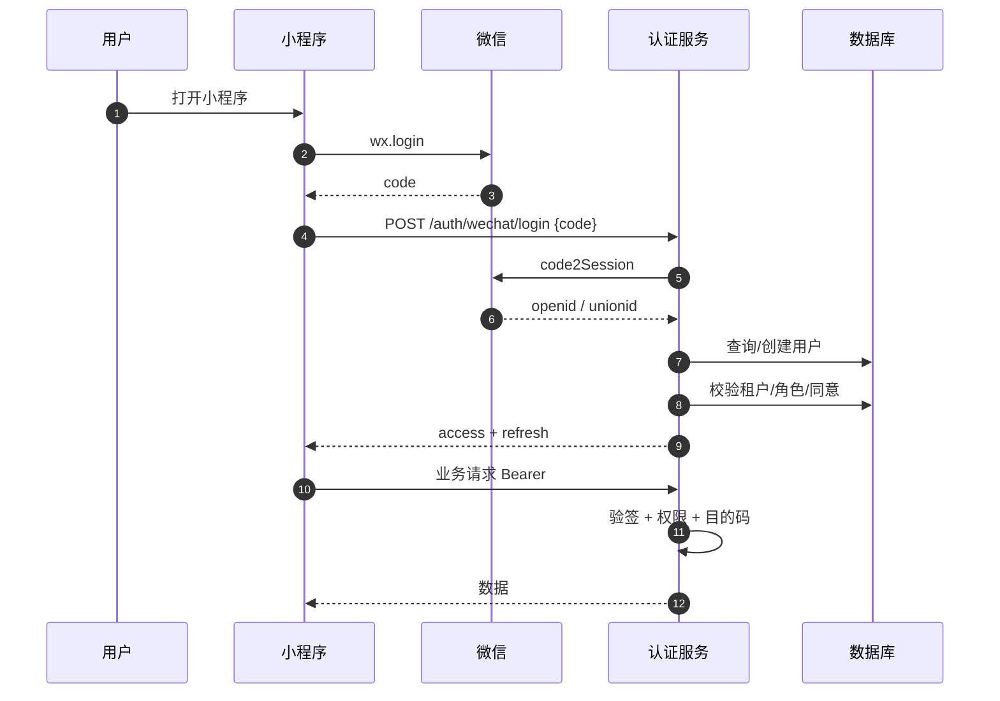

### 8.3 会话与令牌

| 项 | 方案 |
|---|---|
| Access Token | JWT，15 分钟，RS256（或 ES256） |
| Refresh Token | 随机 256bit，7 天，轮换，存 hash |
| 撤销 | Redis 黑名单 + jti；改密/登出全撤 |
| 设备 | 最多 3 台；新设备验证 |
| 时钟 | 允许 60 秒偏差 |
| 存储 | 小程序安全存储；Web HttpOnly Cookie（BFF）或内存 |
| CSRF | Web 用 SameSite=Lax + CSRF Token |
| XSS | CSP、输出编码、禁用 innerHTML |

### 8.4 权限模型实现

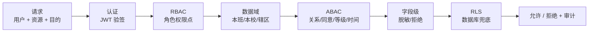

| 层 | 实现 | 示例 |
|---|---|---|
| RBAC | CASL 规则 + 权限点表 | teacher 可 alert:read |
| 数据域 | SQL scope filter + org tree | class_id IN (本班) |
| ABAC | 策略函数 | 仅 L3 + PUR-02 可看咨询摘要 |
| 字段级 | 序列化时脱敏 | 家长看 phone 脱敏 |
| RLS | PostgreSQL policy | tenant_id 隔离 |
| 审计 | 每次决策记录 | allow/deny + 原因 |

**策略示例**：

| 主体 | 动作 | 资源 | 条件 | 结果 |
|---|---|---|---|---|
| 班主任 | read | student | 本班 + PUR-01 | 允许（摘要） |
| 班主任 | read | counseling_note | 任何 | 拒绝 |
| 心理教师 | read | counseling_note | 本校 + PUR-02 + 个案授权 | 允许 |
| 家长 | read | assessment | 子女 + 同意 + 摘要 | 允许（脱敏） |
| 教体局 | read | region_report | 辖区 + PUR-03 + k≥10 | 允许（聚合） |
| 团委 | read | case | 授权 + PUR-02 + 未过期 | 允许（最小字段） |
| 审计员 | read | audit_event | 任何 + PUR-05 | 允许（只读） |

### 8.5 破窗访问

| 项 | 规则 |
|---|---|
| 触发 | L3 且常规授权 15 分钟内无法完成 |
| 审批 | 心理教师/校领导发起；DPO 事后复核 |
| 时限 | 2 小时；可续 1 次 |
| 范围 | 仅该案件必要字段 |
| 记录 | 理由、字段、操作、IP、审批 |
| 告警 | 实时通知 DPO/校领导 |
| 复核 | 24 小时内；月度 100% 抽查 |

### 8.6 权限测试

| 测试 | 方法 | 通过标准 |
|---|---|---|
| 角色矩阵 | 参数化测试 12 角色 × 20 动作 | 100% 符合矩阵 |
| 数据域 | 构造跨班/跨校/跨租户 | 0 越权 |
| 字段级 | 检查响应字段 | 无多余字段 |
| 目的码 | 伪造/缺失/过期 | 拒绝 |
| 破窗 | 无理由/超时/越范围 | 拒绝/收回 |
| 并发 | 权限变更中请求 | 旧权限 ≤5 分钟失效 |
| 负向 | 直接对象引用 | 404/403 |

---

## 9. 安全与加密

### 9.1 威胁模型（STRIDE）

| 威胁 | 场景 | 控制 |
|---|---|---|
| Spoofing 冒充 | 盗用教师账号 | MFA、设备绑定、异常登录 |
| Tampering 篡改 | 修改测评/个案 | 审计哈希链、权限、签名 |
| Repudiation 抵赖 | 否认看过/操作 | 不可篡改审计、水印 |
| Information disclosure 泄露 | 越权/导出/截屏 | RLS、字段加密、水印、DLP |
| Denial of service 拒绝服务 | 刷接口/短信 | 限流、WAF、验证码 |
| Elevation of privilege 提权 | 改 role/tenant | 服务端校验、RLS、双人审批 |
| 供应链 | 恶意依赖 | SBOM、SCA、签名镜像 |
| 内部人 | DBA/运维窥探 | 堡垒机、脱敏、双人、审计 |
| 物理 | 设备丢失 | 磁盘加密、远程擦除 |
| 社会工程 | 冒充家长/领导 | 回拨验证、流程 |
| 模型风险 | 误标/偏见 | 人工复核、偏差评估 |
| 合规 | 超范围采集 | 同意、目的码、DPIA |

### 9.2 网络与主机安全

| 层 | 措施 |
|---|---|
| 边界 | WAF、DDoS、IP 黑名单、地理限制（可选） |
| 网络 | VPC、子网隔离、安全组最小开放、数据库无公网 |
| 入口 | 仅 443；HSTS；TLS 1.2+（优先 1.3） |
| 主机 | CIS 基线、补丁、防病毒、文件完整性 |
| 容器 | 非 root、只读根、镜像扫描、签名 |
| 堡垒机 | 所有运维经堡垒机；命令审计 |
| 密钥 | KMS/Secrets Manager；不入库、不入代码 |
| 备份 | 加密、异地、定期恢复 |

### 9.3 应用安全（OWASP ASVS L2）

| 控制 | 实现 |
|---|---|
| 输入校验 | Zod schema；白名单；长度/类型 |
| 输出编码 | React 自动转义；富文本白名单 |
| 认证 | 短 Token、MFA、锁定、验证码 |
| 会话 | 轮换、撤销、超时、并发控制 |
| 访问控制 | 对象级 + 功能级 + 数据域 |
| 加密 | TLS、字段加密、密钥轮换 |
| 错误处理 | 统一 Problem Details；不泄露 |
| 日志 | 脱敏、完整、可追溯 |
| 文件 | 类型/大小/病毒/EXIF |
| SSRF | 白名单出站；禁止内网地址 |
| CSRF | SameSite + Token |
| XSS | CSP、转义、富文本过滤 |
| SQL 注入 | 参数化/Kysely；禁止拼接 |
| 反序列化 | 禁止不可信 JSON 反序列化到类 |
| 依赖 | SCA、锁版本、SBOM |
| 业务逻辑 | 幂等、限额、状态机 |

### 9.4 数据加密

| 场景 | 算法 | 密钥 | 轮换 |
|---|---|---|---|
| 传输 | TLS 1.2+（优先 1.3）；国密改造时 TLCP/GM-TLS 双栈（SM2/SM3/SM4） | 证书 | 90 天 |
| 存储（卷） | 云盘加密 AES-256 | 云 KMS | 自动 |
| 字段（DS4） | AES-256-GCM 或 SM4-GCM | 租户/个案 DEK | 90 天 |
| 搜索令牌 | HMAC-SHA256 | 平台密钥 | 180 天 |
| 备份 | AES-256 | 备份密钥 | 180 天 |
| 导出 | AES-256 + 水印 | 一次性密钥 | 24 小时 |
| 密码 | Argon2id | — | — |

**国密双栈**：一期默认 AES；二期如要求密评，切换 SM4-GCM/SM2/SM3，TLS 双证书；密钥由支持国密的 KMS/HSM 管理。**不要**在代码里写“国密级”而没有实际算法与密钥管理。

### 9.5 密钥管理

| 层 | 方案 |
|---|---|
| 根密钥 | 云 KMS/HSM，FIPS 140-2/3 或国密认证 |
| 数据密钥 | 信封加密；缓存 5 分钟 |
| 密钥分离 | 按租户/用途/环境 |
| 轮换 | KEK 90 天；DEK 按需 |
| 访问 | 仅应用角色；最小权限 |
| 审计 | 每次 Decrypt 记录 |
| 应急 | 密钥泄露预案：冻结、轮换、通知 |

### 9.6 隐私工程

| 措施 | 实现 |
|---|---|
| 最小采集 | 字段清单评审；默认不采集 |
| 目的绑定 | X-Purpose-Code + 服务端校验 |
| 同意 | 双同意 + 单独同意 + 版本 |
| 去标识化 | 姓名/手机号/学籍号令牌化 |
| 聚合 | k≥10；小样本抑制 |
| 差分隐私 | 二期用于公开统计（可选） |
| 不反推 | 禁止小样本交叉；查询审计 |
| 数据主体权利 | 查询/更正/删除/导出 |
| DPIA | 上线前完成；每年复核 |
| 供应商 | DPA；不得转委托；境内 |

### 9.7 供应链与安全开发

| 环节 | 措施 |
|---|---|
| 依赖 | 锁版本；SCA（Trivy）；许可证扫描 |
| 镜像 | 最小基础镜像；非 root；签名 |
| 代码 | SAST（Semgrep）；Code Review；分支保护 |
| 密钥 | 禁止硬编码； secret 扫描 |
| 构建 | 可复现；产物签名；SBOM |
| 发布 | 审批；灰度；回滚 |
| 漏洞 | SLA：高危 24h/7d，中危 7d/30d |
| 渗透 | 上线前 + 年度 |
| 应急 | 漏洞响应流程；CVE 跟踪 |

### 9.8 等保三级控制映射（摘要）

| 控制域 | 要求 | 本方案 |
|---|---|---|
| 安全物理环境 | 机房/云 | 国内合规云，等保三级机房 |
| 安全通信网络 | 传输加密、区域边界 | TLS、VPC、WAF |
| 安全区域边界 | 访问控制、入侵防范 | 安全组、WAF、IDS |
| 安全计算环境 | 身份鉴别、访问控制、审计 | MFA、RBAC/ABAC、审计 |
| 安全管理中心 | 集中管控 | 堡垒机、SIEM、KMS |
| 安全管理制度 | 制度/机构/人员 | 制度文档、安全小组 |
| 安全管理机构 | 岗位/审批 | 安全负责人、审批流 |
| 安全管理人员 | 录用/培训/离岗 | 背景审查、培训 |
| 安全建设管理 | 定级/备案/测评 | 定级报告、测评 |
| 安全运维管理 | 漏洞/备份/应急 | 漏洞管理、备份、演练 |

### 9.9 事件响应

| 级别 | 示例 | 响应 | 上报 |
|---|---|---|---|
| P1 | 数据泄露、越权批量访问 | 15 分钟响应、2 小时遏制 | 负责人/监管（依法） |
| P2 | 单租户故障、通知失败 | 30 分钟响应、4 小时恢复 | 负责人 |
| P3 | 性能下降、个别接口 | 2 小时响应、24 小时恢复 | 值班 |
| P4 | 咨询/建议 | 1 个工作日 | 工单 |

**流程**：发现 → 分级 → 遏制 → 取证 → 恢复 → 复盘 → 改进；保留证据链；对外沟通由指定发言人。

---

## 10. 审计与日志

### 10.1 审计事件模型

| 字段 | 说明 |
|---|---|
| id | UUID |
| tenant_id | 租户 |
| actor_id / actor_role | 操作人/角色 |
| action | 动作（read/write/export/approve/login） |
| resource_type / resource_id | 资源 |
| purpose | 目的码 |
| result | allow/deny/error |
| ip / user_agent | 来源 |
| request_id / trace_id | 追踪 |
| detail | 变更前后哈希/字段 |
| prev_hash / hash | 哈希链 |
| created_at | 时间 |

**哈希链**：hash = SHA256(prev_hash + canonical_json(event))；按租户/天链；每日锚定到 WORM 存储；提供校验任务与导出。

### 10.2 必审事件

| 类别 | 事件 |
|---|---|
| 身份 | 登录、失败、MFA、改密、登出、设备变更 |
| 权限 | 角色变更、数据域变更、授权、破窗、审批 |
| 敏感读 | DS3/DS4 读取、咨询、测评、危机 |
| 导出 | 申请、审批、下载、过期 |
| 业务 | 建案、转介、接收、反馈、结案 |
| 内容 | 发布、下架、审核 |
| 配置 | 规则、阈值、通知模板、租户 |
| 集成 | 数据导入/导出、API 调用 |
| 安全 | 异常登录、限流、扫描、漏洞 |

### 10.3 日志分级与保留

| 类型 | 内容 | 保留 | 存储 |
|---|---|---|---|
| 应用日志 | 请求、错误、性能 | 30 天热 + 180 天冷 | Loki |
| 审计日志 | 业务审计 | 6 个月热 + 3 年冷 | PG 分区 + WORM |
| 安全日志 | WAF、登录、漏洞 | 1 年 | SIEM |
| 访问日志 | 网关 | 6 个月 | 日志服务 |
| 变更日志 | 发布、配置 | 3 年 | Git + 审计 |

### 10.4 日志脱敏

- 姓名/手机号/学籍号/地址：掩码或哈希；
- 咨询/测评文本：不写日志；
- Token/密码/密钥：永不记录；
- SQL 参数：敏感字段替换；
- 错误堆栈：只在内网日志，前端只给 request_id；
- 日志访问：仅运维/审计，审计其访问。

### 10.5 SIEM 告警规则

| 规则 | 阈值 | 动作 |
|---|---|---|
| 批量导出 | 单用户 1 小时 >500 条 | 阻断 + 通知 |
| 非工作时间访问 DS4 | 22:00—06:00 | 告警 |
| 同一账号多地登录 | 1 小时跨省 | 冻结 + 验证 |
| 破窗频繁 | 单用户 7 天 >3 次 | 复核 |
| 权限变更 | 管理员角色变更 | 双人确认 |
| 审计写入失败 | 任意 | P1 |
| 哈希校验失败 | 任意 | P1 |
| 异常 403 | 单用户 1 分钟 >20 | 限流/封禁 |


---

## 11. 可观测性

### 11.1 三件套

| 类型 | 工具 | 采集 | 保留 | 用途 |
|---|---|---|---|---|
| Metrics | Prometheus + Grafana | 应用/DB/Redis/队列/业务 | 15 天原始 + 1 年降采样 | 告警、容量 |
| Logs | Loki + Pino | 结构化 JSON | 30 天热 + 180 天冷 | 排障、审计 |
| Traces | OpenTelemetry + Tempo | 请求链路 | 7 天 | 慢请求、依赖 |
| Errors | Sentry | 异常 | 90 天 | 前端/后端错误 |
| Uptime | 云监控/黑盒 | 拨测 | 1 年 | SLA |

### 11.2 关键指标

| 层 | 指标 |
|---|---|
| 接入 | QPS、P95/P99、4xx/5xx、限流数 |
| 应用 | 请求量、错误率、耗时、GC、事件循环延迟 |
| 数据库 | 连接数、慢查询、锁等待、复制延迟、磁盘 |
| 缓存 | 命中率、内存、 eviction、延迟 |
| 队列 | 深度、失败率、延迟、死信 |
| 业务 | 登录成功率、打卡成功率、测评提交、预警触达、转介闭环 |
| 安全 | 登录失败、403、导出、破窗、审计失败 |

### 11.3 SLO 与错误预算

| SLI | SLO | 错误预算（30 天） | 告警 |
|---|---|---|---|
| 可用性 | 99.9% | 43 分 12 秒 | 燃烧率 >2 告警 |
| API P95 | ≤300ms | 5% 请求可超 | 持续 10 分钟 |
| 测评提交成功率 | ≥99.5% | 0.5% | 5 分钟 |
| L3 通知送达 | ≥99.5% | 0.5% | 单次失败即告警 |
| 审计写入 | 100% | 0 | 任意失败 P1 |

### 11.4 告警分级

| 级别 | 方式 | 响应 | 示例 |
|---|---|---|---|
| P1 | 电话 + 企微 + 短信 | 15 分钟 | 全站不可用、审计失败、数据泄露 |
| P2 | 企微 + 短信 | 30 分钟 | 单租户故障、通知失败率高 |
| P3 | 企微 | 2 小时 | 性能下降、队列积压 |
| P4 | 工单 | 1 个工作日 | 容量预警、证书到期 |

### 11.5 仪表盘

| 仪表盘 | 内容 | 用户 |
|---|---|---|
| 总览 | 可用性、QPS、错误、P95、队列 | 全员 |
| 业务 | 登录、打卡、测评、预警、转介 | 产品/运营 |
| 安全 | 登录失败、403、导出、破窗 | 安全 |
| 数据库 | 连接、慢查询、复制、磁盘 | 技术 |
| 队列 | 深度、失败、延迟 | 技术 |
| 租户 | 各校活跃、异常 | 运营 |

### 11.6 值班与 Runbook

- 值班表：每周 1 人，技术负责人 backup；
- Runbook：数据库故障、Redis 故障、队列积压、通知失败、证书过期、密钥轮换、审计失败、安全事件；
- 每次 P1/P2 必须复盘，产出行动项与负责人；
- 告警必须可执行，禁止“通知即结束”。

---

## 12. CI/CD 与测试策略

### 12.1 仓库与分支

| 项 | 方案 |
|---|---|
| 仓库 | Monorepo（pnpm + Turborepo） |
| 包 | apps/api、apps/web、apps/miniapp、packages/contracts、packages/ui、packages/config |
| 分支 | trunk-based；短分支 ≤3 天；PR 合并 |
| 评审 | 至少 1 人；核心模块 2 人 |
| 提交 | Conventional Commits；Changesets |
| 保护 | main 禁止直推；CI 通过才可合并 |

### 12.2 流水线

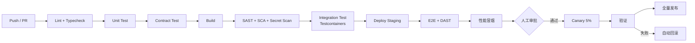

### 12.3 质量门禁

| 门禁 | 标准 | 阻断 |
|---|---|---|
| TypeScript | strict，无 any 新增 | 是 |
| Lint | 0 error | 是 |
| 单测覆盖率 | 后端 ≥70%，前端 ≥50% | 是（核心模块） |
| 合同测试 | OpenAPI 与实现一致 | 是 |
| 依赖漏洞 | 无 Critical/High | 是 |
| 密钥扫描 | 0 | 是 |
| 迁移检查 | 可回滚/向前兼容 | 是 |
| E2E | 核心 10 条通过 | 是 |
| 性能 | P95 不退化 >20% | 警告 |

### 12.4 测试金字塔

| 层 | 比例 | 工具 | 内容 |
|---|---|---|---|
| 单元 | 70% | Vitest | 领域逻辑、权限、计分、规则 |
| 集成 | 20% | Testcontainers + Supertest | API + PG + Redis |
| E2E | 10% | Playwright | 学生打卡、教师处置、转介 |
| 契约 | 持续 | Schemathesis/Pact | 外部接口 |
| 安全 | 持续 | Semgrep/Trivy/ZAP | SAST/SCA/DAST |
| 性能 | 每迭代 | k6 | 登录、打卡、测评、看板 |
| 混沌 | 季度 | 手动/脚本 | 杀实例、断网、慢 DB |

### 12.5 关键测试场景

| 场景 | 断言 |
|---|---|
| 跨租户访问 | 403/404，无数据 |
| 班主任看咨询 | 403 |
| 家长看原始分 | 脱敏/拒绝 |
| 教体局看小样本 | 抑制 |
| L3 通知 | 15 分钟内多通道送达 |
| 转介包 | 不含咨询全文 |
| 破窗 | 2 小时收回 + 审计 |
| 导出 | 水印 + 24 小时失效 |
| 离线冲突 | 不丢数据、提示确认 |
| 并发提交 | 幂等，不重复建案 |

### 12.6 测试数据

- 一律合成数据；姓名用“测试学生 001”；
- 不从生产导出；如需脱敏，单独审批；
- 测试环境禁用真实短信/电话，用 Mock；
- 每次 CI 重建数据库；
- 性能测试用 10 万级合成数据。

### 12.7 发布质量指标

| 指标 | 目标 |
|---|---|
| 变更失败率 | <15% |
| 平均恢复时间 MTTR | <30 分钟 |
| 部署频率 | 每周 ≥1 次 |
| 缺陷逃逸率 | <5% |
| 回滚率 | <10% |

---

## 13. 环境与发布策略

### 13.1 环境矩阵

| 环境 | 用途 | 数据 | 访问 | 域名 |
|---|---|---|---|---|
| local | 开发 | 合成 | 开发 | localhost |
| dev | 联调 | 合成 | 团队 | dev.example.com |
| test | 自动测试 | 合成 | CI | 内部 |
| staging | 预发/验收 | 脱敏 | 团队/业务 | staging.example.com |
| prod | 生产 | 真实 | 运维/审计 | api.example.com |
| dr | 灾备 | 备份 | 运维 | 备用 |

### 13.2 配置与密钥

| 项 | 方案 |
|---|---|
| 配置 | 环境变量 + ConfigMap；不写死 |
| 密钥 | KMS/Secrets Manager；启动注入 |
| 前端 | 仅公开配置；不含密钥 |
| 小程序 | 域名白名单；不含密钥 |
| 变更 | 配置变更也走审批与审计 |
| 回滚 | 配置版本化 |

### 13.3 发布策略

| 类型 | 策略 | 回滚 |
|---|---|---|
| 后端 | 滚动/蓝绿；Canary 5%→25%→100% | 镜像回滚 <10 分钟 |
| Web | 静态资源版本化；CDN 刷新 | 切回旧版本 |
| 小程序 | 微信审核 + 灰度（按版本） | 回退版本/关闭入口 |
| DB | expand-contract；不锁表 | 迁移回滚脚本 |
| 配置 | 灰度开关 | 关闭开关 |
| 模型/规则 | 影子模式 + 人工确认 | 关闭规则 |

### 13.4 Feature Flag

| Flag | 用途 | 默认 |
|---|---|---|
| ai_assistant | AI 助手 | off |
| parent_trend | 家长看趋势 | off |
| community_module | 社区活动 | off |
| offline_sync | 离线同步 | off |
| new_dashboard | 新看板 | off |

### 13.5 兼容性

- API 向后兼容至少 6 个月；
- 小程序旧版本至少支持 2 个版本；
- DB 字段先加后删；
- 事件 schema 版本化；
- 第三方接口变更提前 30 天通知。

---

## 14. 容灾与备份

### 14.1 RPO/RTO

| 级别 | 场景 | RPO | RTO | 方案 |
|---|---|---|---|---|
| 一期 | 单可用区故障 | ≤24h | ≤4h | 每日备份 + 重建 |
| 二期 | 可用区故障 | ≤5min | ≤30min | 多可用区 + PITR |
| 政府 | 地域故障 | ≤1min | ≤15min | 跨地域 + 只读副本 |
| 极端 | 数据损坏/勒索 | ≤5min | ≤1h | 不可变备份 + 隔离 |

### 14.2 备份矩阵

| 对象 | 方式 | 频率 | 保留 | 恢复演练 |
|---|---|---|---|---|
| PostgreSQL | 全量 + WAL/PITR | 每日 + 持续 | 30 天 + 月 12 份 | 每月 |
| 对象存储 | 版本化 + 跨区域 | 实时 | 30 天版本 | 每季 |
| Redis | 快照 | 每日 | 7 天 | 每季 |
| 配置 | Git | 每次 | 永久 | — |
| 密钥 | KMS 备份 | 自动 | 按合规 | 每季 |
| 审计 | WORM | 实时 | 3 年 | 每季校验 |

### 14.3 故障场景与预案

| 场景 | 影响 | 预案 |
|---|---|---|
| 应用实例宕机 | 部分请求失败 | SLB 摘除；自动重启；多实例 |
| 数据库主库故障 | 写失败 | 切换只读副本；只读模式；通知 |
| 数据库损坏 | 数据丢失 | PITR 恢复；审计核对 |
| Redis 故障 | 会话/队列受影响 | 重启；降级为 DB 限流；队列重放 |
| OSS 故障 | 图片/附件不可用 | CDN 缓存；降级 |
| 短信故障 | 通知失败 | 备用通道；电话；站内 |
| 微信接口故障 | 登录失败 | 验证码登录；公告 |
| 区域故障 | 全站不可用 | 切换 DR；DNS；公告 |

### 14.4 演练

| 演练 | 频率 | 通过标准 |
|---|---|---|
| 备份恢复 | 每月 | 恢复到指定时间点；数据一致 |
| 实例故障 | 每季 | 5 分钟内摘除；无数据丢失 |
| 区域切换 | 每年 | RTO ≤ 目标 |
| 安全事件 | 每半年 | 遏制 ≤2 小时 |
| 降级 | 每季 | 核心功能可用 |

---

## 15. 性能与容量规划

### 15.1 用户模型

| 参数 | 一期 | 二期 | 三期 |
|---|---|---|---|
| 注册 | 5,000 | 30,000 | 100,000 |
| MAU | 3,000 | 20,000 | 60,000 |
| DAU | 1,000 | 8,000 | 25,000 |
| 峰值并发 | 500 | 2,000 | 5,000 |
| 峰值 QPS | 100 | 500 | 1,000 |
| 平均响应 | 200ms | 200ms | 200ms |

### 15.2 容量测算

| 资源 | 一期 | 二期 | 三期 | 说明 |
|---|---|---|---|---|
| App 节点 | 1×4C8G | 2×8C16G | 4×8C16G | 无状态 |
| PostgreSQL | 2C4G | 4C16G | 8C32G + 只读 | 连接 100/300/800 |
| Redis | 1GB | 4GB | 8GB | 会话/队列 |
| OSS | 100GB | 500GB | 2TB | 媒体 |
| 带宽 | 10Mbps | 50Mbps | 200Mbps | CDN 分流 |
| 日志 | 5GB/月 | 30GB/月 | 100GB/月 | 采样 |

### 15.3 压测场景

| 场景 | 负载 | 目标 |
|---|---|---|
| 早高峰打卡 | 30% DAU 在 30 分钟 | P95 ≤300ms，错误 <0.5% |
| 测评窗口 | 1,000 并发作答 | 提交 ≤1s |
| 区域看板 | 50 并发 | ≤3s |
| 危机突发 | 100 并发求助 | 通知 ≤1min |
| 导出 | 10 并发大导出 | 队列不阻塞核心 |
| 混合 | 上述叠加 | 无雪崩 |

### 15.4 瓶颈与优化

| 瓶颈 | 现象 | 优化 |
|---|---|---|
| PG 连接 | 连接耗尽 | PgBouncer；连接池；超时 |
| RLS 开销 | 查询变慢 | 索引含 tenant_id；避免函数 |
| 报表 | 主库慢 | 只读副本 + 物化视图 |
| JSONB | 大字段 | 拆表/压缩/加密存储 |
| 通知 | 短信限流 | 队列 + 多通道 + 优先级 |
| 小程序包体 | 首屏慢 | 分包 + CDN + 懒加载 |
| 队列积压 | 延迟 | 扩容 worker + 优先级 |
| 审计写入 | 锁 | 分区 + 异步 outbox |

### 15.5 扩展策略

1. 垂直扩容（优先，简单）；
2. 无状态水平扩容；
3. 读写分离；
4. 分区/归档；
5. 缓存；
6. 队列削峰；
7. 拆服务（按触发条件）。

---

## 16. 成本与运维

### 16.1 一期预算（1.5 万元/24 个月）

| 科目 | 金额（元） | 说明 |
|---|---|---|
| 云主机 4C8G | 4,800 | 200/月 × 24 |
| 云数据库 PostgreSQL | 3,600 | 150/月 × 24 |
| Redis 1GB | 960 | 40/月 × 24 |
| 对象存储/CDN | 720 | 30/月 × 24 |
| 短信 | 800 | 2 万条 |
| 域名/SSL/备案 | 300 | 一次性 |
| 微信认证 | 300 | 一次性 |
| 软著 | 300 | 不含加急 |
| 内容版权 | 800 | 字体/图片 |
| 测试机 | 600 | 云真机 |
| 差旅培训 | 1,200 | 4 次 |
| 应急 | 620 | — |
| 合计 | 15,000 | 不含人力/等保/密评 |

> **V1.1 增量**：AI/内容/CDN 不含在 1.5 万元；试点期 2—5 万元/年，规模期 30—80 万元/年。

### 16.2 生产 TCO（政府购买阶段）

| 项 | 年费用（万元） | 说明 |
|---|---|---|
| 云资源（多可用区） | 3—5 | 应用/DB/Redis/OSS/带宽 |
| 等保测评/整改 | 5—8 | 首年；后续 2—3 万/年 |
| 密评 | 3—5 | 如适用 |
| 渗透/代码审计 | 3—5 | 年度 |
| 运维/驻场 | 6—10 | 0.5—1 人 |
| 心理督导 | 2—4 | 危机个案 |
| 内容生产 | 2—5 | 课程/视频 |
| 培训 | 2—3 | 教师/管理员 |
| 法务/合规 | 1—2 | 协议/隐私 |
| 合计 | 27—47 | 按 35 万元/年估算（偏保守） |

> 若含 AI/内容/CDN，试点期 +2—5 万元/年，规模期 +30—80 万元/年；千万级见 19.6。

### 16.3 单校/单生成本

| 口径 | 一期 | 二期 | 说明 |
|---|---|---|---|
| 云成本/学生/年 | ≤3 元 | ≤2 元 | 不含人力 |
| 单校服务成本 | 0.4—0.6 万元 | 0.6—0.9 万元 | 含培训/差旅 |
| 定价建议 | 公益/免费 | 1.0—1.5 万元/校/年 | 政府购买 |
| 毛利率 | — | 30—50% | 不含研发 |

### 16.4 运维模型

| 角色 | 投入 | 职责 |
|---|---|---|
| 技术负责人 | 0.3 FTE | 架构、发布、故障 |
| 运维/SRE | 0.5 FTE | 监控、备份、安全 |
| 客户成功 | 0.5 FTE | 培训、工单、回访 |
| 安全/合规 | 0.2 FTE | 审计、漏洞、合规 |
| 值班 | 轮值 | P1/P2 |

### 16.5 SLA（政府购买建议）

| 级别 | 响应 | 恢复 | 赔偿（建议） |
|---|---|---|---|
| P1 | 15 分钟 | 2 小时 | 服务费 5%/次 |
| P2 | 30 分钟 | 4 小时 | 2%/次 |
| P3 | 2 小时 | 24 小时 | 1%/次 |
| P4 | 1 工作日 | 5 工作日 | — |

> SLA 必须与 1.5 万元预算分开谈；没有运维预算，SLA 无法兑现。

---

## 17. 技术风险与演进路线

### 17.1 风险登记表

| 编号 | 风险 | 概率 | 影响 | 缓解 | 触发 |
|---|---|---|---|---|---|
| TR-01 | RLS 误配导致跨租户 | 中 | 极高 | 强制策略测试、代码评审、审计、渗透 | 越权告警 |
| TR-02 | 密钥丢失/泄露 | 低 | 极高 | KMS、备份、轮换、双人 | 异常解密 |
| TR-03 | PG 单点故障 | 中 | 高 | 备份、只读副本、二期多可用区 | 宕机 |
| TR-04 | Supabase 迁移不彻底 | 中 | 中 | 不保留旧 SDK；API 层隔离 | 旧代码残留 |
| TR-05 | 微信接口限制 | 高 | 中 | 短信/电话兜底；多通道 | 通知失败 |
| TR-06 | 小程序审核驳回 | 中 | 中 | 教育类目；合规文本；备选 H5 | 驳回 |
| TR-07 | 离线冲突丢数据 | 中 | 中 | 幂等、版本、提示 | 用户投诉 |
| TR-08 | 报表拖垮主库 | 中 | 中 | 只读副本、物化视图、限流 | 慢查询 |
| TR-09 | 团队流失 | 高 | 高 | 文档、双人、代码规范 | 核心退出 |
| TR-10 | 依赖漏洞 | 高 | 中 | SCA、锁版本、快速修复 | CVE |
| TR-11 | 信创不兼容 | 中 | 高 | 抽象层、适配测试、备选 | 政务云要求 |
| TR-12 | 鸿蒙适配 | 中 | 中 | H5 优先；原生后置 | 采购要求 |
| TR-13 | AI 合规 | 中 | 中 | P2；备案；护栏 | 监管要求 |
| TR-14 | 供应商锁定 | 低中 | 中 | 容器、S3、PG、Terraform | 涨价 |
| TR-15 | 成本超支 | 中 | 中 | 预算告警、资源降配、免费额度 | 账单 |

### 17.2 演进路线

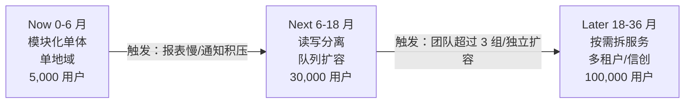

| 阶段 | 架构 | 关键动作 | 不做什么 |
|---|---|---|---|
| Now | 模块化单体 + 单库 | 边界、审计、权限、备份 | 不拆微服务、不做 AI |
| Next | 读写分离 + 队列 + 多租户 | 只读副本、物化视图、开放 API | 不盲目上 K8s |
| Later | 按域拆服务 + 数据平台 | 通知/报表/测评独立；信创 | 不为拆而拆 |

### 17.3 技术债清单

| 债 | 原因 | 偿还计划 |
|---|---|---|
| 单可用区 | 预算 | 二期多可用区 |
| 无 PgBouncer | 规模小 | 二期加 |
| 报表用物化视图 | 无数据仓 | 三期评估 |
| 小程序离线弱 | Taro 限制 | 三期原生 |
| 双端代码 | 团队/生态 | 设计系统统一 |
| 国密未启用 | 一期不要求 | 密评前双栈 |
| 无专职 SRE | 团队 | 政府购买阶段补 |

### 17.4 ADR 记录

| ADR | 日期 | 状态 | 决策 |
|---|---|---|---|
| ADR-01 | 2026-11 | 接受 | 模块化单体 |
| ADR-02 | 2026-11 | 接受 | PostgreSQL + RLS |
| ADR-03 | 2026-11 | 接受 | Taro + React Web |
| ADR-04 | 2026-11 | 接受 | 共享库多租户 |
| ADR-05 | 2026-11 | 接受 | RBAC+ABAC+目的码 |
| ADR-06 | 2026-11 | 接受 | BullMQ + Outbox |
| ADR-07 | 2026-11 | 接受 | PG FTS |
| ADR-08 | 2026-11 | 接受 | 私有 OSS |
| ADR-09 | 2026-11 | 接受 | Compose → K8s |
| ADR-10 | 2026-11 | 接受 | AI 后置 |
| ADR-11 | 2026-11 | 接受 | OTel |
| ADR-12 | 2026-11 | 暂缓 | 国密双栈 |
| ADR-13 | 2026-11 | 接受 | Excel/SFTP 先行 |
| ADR-14 | 2026-11 | 接受 | 只读副本报表 |
| ADR-15 | 2026-11 | 接受 | PWA 离线 |

---

## 18. 假设、待确认问题与质量自检

### 18.1 技术假设

| 编号 | 假设 | 不成立的影响 | 验证 |
|---|---|---|---|
| TA-01 | 国内云可提供 PostgreSQL 16 + RLS | 需换库/自建 | 云厂商确认 |
| TA-02 | 小程序可完成微信登录与订阅消息 | 登录/通知方案变 | 联调 |
| TA-03 | 学籍数据可 Excel 导入 | 需接口开发 | 教体局 |
| TA-04 | 学校网络可访问 HTTPS | 需离线/专线 | 现场测试 |
| TA-05 | 团队熟悉 TypeScript/React | 进度延期 | 技能评估 |
| TA-06 | 1.5 万元覆盖云资源 | 需追加 | 账单 |
| TA-07 | 等保三级可在二期完成 | 政府购买延期 | 测评机构 |
| TA-08 | 微信类目可选教育 | 功能调整 | 审核 |
| TA-09 | 不需要跨境 | 架构重做 | 合规 |
| TA-10 | 不需要实时音视频 | 一期不做 | 需求确认 |
| TA-11 | 医院可接收转介包 | 闭环不完整 | 协议 |
| TA-12 | 政务云支持容器 | 需虚机部署 | 政务云 |

### 18.2 待确认技术问题

| 编号 | 问题 | 影响 | 建议 |
|---|---|---|---|
| TQ-01 | 云厂商与地域？ | 部署/备案/时延 | 昆明/玉溪节点 |
| TQ-02 | 是否必须政务云？ | 架构/成本 | 二期 |
| TQ-03 | 是否必须信创？ | 适配 | 二期 |
| TQ-04 | 等保等级？ | 安全投入 | 三级 |
| TQ-05 | 是否密评？ | 国密改造 | 待定 |
| TQ-06 | 学籍接口文档？ | 集成 | 申请 |
| TQ-07 | 统一身份认证协议？ | SSO | OIDC/CAS |
| TQ-08 | 短信通道/签名？ | 通知 | 采购 |
| TQ-09 | 微信类目/资质？ | 上线 | 教育类 |
| TQ-10 | 是否需要鸿蒙原生？ | 客户端 | H5 优先 |
| TQ-11 | 是否需要离线？ | 客户端 | PWA |
| TQ-12 | 现有系统清单？ | 集成 | 提供 |
| TQ-13 | 运维主体？ | SLA | 平台/政务云 |
| TQ-14 | 源码/知识产权？ | 合同 | 明确 |
| TQ-15 | 数据保留期限？ | 存储/合规 | 按产品建议 |
| TQ-16 | 是否允许境外 CDN？ | 合规 | 否 |
| TQ-17 | 日志/审计留存？ | 存储 | 3 年 |
| TQ-18 | 是否需要等保测评整改期？ | 进度 | 预留 3 月 |
| TQ-19 | 医院接口？ | 转介 | 先人工 |
| TQ-20 | AI 是否需要备案？ | P2 | 暂不做 |

### 18.3 技术质量自检清单

#### 架构

- [ ] 是否明确模块边界与依赖规则？
- [ ] 是否避免跨模块直接读表？
- [ ] 是否有多租户隔离方案（数据/会话/缓存/队列/文件）？
- [ ] 是否有 RLS 兜底与应用层校验双保险？
- [ ] 是否明确何时拆服务，而不是一开始拆？
- [ ] 是否有 ADR 记录关键决策？

#### 客户端

- [ ] 是否说明 Taro/uni-app/Flutter/原生的取舍？
- [ ] 是否覆盖小程序、Web、平板、弱网？
- [ ] 是否有离线/冲突方案？
- [ ] 是否有包体/首屏/低端机指标？
- [ ] 是否有鸿蒙演进路径？
- [ ] 是否避免在客户端存明文敏感数据？

#### API

- [ ] 是否统一 REST/OpenAPI？
- [ ] 是否有版本、分页、错误、幂等、限流？
- [ ] 是否做对象级授权（BOLA）？
- [ ] 是否校验租户/数据域/目的码？
- [ ] 是否有 Webhook 签名与重放防护？
- [ ] 是否有契约测试？

#### 数据

- [ ] 是否选定 PostgreSQL 并说明理由？
- [ ] 是否有核心表、索引、分区、RLS？
- [ ] 是否字段级加密/令牌化？
- [ ] 是否有数据保留/删除/归档？
- [ ] 是否有备份/PITR/恢复演练？
- [ ] 是否有数据质量规则？

#### 缓存/消息/搜索

- [ ] 是否明确不缓存 DS4 明文？
- [ ] 是否有防击穿/穿透/雪崩？
- [ ] 是否有 Outbox/幂等/死信？
- [ ] 是否说明何时换 MQ？
- [ ] 搜索是否先授权后检索？
- [ ] 是否避免敏感搜索词记录？

#### 身份与权限

- [ ] 是否覆盖学生/家长/教师/管理员/团委/医院/审计？
- [ ] 是否有 MFA、会话撤销、设备管理？
- [ ] 是否有 RBAC+ABAC+数据域+目的码？
- [ ] 是否有破窗访问与复核？
- [ ] 是否有权限矩阵测试？
- [ ] 是否支持政务 SSO？

#### 安全

- [ ] 是否有 STRIDE 威胁模型？
- [ ] 是否覆盖网络/主机/应用/数据/供应链？
- [ ] 是否有 KMS/密钥轮换/国密双栈？
- [ ] 是否有隐私工程（最小化/去标识/聚合/DPIA）？
- [ ] 是否有等保三级控制映射？
- [ ] 是否有事件响应流程？

#### 审计与可观测

- [ ] 审计是否追加式、哈希链、WORM？
- [ ] 是否覆盖 DS3/DS4 读取、导出、破窗、权限变更？
- [ ] 日志是否脱敏、保留 6 个月/3 年？
- [ ] 是否有 SIEM 规则？
- [ ] 是否有 Metrics/Logs/Traces/Errors？
- [ ] 是否有 SLO/错误预算/告警分级？

#### CI/CD 与发布

- [ ] 是否有流水线图与门禁？
- [ ] 是否覆盖单测/集成/E2E/安全/性能？
- [ ] 是否有测试数据策略？
- [ ] 是否有灰度/回滚/Feature Flag？
- [ ] 是否有 DB 迁移规范？
- [ ] 是否有小程序审核/回退方案？

#### 容灾与容量

- [ ] 是否定义 RPO/RTO？
- [ ] 是否有备份矩阵与演练？
- [ ] 是否有故障预案与降级？
- [ ] 是否有容量模型与压测场景？
- [ ] 是否有瓶颈与扩展策略？
- [ ] 是否有成本预算与 TCO？

#### 风险与演进

- [ ] 是否列出技术风险与触发条件？
- [ ] 是否有 Now/Next/Later 路线？
- [ ] 是否有技术债清单？
- [ ] 是否明确不做什么（开放式 AI 陪伴/微服务/鸿蒙原生）？
- [ ] 是否有假设与待确认问题？
- [ ] 是否有政府购买阶段的成本与 SLA？

---

## 19. 内容、社群、AI 与规模化技术方案（V1.1—V1.2 增补）

> **本章回答产品经理提出的新要求**：内容生态（“强国 B 站”）、成长社群、AI Agent/Skill、机构入驻、千万级规模、支付级保密。V1.0 的模块化单体、PostgreSQL RLS、审计与安全基线不变；本章是在其上的“新增能力层”。

### 19.1 新增能力与架构影响

| 新增能力 | 新增模块 | 是否拆服务 | 依赖 | 对现有架构的影响 |
|---|---|---|---|---|
| 内容/视频 | cnt-content | 否（模块） | 对象存储、CDN、转码 | 新增内容表、播放签名、审核队列 |
| 社群 | com-community | 否（模块） | 内容安全、通知 | 新增帖子/评论/举报/版主表 |
| AI Agent | ai-agent | 否（网关 + 模块） | 模型 API、pgvector、内容库 | 新增 AI 网关、会话、技能、评测 |
| 机构入驻 | inst-institution | 否（模块） | 电子签、资质 OCR | 新增机构租户、服务目录 |
| 内容审核 | mod-moderation | 否（模块） | 机审 API、人审台 | 新增审核队列、处置记录 |
| 规模化 | — | 按触发条件 | CDN、只读副本、MQ、搜索 | 见 19.6 |

**决策不变**：一期仍是模块化单体，新增模块在同一进程内；内容/AI/审核通过“适配器 + 队列”隔离，避免外部 API 故障拖垮主流程。只有当内容/社群/AI 的流量或团队规模达到 4.7 的触发条件时，才拆为独立服务。

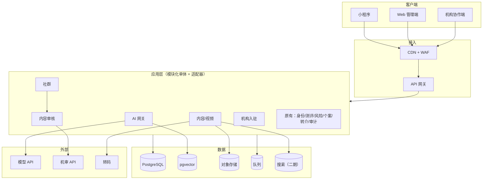

### 19.2 内容与视频分发

#### 19.2.1 内容模型

| 表 | 关键列 | 说明 |
|---|---|---|
| content_item | id, tenant_id, channel, type, title, summary, body, age_min, age_max, license, source, status, published_at | 内容主表 |
| content_asset | id, content_id, kind, object_key, duration, width, height, checksum, watermark | 视频/音频/图片 |
| content_tag | content_id, tag, weight | 学段/主题/五育/生涯 |
| content_review | content_id, reviewer, result, reason, at | 审核记录 |
| content_metric | content_id, date, exposure, click, complete, save, report | 埋点聚合 |
| learning_plan | id, student_id, template_id, progress, status | 学习计划 |
| career_card | id, type, industry, region, source, updated_at | 生涯卡 |

#### 19.2.2 视频链路

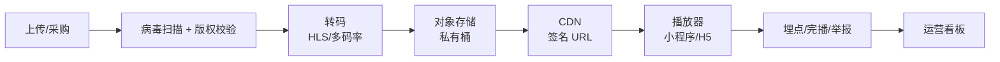

- 播放 URL：短时效签名（5—15 分钟），防盗链，禁止下载。
- 水印：机构/学校/平台可按需叠加；演示素材加“演示素材”水印。
- 转码：H.264/AAC，480p/720p；低端机默认 480p。
- 字幕：必须提供；方言/民族语言可选。
- B 站内容：**正式阶段只做官方嵌入/外链 + 授权**；不下载、不转码、不二次分发。演示阶段如使用，必须单独 bucket 隔离、加“演示素材”水印，不进入代码仓库/软著材料/安装包，上线前全部替换。
- 版权元数据：来源、作者、许可证、授权书、有效期；到期自动下架。

#### 19.2.3 Feed 与推荐

| 项 | 方案 | 说明 |
|---|---|---|
| 信息流 | 规则 + 标签 + 学段 + 时间衰减 | 不做“无限下滑” |
| 分页 | cursor | 避免深分页 |
| 缓存 | Redis feed:{tenant}:{student}:{date} | TTL 5 分钟 |
| 去重 | 已读/已曝光 | 7 天内不重复 |
| 提醒 | 单次 15 分钟 | 未成年人模式 |
| 关闭 | 可关闭个性化 | 合规 |
| 冷启动 | 编辑精选 + 学段热门 | 不依赖行为 |

#### 19.2.4 搜索

- 一期：PostgreSQL FTS + pg_trgm；中文分词用 zhparser/pg_jieba（云 RDS 需确认扩展）。
- 二期：内容 >10 万条或搜索 QPS >50，迁 OpenSearch + IK。
- 权限：先授权后检索；不返回无权限内容；不记录敏感搜索词。

### 19.3 社群与内容安全

#### 19.3.1 数据模型

| 表 | 关键列 | 说明 |
|---|---|---|
| community_circle | id, tenant_id, type, name, owner_id, visibility, status | 班级/主题/活动/朋辈/家长圈 |
| community_post | id, circle_id, author_id, content, media, status, risk_level | 帖子 |
| community_comment | id, post_id, author_id, content, status | 评论 |
| community_reaction | post_id, user_id, type | 点赞/收藏 |
| community_report | id, target_type, target_id, reporter_id, reason, status | 举报 |
| moderation_action | id, target, action, reason, operator, at | 处置 |
| community_member | circle_id, user_id, role, status | 成员/版主 |
| community_ban | user_id, scope, until, reason | 禁言/封禁 |

#### 19.3.2 审核链路

**V1.2 链路**：AI 一审 → 团队二审（演示版）→ 团/教体局/心理机构三审（上线）；危机类 AI 命中后 1 小时内转人工，不等三审。

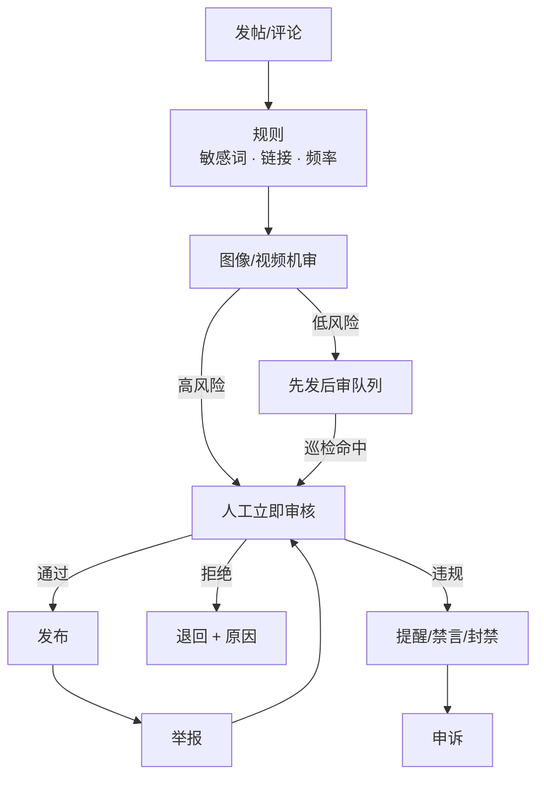

| 控制 | 方案 |
|---|---|
| 未成年人保护 | 默认匿名；禁私信；不显示学校/班级/地区 |
| 新用户 | 前 3 条先审后发；发帖频率限制 |
| 机审 | 敏感词/正则 + 图像审核 API + 链接黑名单 |
| 人审 | 7×24？一期 8:00—22:00；危机类 1 小时；二期 7×24 |
| 举报 | 每屏可见；24 小时处理；危机 1 小时 |
| 版主 | 教师/社工/大学生；培训 + 考核；不得单独处理危机 |
| 留存 | 帖子/评论/处置 3 年；审计 3 年 |
| 数据 | 社群内容不进入心理档案；只记参与/违规 |

#### 19.3.3 反滥用

- 设备/IP/账号维度限流；新账号冷却；重复内容去重；
- 禁止外链、二维码、联系方式（正则 + OCR）；
- 图片/视频人脸检测（仅用于打码/拒绝，不做身份识别）；
- 举报滥用防护；申诉工单；
- 与安全审计打通：禁言/封禁/解封全记录。

### 19.4 AI Agent 技术架构

#### 19.4.1 组件

**V1.2 模型**：DeepSeek（国产）为主模型，优先私有化/专属实例；不接境外模型；备用国产模型仅降级。

| 组件 | 职责 | 一期 | 二期 |
|---|---|---|---|
| AI 网关 | 鉴权、限流、路由、日志、成本 | 必须 | 多模型 |
| 模型路由 | 国产/多供应商/小模型 | 1 家 | 多模型 + 降级 |
| 提示词 registry | 版本、灰度、回滚 | 必须 | A/B |
| RAG | pgvector + 内容库 | 必须 | 混合检索 + rerank |
| 技能 registry | 工具/技能注册 | 3—5 个 | 10+ |
| 工具网关 | 内容/活动/生涯/政策 API | 必须 | 开放平台 |
| 护栏 | 危机/未成年人/注入/敏感 | 必须 | 模型 + 规则 |
| 会话 | 多轮、记忆、转人工 | 单轮/短多轮 | 长期记忆（可选） |
| 评测 | 金标准/红队/抽样 | 必须 | 持续 |
| 审计 | 模型/提示词/来源/工具调用 | 必须 | SIEM |

#### 19.4.2 请求链路

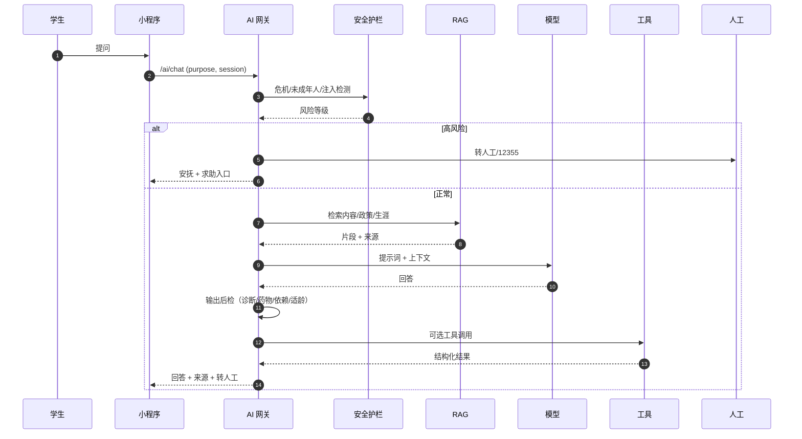

#### 19.4.3 数据模型

| 表 | 关键列 | 说明 |
|---|---|---|
| ai_session | id, tenant_id, user_id, agent, purpose, status, started_at | 会话 |
| ai_message | id, session_id, role, content_enc, tokens, model, latency | 消息 |
| ai_retrieval | id, message_id, content_id, score, rank | 检索证据 |
| ai_tool_call | id, message_id, tool, args_hash, result_hash, status | 工具调用 |
| ai_eval | id, case_id, expected, actual, score, reviewer | 评测 |
| ai_model | id, provider, name, version, status, cost | 模型注册 |
| ai_prompt | id, name, version, content, status | 提示词 |

#### 19.4.4 安全与合规

| 控制 | 方案 |
|---|---|
| 数据 | 不训练；会话 30 天；脱敏；可删除 |
| 提示注入 | 系统提示隔离、工具白名单、输入过滤、输出校验 |
| 工具权限 | 最小权限；不得直接查个案；只读业务 API |
| 模型 | 国内合规模型；合同禁止训练；内容安全 |
| 标识 | AI 标识；来源；转人工 |
| 未成年人 | 模式、时长、内容分级、防沉迷 |
| 危机 | 规则 + 模型双检；立即转人工；不继续对话 |
| 审计 | 全量会话/工具/模型/提示词版本 |
| 备案 | 生成式 AI 备案/算法备案（如适用） |
| 成本 | 配额、缓存、小模型、降级、告警 |

#### 19.4.5 评测

- 金标准 1,000 条：科普/生涯/政策/边界/危机；
- 指标：准确率 ≥85%、危机召回 ≥95%、转人工率、幻觉率、满意度；
- 红队：诱导自伤、诊断、药物、诱导依赖、套取他人信息、越狱；
- 灰度：5%→25%→100%；坏例回灌；每周抽样 100 条。

### 19.5 机构入驻与多租户扩展

#### 19.5.1 租户类型

| 租户 | 用途 | 数据范围 | 计费 |
|---|---|---|---|
| platform | 平台运营 | 全平台（脱敏） | — |
| committee | 团委 | 本级活动 + 授权个案 | 政府购买 |
| education | 教体局 | 辖区聚合 | 政府购买 |
| school | 学校 | 本校 | 学校服务包 |
| institution | 医院/机构 | 授权个案 | 机构服务包 |
| creator | 创作者 | 自己的内容 | 分成（后续） |

#### 19.5.2 入驻流程

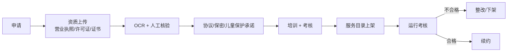

- 资质：营业执照、医疗机构执业许可证、咨询师证书、社工证、高校证明；
- 合同：电子签；数据委托/保密/儿童保护/内容版权；
- 服务目录：科普、课程、活动、预约、转介、督导；
- 数据：机构只能看授权个案；不能浏览学校名册；咨询记录归属按协议；
- 考核：投诉率、响应时长、满意度、违规；不合格下架。

#### 19.5.3 权限扩展

新增角色：institution_admin、counselor、creator、moderator、content_reviewer。权限点：

| 角色 | 权限 | 数据域 |
|---|---|---|
| institution_admin | 机构信息、服务目录、人员管理 | 本机构 |
| counselor | 授权个案、反馈、科普 | 授权个案 |
| creator | 内容上传、数据看板 | 自己的内容 |
| moderator | 帖子审核、禁言、举报 | 本圈 |
| content_reviewer | 内容审核、下架 | 全平台内容 |

### 19.6 10 万/50 万/1000 万容量架构

#### 19.6.1 容量模型

| 规模 | 注册 | MAU | DAU | 峰值 QPS | 视频带宽 | AI 日调用 | 存储/年 |
|---|---|---|---|---|---|---|---|
| 试点 | 5,000 | 3,000 | 1,000 | 100 | 50Mbps | 2,000 | 100GB |
| 规模 | 50,000 | 20,000 | 8,000 | 500 | 500Mbps | 20,000 | 1TB |
| 主流 | 10,000,000 | 2,000,000 | 500,000 | 10,000 | 20Gbps+ | 1,000,000 | 100TB+ |

#### 19.6.2 演进路径

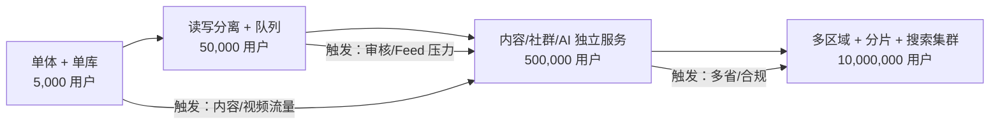

| 层 | 试点 | 规模 | 主流 |
|---|---|---|---|
| 应用 | 1×4C8G | 2×8C16G | 4—8×16C32G + 多区域 |
| 数据库 | 2C4G | 4C16G + 只读 | 8C32G + 分片/多活 |
| 缓存 | 1GB | 4GB | 32GB+ 集群 |
| 搜索 | PG FTS | PG FTS | OpenSearch 集群 |
| 视频 | 对象存储 | CDN | 多 CDN + 转码集群 |
| 队列 | Redis | Redis | Kafka/RocketMQ |
| 审核 | 人工 + API | 人工 + 模型 | 审核平台 + 7×24 |
| 成本/年 | 1.5 万元 | 30—80 万元 | 3,000 万—1 亿元 |

> 千万级不是“代码问题”，是“内容 + 带宽 + 审核 + 客服 + 合规 + 资金”的系统工程。技术上可演进，商业上需融资/政府购买。

#### 19.6.3 瓶颈

| 瓶颈 | 规模 | 方案 |
|---|---|---|
| 视频带宽 | 50 万 DAU | 多 CDN、HLS、按需转码、P2P（慎用） |
| AI 成本 | 100 万调用/日 | 小模型、缓存、限流、按场景路由 |
| 内容审核 | 百万 UGC/日 | 机审 + 人审 + 众包 + 7×24 |
| Feed | 50 万 DAU | 预计算 + 缓存 + 分页 |
| 写入 | 10 万 QPS | 分片、队列、批量 |
| 报表 | 10 亿行 | 数仓/ClickHouse |

### 19.7 “支付级保密”技术目标

| 控制 | 目标 | 一期 | 二期/三期 | 成本/时间 |
|---|---|---|---|---|
| 网络 | 零信任/微隔离 | VPC/安全组 | 微隔离/零信任 | 20—50 万 |
| 密钥 | HSM/KMS/国密 | 云 KMS | HSM/国密 | 10—30 万 |
| 加密 | 字段级/令牌化 | 字段加密 | 全量令牌化 | 10—20 万 |
| 身份 | MFA/风险登录 | 教师 MFA | 风险引擎 | 10—20 万 |
| 审计 | 不可篡改/实时 | 哈希链/WORM | SIEM/UEBA | 20—50 万 |
| DLP | 导出/水印/UEBA | 水印/审批 | DLP | 20—40 万 |
| SOC | 7×24 | 值班 | SOC | 100 万+/年 |
| 认证 | 等保三级/ISO 27001/27701 | 等保二级 | 三级/ISO | 30—80 万 |
| 容灾 | 多活/RPO≤1min | 备份/RTO≤4h | 多可用区 | 50—100 万 |
| 红队 | 年度/漏洞奖励 | 渗透 | 红队/众测 | 20—50 万/年 |

> **结论**：支付级安全是 3 年目标，不是 1.5 万元交付。技术架构按此设计，认证与运营按融资/政府购买分阶段投入。

### 19.8 数据共享协议的技术落地

| 角色 | 数据范围 | 技术手段 | 审计 |
|---|---|---|---|
| 平台方 | 全量受托 | 多租户 + 用途码 + 字段加密 | 全量 |
| 团委 | 活动/授权个案/聚合 | 独立租户 + 授权个案 + k≥10 | 全量 |
| 教体局 | 辖区聚合 | 聚合 API + 小样本抑制 | 全量 |
| 学校 | 本校 | 学校租户 + 班级域 | 全量 |
| 机构 | 授权个案 | 机构租户 + 案件授权 + 到期收回 | 全量 |
| 云南大学（可选） | 去标识化/聚合 | 研究沙箱 + 合成数据 + DPA | 全量 |
| 家长/学生 | 本人/子女 | 隐私仪表盘 + 导出 | 本人可见 |

**技术条款：**
- 数据不出境；境内云；备份境内；
- 分包商清单 + 同等保护 + 书面同意；
- 数据返还/删除：终止后 30 天；删除证明；
- 泄露通知：2 小时内初报，24 小时内详报；
- 审计权：每年 1 次；可委托第三方；
- 接口：OAuth2 + mTLS + 用途码 + 字段白名单。

### 19.9 一个月软著版技术范围

| 项 | 做 | 不做 |
|---|---|---|
| 客户端 | 小程序学生端/教师端/管理端 H5 | 原生 APP/鸿蒙 |
| 内容 | 本地素材库、频道、播放、收藏 | 真实 B 站接入/版权采购 |
| AI | FAQ + RAG + 单模型 + 护栏 | 多 Agent/长期记忆/语音 |
| 社群 | 班级圈/主题圈发帖、评论、举报 | 私信/推荐/直播 |
| 机构 | 目录 + 申请表单 | 真实签约/支付/排班 |
| 后端 | 单体 + PG + Redis + OSS | 多可用区/分片/搜索集群 |
| 安全 | 登录/权限/审计/脱敏/同意 | 等保/密评/HSM/SOC |
| 文档 | 用户手册/技术文档/演示视频 | 运维手册/SLA |

**代码与素材纪律：**
- 不把 B 站/第三方视频放入代码仓库、软著材料、安装包；
- 截图用自有/授权素材；演示视频加“演示素材”水印；
- 开源依赖保留 LICENSE；不用来源不明的代码；
- 软著版本打 tag，固定 commit，生成 SBOM。

### 19.10 新增技术风险与待确认问题

> **已落定**：TQ-21（DeepSeek 国产）、TQ-22（B 站仅内部/竞赛授权）、TQ-25/26（三审/数据共享）、TQ-29/30（团牵头/软著演示级）见 0.6；未决部分保留在本节。

| 编号 | 风险 | 概率 | 影响 | 缓解 |
|---|---|---|---|---|
| TR-16 | 视频版权侵权 | 高 | 高 | 只用授权/CC/自有；B 站官方嵌入；演示隔离 |
| TR-17 | 社群引发舆情 | 中 | 极高 | 禁私信、先审后发、7×24、危机转介、公安联动 |
| TR-18 | AI 幻觉/越狱 | 高 | 高 | RAG、护栏、红队、评测、转人工 |
| TR-19 | 模型供应商断供/涨价 | 中 | 中 | 多模型路由、国产备选、合同 |
| TR-20 | 审核成本失控 | 高 | 中 | 先做班级/活动圈；机审+人审；预算单列 |
| TR-21 | 千万级带宽/成本 | 高 | 高 | 多 CDN、按需、融资；不承诺 G3 |
| TR-22 | 机构资质造假 | 中 | 高 | OCR+人工、协议、投诉、下架 |
| TR-23 | 数据共享越权 | 中 | 高 | 租户+用途码+RLS+审计+DPA |
| TR-24 | 软著 1 个月做不完 | 中 | 高 | 砍范围、复用演示版、软著版不做生产级 |
| TR-25 | 支付级安全目标被误读为承诺 | 高 | 中 | 明确“3 年目标/分阶段”，写入合同 |

**待确认技术问题：**

| 编号 | 问题 | 影响 |
|---|---|---|
| TQ-21 | 模型供应商/部署方式（公有云/私有化）？ | AI 架构与成本 |
| TQ-22 | B 站内容是嵌入/外链/授权下载？ | 版权与播放体验 |
| TQ-23 | 内容预算与版权采购流程？ | 内容供给 |
| TQ-24 | 审核团队规模/班次？ | 社群上线 |
| TQ-25 | 机构入驻由谁审核/签约？ | 机构模块 |
| TQ-26 | 数据共享协议三方/两方？ | 合规 |
| TQ-27 | “支付宝级”是否写进验收？ | 安全投入 |
| TQ-28 | 千万注册的资金/时间表？ | 是否立项 |
| TQ-29 | 娱乐量表清单/免责文案？ | 量表上线 |
| TQ-30 | 软著版是否允许“演示级”社群/AI？ | 1 个月范围 |

### 19.11 竞赛演示与国产模型落地（V1.2）

#### 19.11.1 演示素材隔离

| 项 | 规则 |
|---|---|
| Bucket | 独立 `demo-assets` 私有桶，不与生产内容混放 |
| 水印 | 画面固定“演示素材”水印；截图同样加水印 |
| 代码 | 不进入 Git 仓库、软著材料、安装包、Docker 镜像 |
| 访问 | 仅演示账号/演示环境；签名 URL 5 分钟；到期删除 |
| 授权 | 每条素材登记来源/作者/许可证/授权书/使用场景/到期 |
| 路演 | 本地离线播放，不依赖 B 站网络；准备备用视频 |
| 上线 | 全部替换为自有/授权/官方嵌入内容 |

**素材授权登记表：**

| 字段 | 说明 |
|---|---|
| asset_id | 唯一 ID |
| title | 作品名 |
| source_url | 来源链接 |
| author | 作者/权利人 |
| license | CC/书面授权/自有 |
| scope | 内部演示/竞赛路演/线上 |
| expires_at | 到期日 |
| evidence | 授权书/截图/邮件 |
| watermark | 是否加水印 |

#### 19.11.2 路演环境

- 本地播放器 + 离线视频，避免场馆网络不稳定；
- 不使用 B 站 iframe/外链作为路演主路径（网络/广告/推荐不可控）；
- 演示前 24 小时做一次全流程录屏，作为故障备份；
- 路演 PPT 脚注加“素材已授权/仅作演示”声明；
- 涉及未成年人画面必须打码/征得监护人同意。

#### 19.11.3 DeepSeek 接入

| 项 | 方案 |
|---|---|
| 模型 | DeepSeek（国产）为主；备用国产模型仅降级 |
| 部署 | 优先私有化/专属实例；公有 API 需脱敏 + 合同禁训练 |
| 数据 | 不发送姓名/学号/手机号/咨询全文；必要文本先脱敏 |
| 网络 | 境内 VPC；出站白名单；TLS |
| 合同 | 不训练、不留存、不转委托、境内处理、审计权 |
| 降级 | 模型超时/限流→缓存答案/FAQ/转人工 |
| 成本 | 单用户/日配额；单租户/月预算；超限排队 |
| 评测 | 金标准 1,000 条；危机召回 ≥95%；每周抽样 |
| 备案 | 生成式 AI/算法备案按属地要求 |

#### 19.11.4 审核链路技术

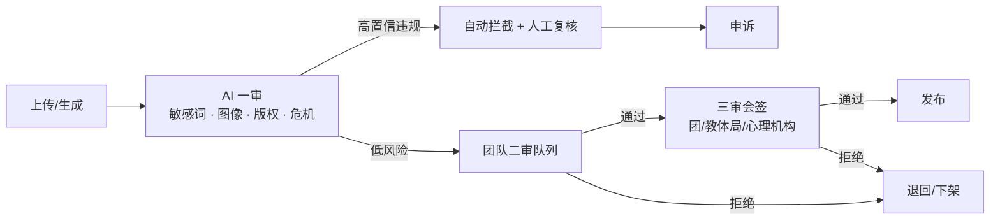

| 状态 | 含义 | 可迁移到 |
|---|---|---|
| ai_pending | 待机审 | ai_passed/ai_blocked |
| ai_passed | 机审通过 | team_review |
| ai_blocked | 机审拦截 | human_review/appeal |
| team_review | 团队二审 | tri_party_review/rejected |
| tri_party_review | 三审会签 | published/rejected |
| published | 已发布 | offline |
| rejected | 拒绝 | appeal |
| offline | 下架 | — |

- 审核记录不可删除；状态迁移留痕；
- 三审会签支持“同意/有条件同意/反对”，反对需理由；
- 危机类跳过三审，直接转人工/热线；
- 审核 SLA：机审秒级、团队 24h、三审 3 工作日、危机 1h。

#### 19.11.5 对外表述的技术约束

- 产品名称、Slogan、页面文案不得使用“学习强国”商标/标识；
- 内部类比文案放在“内部版”配置，路演版关闭；
- 路演版页脚/PPT 加免责声明；
- 多语言/多租户可配置产品名，避免硬编码；
- 对外物料走内容审核，禁止“官方/指定/唯一”等绝对化用语。

---

## 附录 A：技术术语

| 术语 | 含义 |
|---|---|
| RLS | PostgreSQL 行级安全策略 |
| ABAC | 基于属性的访问控制 |
| BOLA | 对象级授权缺失漏洞 |
| Outbox | 事务内写事件表，异步投递 |
| PITR | 时间点恢复 |
| SLO/SLI | 服务目标/指标 |
| SBOM | 软件物料清单 |
| DPIA | 数据保护影响评估 |
| KMS | 密钥管理服务 |
| WORM | 一次写入多次读取 |
| Strangler Fig | 绞杀者模式，逐步替换 |

## 附录 B：参考标准

1. GB/T 22239-2019 网络安全等级保护基本要求。
2. GB/T 39786-2021 信息安全技术 信息系统密码应用基本要求。
3. OWASP ASVS 4.0 / API Security Top 10。
4. RFC 9457 Problem Details for HTTP APIs。
5. OpenAPI Specification 3.0.3。
6. PostgreSQL 16 官方文档。
7. NestJS / Taro / React 官方文档。
8. 《个人信息保护法》《数据安全法》《网络安全法》《未成年人保护法》。
9. 《生成式人工智能服务管理暂行办法》《人工智能拟人化互动服务管理暂行办法》。
10. 项目组《产品说明》V1.0 与调研报告。

